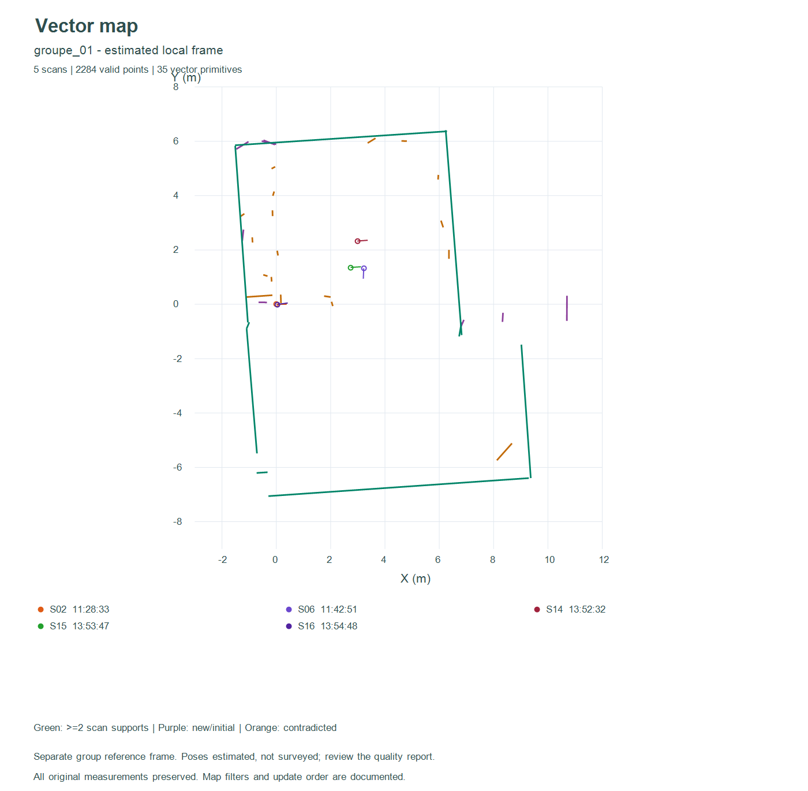

# TP LD06 — Extraction, visualisation et cartographie 2D

**Rapport de synthèse du TP 1 :** [version PDF illustrée](rapport/rapport_TP1.pdf)
et [source Markdown](rapport/rapport_TP1.md).

**TP 2, étape 1 :** [localisation sur une grid map](localisation/grid/README.md),
intégrée au même outil. Recherche corrélative locale à trois niveaux, exemple
sur grille de quatre scans et scan test exclu, évaluation synthétique et réelle
avec distinction entre pose connue et pseudo-référence estimée.
La [recherche exhaustive](localisation/grid/BRUTE_FORCE.md) est aussi disponible :
toutes les poses du domaine discret, tous les points acceptés, avec une évaluation
sur les mêmes 24 essais et une comparaison à la méthode à trois niveaux.
Les [méthodes gradient, multi-résolution par pyramide et recuit simulé](localisation/grid/OPTIMISATIONS.md)
complètent la localisation sur grille. Les échecs du gradient sont conservés
dans les bilans ; le recuit est évalué avec trois graines reproductibles.

**TP 2, étape 2 :** [localisation sur carte vectorielle par recherche exhaustive](localisation/vectorielle/README.md).
Distances directes aux segments finis, coût quadratique tronqué, 13 671 poses
par essai, cartes construites sans le scan test et 24 essais chiffrés avec images.
Une [descente de gradient sur les segments finis](localisation/vectorielle/GRADIENT.md)
complète cette étape, avec gradient analytique, trace du coût et comparaison
à la recherche exhaustive sur les mêmes cartes et scans.
La [multi-résolution vectorielle](localisation/vectorielle/MULTI_RESOLUTION.md)
ajoute un sous-échantillonnage progressif du scan et une recherche de pose affinée,
avec ses bilans et figures des trois niveaux.
Le [recuit simulé vectoriel](localisation/vectorielle/PROBABILISTE.md) complète
les pistes probabilistes, avec trajectoires, graines reproductibles et 72 essais
calculatoires répartis sur trois graines.
Un [calcul direct vectoriel](localisation/vectorielle/CALCUL_DIRECT.md) complète
les approches : association des segments une fois, orientation fermée et
résolution linéaire de la translation, avec vérification de l'observabilité.

**TP 2, étape 3 :** [localisation entre scans](localisation/entre_scans/README.md).
Cinq méthodes point-à-point sont comparées sur les mêmes six initialisations,
avec poses connues en simulation et références TP 1 explicitement estimées.
Le protocole contient 252 exécutions, erreurs en mètres/degrés, temps et taux de
réussite à 20 cm / 2°, y compris les échecs.
Une [nouvelle paire A/B](localisation/entre_scans/campagne_mesuree/README.md)
ajoute 42 essais sur un déplacement de 50 cm déclaré par l'opérateur ; la règle
est graduée au centimètre, mais l'incertitude totale de placement et d'angle reste
inconnue. Le visualiseur propose les deux exemples séparément.

Le projet réunit les cinq étapes du TP : acquisitions réelles, affichage des scans
avec poses indépendantes, grille d'occupation, manipulation de segments et carte
vectorielle. Le **recalcul complet utilise 17 scans contrôlés** : les six captures
initialement intégrées au visualiseur et les onze nouvelles acquisitions.

## Ouvrir l'outil

Ouvrir [`visualisation/index.html`](visualisation/index.html) dans Chrome ou Edge.
Il fonctionne localement, sans serveur ni installation de paquets. Les données
chargées sont traitées dans le navigateur et les CSV d'origine restent intacts.

1. **Charger les 17 scans**.
2. Choisir un groupe dans **Poses estimées des 17 scans**, puis **Charger ce groupe**.
3. Consulter les points, créer une grille, extraire les segments ou construire
   la carte vectorielle avec les panneaux correspondants.

Les paramètres initiaux de pose sont nuls : il faut régler les poses ou charger
un groupe avant de fusionner des scans. Les sept groupes identifiés possèdent
des repères séparés. La fusion exploratoire des 17 est aussi disponible, mais
elle inclut des liens faibles et **ne constitue pas une carte de salle validée**.

## Résultats complets avec les nouveaux scans

Le [rapport de recalcul](traitement_complet/README.md) décrit les entrées, les
filtres, les poses estimées, les seuils de qualité, les cartes et les limites.
Les sept composantes regroupent les 17 acquisitions sans en écarter silencieusement.
Chaque composante et la fusion exploratoire disposent de :

- poses rechargeables et points alignés ;
- segments extraits et carte vectorielle ;
- grille d'occupation ;
- images PNG et exports JSON/CSV ;
- bilans et vérifications reproductibles.



Le groupe le plus fourni compte **5 scans et 35 primitives**. La fusion
exploratoire rassemble les **7745 points valides des 17 scans** et donne
**85 primitives**, sans garantie de justesse des liaisons entre groupes.
Les déplacements physiques et dimensions de salle n'ont pas été relevés ; les
poses restent des estimations et les mesures de précision absolue sont absentes.

## Démarche et code par étape

| Étape | Guide et compte rendu | Code principal |
|---|---|---|
| 1. Acquisition réelle | [Compte rendu](compte_rendu_acquisition.md), [nouvelle série](nouvelle_serie/README.md), [contrôle des blocs longs](controle_scans/controle.md) | [Acquisition et validation](acquisition/README.md), CSV et rapports |
| 2. Nuages et poses | [Visualiseur](visualisation/README.md), [exemple de pose indépendante](visualisation/exemple_pose/README.md) | `core.js`, `viewer.js` |
| 3. Occupation | [Compte rendu](compte_rendu_grid_map.md), [guide](visualisation/GRID.md) | `grid.js` |
| 4. Segments | [Compte rendu](compte_rendu_segments.md), [guide](visualisation/SEGMENTS.md) | `segments.js`, `segments-ui.js` |
| 5. Carte vectorielle | [Compte rendu](compte_rendu_carte_vectorielle.md), [guide](visualisation/VECTORIELLE.md) | `vector-map.js`, `vector-ui.js` |

Les anciennes démonstrations et captures d'écran restent conservées pour la
traçabilité. Les résultats de `traitement_complet/resultats` sont ceux du
recalcul étendu ; les exemples à un ou deux scans des guides restent des
démonstrations pédagogiques distinctes.

## Tests et reproduction

```powershell
node visualisation/test_core.cjs
node visualisation/test_grid.cjs
node visualisation/test_segments.cjs
node visualisation/test_vector.cjs
python traitement_complet/test_alignement.py
node traitement_complet/verifier.cjs
```

Les 92 contrôles JavaScript et six tests de recalage passent. La vérification
des exports couvre les huit jeux de résultats. Le raccordement des commandes
est testé dans un DOM minimal, sans revendiquer une validation graphique complète
du navigateur. Les images calculées sont inspectées séparément.

La [procédure de reproduction](traitement_complet/README.md#reproduire) détaille
le recalage Python/NumPy, les cartes calculées avec les mêmes modules JavaScript
que l'interface et le tracé PowerShell/.NET. Le visualiseur lui-même n'a pas
besoin de ces outils de recalcul pour ouvrir les données déjà fournies.

## Ajout des captures A/B : 19 scans et contexte réel

Les nouvelles captures sont intégrées aux 17 précédentes : [résultats et limites](traitement_complet/resultats_19_scans/README.md), [photos de la salle](traitement_complet/contexte_salle/README.md). Le groupe principal contient 7 scans ; les sept groupes restent dans des repères indépendants. Le visualiseur propose le bouton **19 scans avec A/B** et des poses supplémentaires.

## Rapport TP2 - Localisation et scan matching

Le [rapport PDF](rapport/TP2/rapport_TP2.pdf) et sa [version Markdown](rapport/TP2/rapport_TP2.md) présentent les trois types de référence, les résultats simulés et réels, la sensibilité à l’initialisation et les limites des mesures A/B. Les [empreintes des sources](rapport/TP2/sources_rapport.json) assurent la traçabilité des tableaux et figures ; le script `rapport/generer_TP2.py` régénère le document à partir des bilans enregistrés.

## TP3 - Intégration SLAM locale

L’[outil de localisation et cartographie incrémentales](slam/index.html) réutilise les moteurs TP1/TP2 et contrôle les poses avant insertion. Les [résultats et limites](slam/README.md) incluent un parcours simulé de 33 scans, la paire A/B et les refus sur les anciennes acquisitions. La [préparation du robot ESP32](slam/MATERIEL.md) décrit le programme RobotControl fourni. La couverture complète de la classe et le déplacement autonome restent à valider matériellement.

## Scan final fusionne

[Image du nuage final](slam/resultats/fusion_finale/scan_final.png) · [CSV](slam/resultats/fusion_finale/scan_final.csv) · [Vue HTML autonome a telecharger](slam/resultats/fusion_finale/scan_final.html) · [Methode et limites](slam/resultats/fusion_finale/LIRE_MOI.md). Sur 507 captures analysees, 203 sont fusionnees en 7 013 points ; 304 restent exclues faute de recalage assez fiable. La couverture complete de la salle et l exactitude des poses physiques ne sont pas certifiees.
