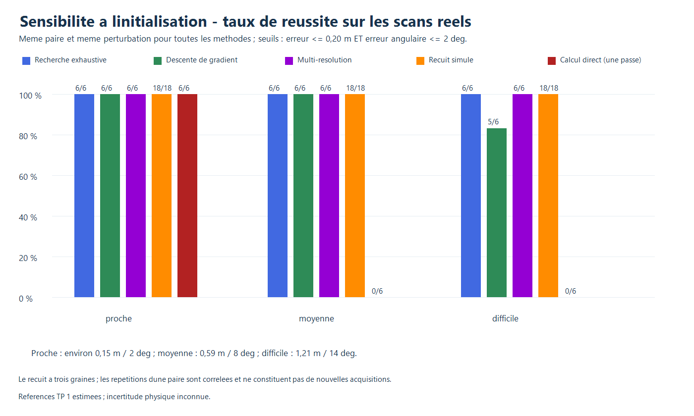
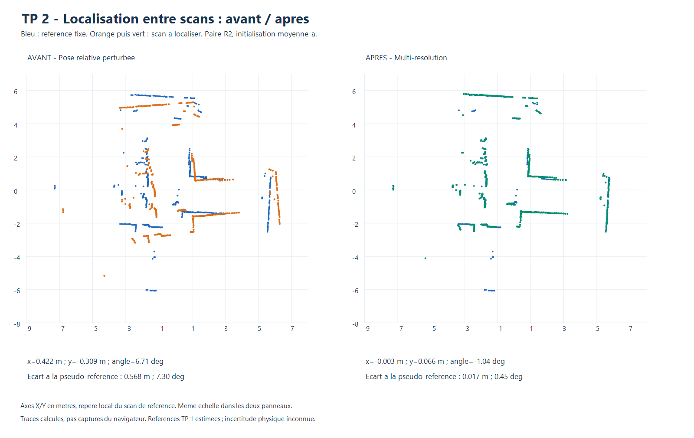
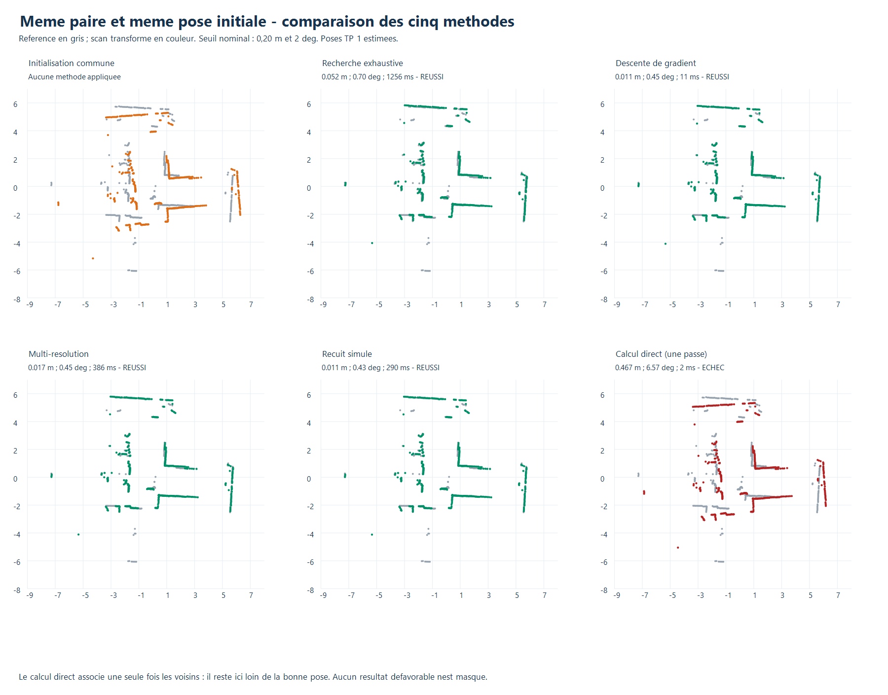

# TP 2 - Localisation d'un scan par rapport à un autre

L'outil estime une transformation rigide du **repère local du scan courant vers
le repère local du scan de référence**. Les scans doivent provenir de positions
proches et présenter un recouvrement suffisant. Aucun des nuages n'est transformé
en carte d'occupation ou en carte vectorielle pour ce calcul.

Cinq méthodes sont comparées sur les mêmes paires et les mêmes initialisations :
recherche exhaustive, descente de gradient, multi-résolution, recuit simulé et
calcul direct avec une seule association. Les références générales sont les
sections 6 et 8 du document « Scan matching.md », Jonathan Quillès, 2026, fourni
pour le TP.

**Statut expérimental :** les comparaisons ci-dessous utilisent des poses connues
en simulation et des poses estimées du TP 1 pour les anciennes captures réelles.
Une [campagne physique A/B](campagne_mesuree/README.md) a ensuite été réalisée
avec un déplacement déclaré de 50 cm. La graduation est de 1 cm ; les marges
de placement et d'orientation n'ont pas pu être quantifiées. Les bilans de cette
paire restent séparés et leurs réussites sont explicitement nominales.

## 1. Utilisation

Ouvrir `visualisation/index.html`, panneau **TP 2 · Localisation entre scans**.

1. Choisir **Mes captures A/B : 50 cm déclarés** ou **Exemple historique (poses estimées)**,
   ou charger deux scans distincts pris près l'un de l'autre.
2. Choisir le **scan de référence** dans le sélecteur ; sélectionner le scan
   courant dans la liste de cartes de scans.
3. Choisir une méthode et donner une pose initiale **relative à la référence**.
4. **Estimer**, examiner coût, recouvrements et avertissements, puis **Appliquer**.
5. Exporter le résultat JSON pour garder la transformation et les identités des scans.

L'exemple affiche deux acquisitions réelles distinctes, sans modifier les fichiers.
Les autres scans sont conservés et masqués. L'application déplace uniquement le
scan courant ; le scan de référence reste fixe. Les cartes TP 1 déjà calculées
ne sont pas déplacées automatiquement.

## 2. Repères et fonction de coût commune

La transformation recherchée est `p_reference = R(theta)*p_courant + t`.
Si le scan de référence possède déjà une pose d'affichage P, appliquer la pose
relative T donne la pose d'affichage `P compose T` du scan courant. Une translation
relative ne doit donc pas être copiée directement dans les coordonnées globales.

Toutes les méthodes utilisent le même filtrage : distances positives jusqu'à
12 m, seuil d'intensité nul, puis regroupement des deux nuages par centroïdes
dans des carrés locaux de **10 cm**. Aucun nuage traité n'est choisi en fonction
du résultat d'une méthode. Les données brutes restent disponibles pour les tracés.

Pour chaque point courant transformé, rechercher le **plus proche point** du
nuage de référence. Un arbre k-d 2D réalise cette recherche exacte ; le tronquage
de la distance permet d'éviter certains parcours sans changer le coût :

```text
E(T) = (1/N) somme min(||T*p_i - voisin_reference(T*p_i)||², D²)
D = 0,50 m
```

Tous les points courants traités restent dans le dénominateur. Le coût est
directionnel : courant vers référence. La troncature limite l'effet des zones
non partagées et des objets mobiles, au prix de plateaux. Les fractions de
voisins à 20 cm sont également calculées dans **les deux sens** pour contrôler
le recouvrement ; elles ne sont pas une probabilité de pose.

## 3. Méthodes implémentées

### Recherche exhaustive

Tester toutes les poses d'une fenêtre initiale **±1 m par axe et ±15°**, avec
des pas de **10 cm et 1°**, soit **13 671 candidats**. Chaque pose utilise tout
le nuage courant traité et le même coût. La meilleure pose discrète est retournée.
La garantie concerne ce domaine discret, pas la pose continue ou toute la salle.

### Descente de gradient

Calculer le gradient analytique point-à-point avec les voisins courants et
ignorer les contributions saturées. Les coordonnées de calcul sont
`(dx, dy, 2*dtheta_rad)` pour régler l'échelle de la rotation. Une recherche
linéaire d'Armijo réduit un pas normalisé initial de 0,25 jusqu'à décroissance,
avec au plus 14 essais. Les propositions sont projetées dans la fenêtre initiale.
Le budget est de 100 itérations, avec arrêt sur petite variation, petit gradient,
plateau ou absence de pas accepté. Une solution locale peut être incorrecte.

### Multi-résolution

Regrouper les deux nuages à **40 cm**, puis **20 cm**, avant de retrouver les
nuages communs de **10 cm**. Les pas de pose sont successivement
**40 cm / 4°**, **10 cm / 1°**, **2,5 cm / 0,25°**. Au plus quatre hypothèses
distinctes passent à chaque niveau. Les recherches fines restent dans la fenêtre
initiale ; l'initialisation est aussi évaluée au dernier niveau.
Le filtrage des hypothèses est heuristique et peut éliminer une bonne solution.

### Probabiliste : recuit simulé

Explorer huit chaînes de 400 tentatives gaussiennes. La première part de la
pose initiale, les autres de poses aléatoires dans la fenêtre. Une amélioration
est acceptée ; une dégradation peut l'être avec `exp(-(E_nouveau-E_actuel)/T)`.
La température descend de 0,04 à 0,00002 et la meilleure pose est conservée.
Les graines 20261103, 20261104 et 20261105 sont toutes évaluées.
Il s'agit d'une optimisation stochastique, pas d'un posterior de pose calibré.

### Calcul direct, une seule association

Associer une seule fois les points transformés par la pose initiale à leurs
voisins de référence, en gardant les distances inférieures à 50 cm. Calculer les
barycentres et les sommes de produits scalaires/vectoriels des couples centrés.
La rotation corrective est `atan2(somme_cross, somme_dot)` ; la translation est
la différence entre le barycentre cible et le barycentre source tourné.
Composer cette correction avec la pose initiale.

Cette solution fermée est exacte pour les **correspondances fixées**, mais
ces correspondances peuvent être mauvaises. Aucun réappariement ICP n'est
ajouté. Le calcul direct sur points n'est pas le même algorithme que le calcul
direct sur orientations de segments de l'étape vectorielle.

## 4. Protocole commun et sensibilité à l'initialisation

Le jeu comporte trois paires simulées et trois paires réelles. Chaque paire
reçoit six perturbations de pose, sans adaptation par méthode :

| Niveau | dx, dy (m), angle (°), essai A | dx, dy (m), angle (°), essai B |
|---|---|---|
| Proche | +0,113 ; -0,087 ; +2,3 | -0,127 ; +0,093 ; -2,2 |
| Moyenne | +0,437 ; -0,363 ; +7,3 | -0,417 ; +0,453 ; -8,2 |
| Difficile | +0,913 ; -0,787 ; +14,3 | -0,863 ; +0,847 ; -14,2 |

Les perturbations sont ajoutées à la pose vraie simulée ou à la pseudo-référence
réelle. Sur un robot, cette initialisation doit venir d'une estimation disponible,
pas d'une pose attendue connue à l'avance. Les perturbations ne sont pas toutes
multiples des pas discrets. La vérité reste à l'intérieur de la fenêtre initiale.

Chaque méthode déterministe compte **18 essais par type de données**. Le recuit
compte **54 essais par type**, puisque les trois graines sont conservées.
Au total : **252 exécutions mesurées**. Un passage d'échauffement fixe par méthode
est exclu des statistiques ; l'ordre des méthodes tourne entre configurations.

La réussite exige simultanément :

```text
erreur_position = norme(t_estime - t_reference) <= 0,20 m
erreur_angle = abs(angle_circulaire(theta_estime - theta_reference)) <= 2 deg
```

Le temps inclut filtrage, préparation des nuages, construction des arbres,
optimisation et diagnostics. Les pauses de l'interface sont exclues du banc
synchrone. Les refus comptent comme échecs ; les erreurs moyennes sont calculées
sur les estimations retournées, dont l'effectif est donné. Aucun refus n'a eu
lieu sur le jeu fourni, mais plusieurs solutions retournées sont incorrectes.

## 5. Simulation avec poses connues

Les scans sont produits séparément par lancer de rayons dans une salle en L
avec obstacle rectangulaire. Les graines de bruit des deux scans sont différentes,
avec un bruit déterministe uniforme de ±4 mm. Il ne s'agit pas de transformer
artificiellement un seul nuage pour créer sa copie.

Les écarts de position entre capteurs sont de **0,180 m, 0,361 m et 0,292 m**.
Les poses du simulateur sont connues exactement. Les erreurs ne modélisent pas
les biais physiques du LD06 ou sa calibration.

| Méthode | Erreur position moyenne (m) | Erreur angle moyenne (°) | Temps moyen (ms) | Réussites |
|---|---:|---:|---:|---:|
| Exhaustive | 0,038 | 0,47 | 1 150 | 18/18 |
| Gradient | 0,009 | 0,29 | 10 | 18/18 |
| Multi-résolution | 0,015 | 0,35 | 297 | 18/18 |
| Recuit, trois graines | 0,008 | 0,35 | 215 | 54/54 |
| Direct, une association | 0,566 | 7,61 | 1,6 | 6/18 |

## 6. Anciennes captures réelles et incertitude des références

Trois paires sont sélectionnées, avant comparaison, comme les plus proches
dans trois groupes distincts du TP 1. La proximité est **estimée**, pas vérifiée
par un relevé physique des anciennes acquisitions :

| Paire | Captures de référence / courante | Écart estimé (m) | RMSE interne TP 1 (m) |
|---|---|---:|---:|
| R1 | 11:28:33 / 13:54:48, tour contrôlé | 0,041 | 0,049 |
| R2 | 11:37:14 tour2 / 11:39:03 | 0,057 | 0,052 |
| R3 | 11:34:56 / 13:55:40 | 0,735 | 0,082 |

Les chemins, empreintes et poses relatives sont conservés dans
[protocole.json](resultats/protocole.json). R3 présente un recouvrement plus faible
dans les diagnostics TP 1 (environ 48 %), et reste incluse pour ne pas masquer
les difficultés. Un avertissement de faible recouvrement peut donc apparaître
même pour une pose proche de la pseudo-référence.

**Incertitude physique des anciennes références : inconnue.** Aucune position,
orientation mesurée ou covariance de mesure n'est disponible. Les RMSE du tableau
sont des résidus de correspondances filtrées, pas une erreur-type de position
ou d'angle du robot. Il serait incorrect de les utiliser comme une incertitude
de pose. Les poses TP 1 ont elles-mêmes utilisé les scans évalués : la validation
réelle est donc une cohérence interne, non une précision absolue indépendante.

| Méthode | Erreur position moyenne (m) | Erreur angle moyenne (°) | Temps moyen (ms) | Réussites |
|---|---:|---:|---:|---:|
| Exhaustive | 0,053 | 0,55 | 1 218 | 18/18 |
| Gradient | 0,095 | 0,42 | 26 | 17/18 |
| Multi-résolution | 0,039 | 0,36 | 379 | 18/18 |
| Recuit, trois graines | 0,038 | 0,40 | 299 | 54/54 |
| Direct, une association | 0,586 | 7,81 | 1,6 | 6/18 |

Temps sous Node.js 24.22.1, Intel Core i5-6300U. Ils varient selon la machine
et sa charge. Les méthodes n'ont pas le même budget ni les mêmes garanties ;
le recuit a davantage de répétitions, corrélées avec les mêmes scans.

### Effet de l'initialisation sur les données réelles

| Méthode | Proche | Moyenne | Difficile |
|---|---:|---:|---:|
| Exhaustive | 6/6 | 6/6 | 6/6 |
| Gradient | 6/6 | 6/6 | 5/6 |
| Multi-résolution | 6/6 | 6/6 | 6/6 |
| Recuit, trois graines | 18/18 | 18/18 | 18/18 |
| Direct, une association | 6/6 | 0/6 | 0/6 |



Le calcul direct est très rapide mais ne corrige pas de mauvaises correspondances
initiales : il échoue avec les décalages moyens et difficiles. Le gradient échoue
sur **R3 / difficile_a**, avec **1,133 m** d'erreur de position et 1,13° d'erreur
angulaire. Son erreur moyenne inclut cet échec. Les méthodes qui réussissent
tous les essais ne sont pas pour autant garanties dans une autre scène.

## 7. Résultats illustrés sur la même paire



Le scan de référence reste fixe. Cet exemple R2 utilise la même initialisation
`moyenne_a` pour toutes les méthodes :



Le calcul direct incorrect est affiché en rouge et conservé dans les bilans.
Les images sont des tracés des données calculées, pas des captures du navigateur.
Les points tracés proviennent des scans bruts ; les calculs utilisent le filtrage
commun décrit plus haut.

## 8. Campagne avec mesures physiques

Les captures A et B ont été enregistrées après les signaux de l'opérateur :
**456 points valides chacune**, amplitudes contrôlées de 359,17° et 359,45°.
L'opérateur déclare **50 cm vers le triangle 0°, sans rotation**. Le mètre est
gradué au centimètre ; l'incertitude totale de placement et d'angle reste inconnue.
Le [bilan physique séparé](campagne_mesuree/README.md) conserve ces limites sans
remplacer l'incertitude par zéro ni reprendre les estimations comme vérité terrain.

Pour le protocole, repérer le centre de rotation et la direction 0° du LD06
(petit triangle indiqué dans le manuel de communication, section 4). Une translation
le long de cette direction simplifie le relevé de X ; contrôler aussi le décalage
latéral Y et la conservation de l'orientation. Le repère mathématique des CSV
utilise X vers 0° et Y vers la gauche vue de dessus, après correction du sens horaire.

Noter la graduation et la précision annoncée de l'instrument, le centrage des
deux poses et l'erreur possible d'orientation. **La graduation seule n'est pas
l'incertitude totale.** Les mesures ne doivent pas être ajustées en fonction
de la pose estimée par le scan matching pour améliorer artificiellement l'erreur.
Le manifeste `campagne_mesuree/mesures.json` distingue les champs mesurés, les
définitions de repère et les champs encore inconnus.

## 9. Reproduction et tests

```powershell
node localisation/entre_scans/test.cjs
node localisation/grid/test_ui.cjs
node localisation/entre_scans/evaluer.cjs
.\localisation\entre_scans\tracer.ps1
```

Les [bilans JSON](resultats/evaluation.json) et [CSV](resultats/evaluation.csv)
conservent les 252 exécutions, initialisations, erreurs, temps et échecs.
Les statistiques par niveau et par graine sont dans le JSON.

Les **18 contrôles dédiés** couvrent l'arbre k-d contre une recherche intégrale,
le sens des transformations, la solution rigide fermée, le gradient analytique
par différences finies, les paires et paramètres, les cinq méthodes, la
conservation des données et l'annulation. Un test de transformation synthétique
connue vérifie explicitement le sens courant-vers-référence.
Le test d'interface commun couvre chargement d'exemple, sélection, composition
avec une référence d'affichage tournée et déplacée, application explicite,
annulation, péremption et doublons. Il utilise un DOM minimal et ne remplace
pas une vérification graphique complète du navigateur.

Le moteur est `visualisation/scan-matching.js`. L'outil reste utilisable localement,
sans serveur ou paquet npm. Les acquisitions sources ne sont jamais écrasées.
