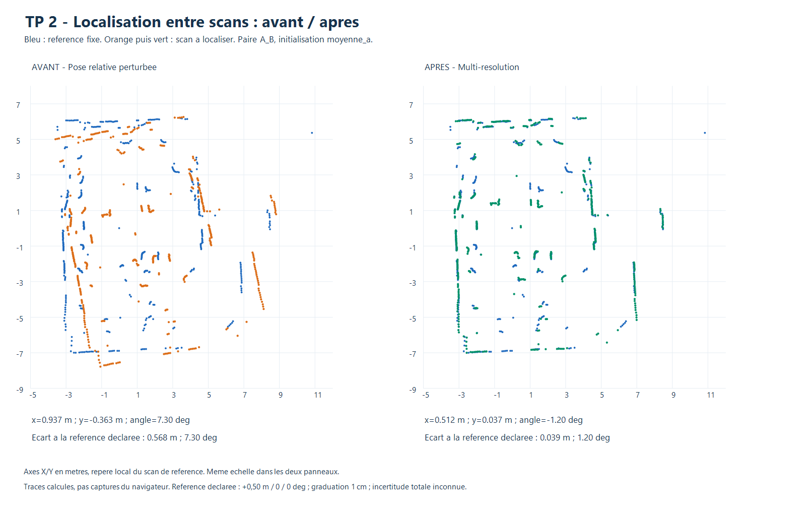
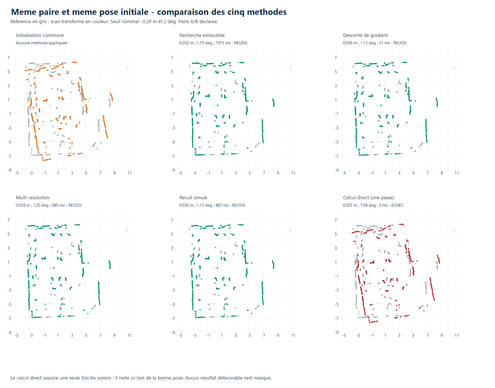
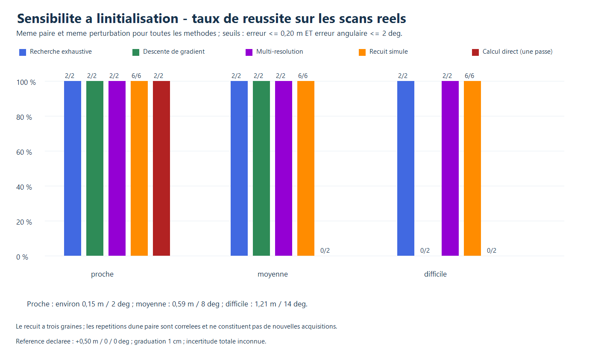

# Nouvelle paire A/B - acquisition et référence physique déclarée

Les deux captures ont été réalisées après le signal utilisateur, le 3 novembre
2026, par COM3 à 115200 bauds. L'immobilité a été demandée mais n'a pas été
mesurée indépendamment.

| Position | Fichier | Points valides | Amplitude angulaire contrôlée |
|---|---|---:|---:|
| A | `A/scan_20261103_180804_809310.csv` | 456 | 359,17° |
| B | `B/scan_20261103_181437_335740.csv` | 456 | 359,45° |

Les horaires sont ceux de sauvegarde, en heure de Paris. Les bruts, contrôles,
manifestes d'acquisition et tracés individuels sont conservés. La validation
vérifie les indices et la progression angulaire, sans prouver l'immobilité.

## Référence déclarée et incertitude

L'opérateur a indiqué : **50 cm de A vers B, dans la direction du petit triangle
0° du LD06, sans rotation**. Le repère de A définit une origine arbitraire ;
la pose relative nominale utilisée pour la comparaison est donc :

```text
x = +0,50 m ; y = 0 m ; theta = 0 deg
```

Le sens de l'axe X est celui de la direction 0° du manuel LD06, section 4.
Les CSV utilisent la correction du sens horaire pour obtenir un repère
cartésien mathématique. Cette définition a été confirmée par l'opérateur ;
le câblage ou l'orientation physique n'ont pas été inspectés directement.

Le mètre est gradué à **1 cm**. L'opérateur a explicitement indiqué que la marge
totale de centrage/placement et l'erreur de maintien de l'orientation étaient
**inconnues**. La graduation ne suffit pas à inclure ces contributions, ni à
déduire une erreur totale de ±0,5 cm. Aucune covariance, erreur-type ou borne
angulaire n'est inventée.

Le manifeste [mesures.json](mesures.json) conserve les incertitudes à `null`,
pas à zéro. Les résultats sont des écarts par rapport au **placement nominal
déclaré**, sans précision expérimentale certifiée. Les différences avec une
estimation ne doivent pas servir à modifier cette référence a posteriori.

## Comparaison sur cette paire

Les six mêmes perturbations initiales, filtres, fenêtres et seuils que dans le
protocole commun sont repris. Les perturbations sont ajoutées à la référence
nominale pour étudier la sensibilité ; elles ne correspondent pas à six
déplacements physiques supplémentaires. Le recuit utilise trois graines.

| Méthode | Erreur XY moyenne nominale (m) | Erreur angle moyenne nominale (°) | Temps moyen (ms) | Réussites nominales |
|---|---:|---:|---:|---:|
| Exhaustive | 0,039 | 1,28 | 2 196 | 6/6 |
| Gradient | 0,367 | 4,60 | 42 | 4/6 |
| Multi-résolution | 0,040 | 1,08 | 697 | 6/6 |
| Recuit, trois graines | 0,037 | 1,05 | 517 | 18/18 |
| Direct, une association | 0,594 | 7,65 | 5,3 | 2/6 |

Seuil nominal : **0,20 m et 2° simultanément**. Les moyennes incluent les
solutions incorrectes. Les méthodes déterministes ont six essais, le recuit 18 ;
ces répétitions restent corrélées à une seule paire physique.
Temps sous Node.js 24.22.1 sur Intel Core i5-6300U, sensibles à la charge du PC.



Dans cet exemple, la multi-résolution estime **x=0,512 m, y=0,037 m,
theta=-1,20°**. L'écart à la valeur déclarée est de **0,039 m et 1,20°**.
Le scan à localiser est orange avant et vert après, la référence reste bleue.
Ce sont des données tracées, pas une capture du navigateur.

Le gradient et le recuit donnent également environ 0,50 m sur X, avec un
décalage latéral de 3 à 4 cm et environ -1° sur l'exemple. La mesure actuelle
ne permet pas de départager les effets du placement, du capteur et du recalage.





Les réussites ne peuvent pas être déclarées robustes vis-à-vis d'une incertitude
de référence inconnue. Le champ `uncertainty.status` vaut donc `unknown` pour
ces essais, même lorsqu'ils satisfont le seuil nominal.

## Compléter la validation physique

Pour obtenir une référence mieux étayée, il faudrait borner le centrage des
deux positions, le décalage latéral, la lecture de distance et l'orientation,
par un support guidé, des repères plus précis et un contrôle angulaire. Les
valeurs doivent être relevées indépendamment des estimations des algorithmes.

Le script prévoit des bornes absolues `xM`, `yM`, `angleDeg` si elles deviennent
disponibles. Il évalue alors une enveloppe conservatrice de l'erreur de position
et d'angle et distingue `robust_pass`, `robust_fail` et `indeterminate`.
Ces enveloppes ne sont pas des intervalles de confiance statistiques. Avec
les données présentes, le script ne fabrique pas ces bornes.

```powershell
node localisation/entre_scans/evaluer_mesures.cjs
.\localisation\entre_scans\tracer.ps1 -DataFolder campagne_mesuree -PhysicalCampaign
```

[Évaluation JSON](evaluation.json) · [Tableau CSV](evaluation.csv) · [Journal](journal_evaluation.txt).
Le protocole et les anciennes références sont décrits dans le [rapport commun](../README.md).
