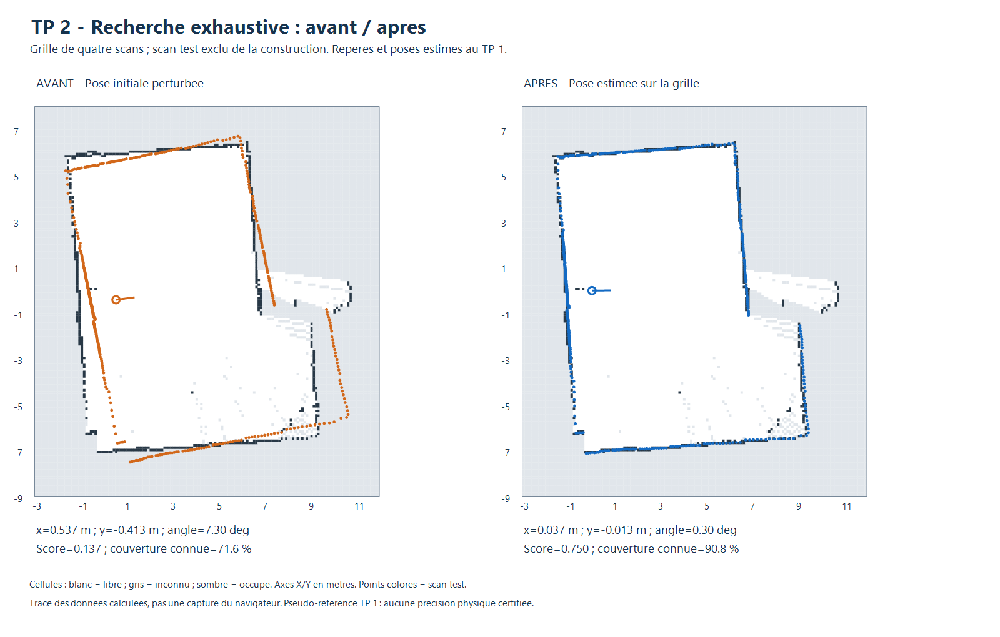

# TP 2 - Recherche exhaustive sur carte d'occupation

Cette méthode répond au point **Recherche exhaustive (brute force)** de l'énoncé.
Elle suit les étapes de la section **8.1 de « Scan matching.md »**, Jonathan
Quillès, 2026, fourni dans `Localisation-20261103 (1).zip` : fenêtre autour de
la pose initiale, discrétisation, score de chaque pose, choix du meilleur score.
La section 4 du même document autorise notamment un score basé sur la distance
aux cellules occupées. Nous réutilisons ce score du premier outil.

## Procédure dans l'outil

1. Ouvrir `visualisation/index.html`, panneau **TP 2 · Localisation sur grille**.
2. Cliquer sur **Exemple : carte de 4 scans + 1 test**, ou charger une grille et
   un scan indépendant couvrant cette zone. L'exemple remplace la grille courante.
3. Choisir **Recherche exhaustive (brute force)**, sélectionnée par défaut.
4. Saisir la pose initiale, les fenêtres et les pas XY/angulaire.
5. Cliquer sur **Estimer la pose**, contrôler score, couverture et avertissements,
   puis **Appliquer la pose proposée**. Le JSON exporte le domaine et les compteurs.

Le choix **Recherche à trois niveaux** reste disponible pour comparaison.
La recherche exhaustive ne passe pas par ce raffinement : c'est un algorithme
distinct, dans `visualisation/grid-brute-force.js`.

## Domaine et coût de calcul

Les candidats sont `x = x0 + k*pasXY`, `y = y0 + l*pasXY`,
`theta = theta0 + m*pasAngle`, pour tous les entiers satisfaisant les fenêtres.
Les origines hors grille sont exclues du domaine admissible, et les angles sont
normalisés dans `[-180°, 180°[`. Les rotations restent mesurées autour de l'axe Z,
positives dans le sens antihoraire, conformément au document sur la pose 2D.

Avec une fenêtre ±1 m sur X et Y, ±15° et des pas de 0,10 m et 1° :

```text
Nx = Ny = 2 floor(1 / 0.10) + 1 = 21
Ntheta = 2 floor(15 / 1) + 1 = 31
Nposes = 21 × 21 × 31 = 13 671
```

Si une fenêtre n'est pas un multiple du pas, le dernier candidat est le multiple
entier intérieur à la fenêtre. Le centre est toujours inclus. L'interface et le
JSON indiquent le nombre de poses effectivement testées ; une grille recoupant
la fenêtre peut réduire ce nombre.

Les pas de 1 cm et 0,5° donnés dans le cours sont des exemples possibles, pas
des paramètres imposés. Ils peuvent être utilisés sur une fenêtre plus petite.
Sur ±1 m et ±15°, ils demanderaient **2 464 461 poses**. L'outil refuse les
recherches de plus de **500 000 poses** et demande d'ajuster les paramètres.
Il ne remplace jamais silencieusement la recherche exhaustive par un échantillonnage.

## Calcul pour chaque pose

- Filtrer une fois les distances invalides, hors portée ou d'intensité insuffisante.
- Préparer une fois le champ de distance de chanfrein aux cellules occupées.
- Pour **chaque** pose admissible, transformer **tous** les points acceptés.
- Noter les impacts par `exp(-d²/(2*sigma²))`, avec sigma fixe de 0,10 m,
  interpolation bilinéaire et contribution nulle des impacts inconnus/hors carte.
- Diviser par le nombre total de points acceptés et garder le score maximal.

Le dénominateur ne diminue pas lorsqu'un point sort de la carte. Les rayons libres
ne sont pas comparés. Les cellules libres proches d'un obstacle peuvent avoir
un score positif via le champ de distance. Le score n'est pas une probabilité.
Les détails du champ sont dans le [compte rendu commun](README.md).

Il n'y a **ni sous-échantillonnage des points, ni élagage des poses, ni arrêt sur
amélioration insuffisante**. Le temps de calcul croît comme `Nposes × Npoints`,
en plus de la préparation du champ. Les égalités exactes de score sont départagées
par la proximité à la pose initiale, sans modifier le score.

Le moteur conserve les scores pour rechercher ensuite le meilleur concurrent
éloigné d'au moins 25 cm ou 4°. Tous les candidats du domaine participent à ce
contrôle, contrairement à la liste limitée de la méthode à trois niveaux.
Cela ne garantit pas l'unicité de la pose physique : deux hypothèses peuvent être
plus proches que ces seuils, ou une meilleure pose peut être hors domaine.

Le maximum retourné est celui du **domaine discret déclaré**. Ce n'est pas
l'optimum de toutes les poses continues ni une localisation globale dans toute
la salle. La finesse du résultat dépend des pas et de la résolution de la grille.

## Évaluation chiffrée

L'évaluation reprend les mêmes fenêtres et perturbations que la première méthode.
Le critère de réussite est une erreur de translation ≤20 cm et d'angle ≤2°.
Chaque essai exhaustif a testé les 13 671 poses prévues. Le moteur à trois niveaux
a été relancé dans le même script pour la comparaison des temps.

| Série | Essais | Erreur XY initiale moyenne | Erreur XY finale moyenne | Erreur angulaire finale moyenne | Réussites |
|---|---:|---:|---:|---:|---:|
| Simulation, pose connue | 9 | 62,0 cm | 8,6 cm | 0,37° | 9/9 |
| Réel, pseudo-référence TP 1 | 15 | 62,0 cm | 4,9 cm | 0,42° | 15/15 |

| Temps moyens observés | Exhaustif, pas 10 cm / 1° | Trois niveaux, dernier pas 2,5 cm / 0,25° |
|---|---:|---:|
| Simulation | 242 ms | 125 ms |
| Scans réels | 344 ms | 143 ms |

Mesures sous Node.js 24.22.1, Intel Core i5-6300U ; elles varient avec la charge
et l'échauffement du moteur JavaScript. Les pauses d'interface ne sont pas incluses.
Les pas finaux différents rendent ce tableau utile pour illustrer le compromis
coût/finesse, sans constituer une comparaison à précision identique.

Les erreurs maximales de translation sont de **9,5 cm en simulation** et
**6,9 cm par rapport aux poses estimées du TP 1**. Les 15 essais réels viennent
de cinq acquisitions distinctes, chacune avec trois perturbations corrélées.
Pour chaque acquisition, la grille est reconstruite avec les quatre autres scans.

**Limite de référence :** les impacts du scan test sont exclus de la grille,
mais les poses de construction et de comparaison viennent du recalage du groupe
complet au TP 1. Les 4,9 cm ne sont donc pas une mesure indépendante de précision
physique. Seule la simulation utilise ici une pose connue. Pour obtenir une
évaluation expérimentale absolue, il faudrait relever des poses sur place et
construire la carte indépendamment des scans test.



Cette image est un tracé du calcul, pas une capture du navigateur. L'exemple
présenté commence avec une erreur de 67,7 cm et 7,3° ; il termine à 3,9 cm et
0,3° de la pseudo-référence. Les autres essais sont conservés, sans sélection
des seuls cas favorables, dans les [bilans JSON](resultats/evaluation_exhaustive.json)
et [CSV](resultats/evaluation_exhaustive.csv).

## Contrôles et reproduction

```powershell
node localisation/grid/test_exhaustif.cjs
node localisation/grid/test_ui.cjs
node localisation/grid/evaluer_exhaustif.cjs
.\localisation\grid\tracer.ps1 -EvaluationFile evaluation_exhaustive.json -OutputFile avant_apres_exhaustif.png
```

Les **11 contrôles dédiés** couvrent le nombre exact de candidats, les fenêtres
non divisibles, le domaine tronqué par la carte, les paramètres et budgets invalides,
les doublons, l'utilisation de tous les points, l'absence de modification de la
carte et la récupération d'une pose connue. Un petit domaine est intégralement
recalculé par une énumération indépendante pour vérifier le maximum. Les tests
couvrent aussi ±180°, une couverture insuffisante et l'annulation asynchrone.

Le test d'interface vérifie le choix par défaut exhaustif, les 13 671 poses annoncées,
le passage à la méthode précédente, l'application explicite, la conservation de
la grille, les doublons et les résultats périmés. Il exerce les gestionnaires dans
un DOM minimal et ne remplace pas une vérification graphique du navigateur.

Si la préparation des résultats de la première méthode n'est pas disponible,
lancer d'abord `node localisation/grid/evaluer.cjs`. Les scans bruts restent intacts.

## Références du cours

Jonathan Quillès, 2026, « Scan matching : Méthode de localisation en 2D avec Lidar »,
sections 4 et 8.1, et « Expression de la pose d'un robot 2D et 3D », section 2.
Documents fournis dans l'archive `Localisation-20261103 (1).zip`.
