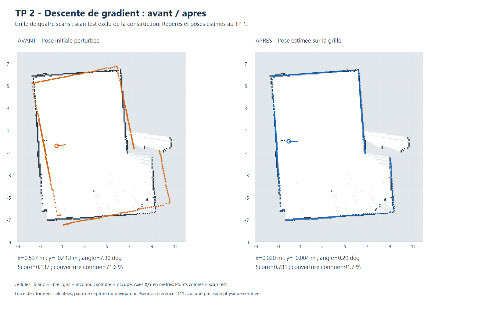
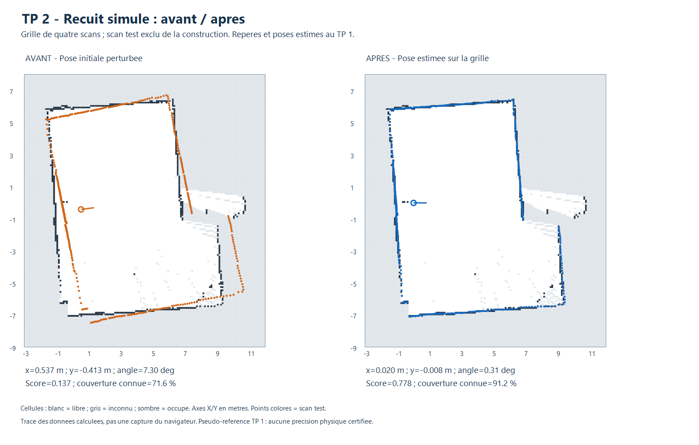

# TP 2 - Gradient, multi-résolution et probabiliste

Les trois méthodes sont disponibles dans le panneau **TP 2 · Localisation sur
grille** de `visualisation/index.html`, en complément de la recherche exhaustive.
Elles suivent les sections **8.2, 8.3 et 8.4 de « Scan matching.md »**, Jonathan
Quillès, 2026, fourni dans l'archive `Localisation-20261103 (1).zip`.

## Utilisation commune

1. Charger l'exemple **carte de 4 scans + 1 test**, ou une grille et un scan
   indépendant représentant une zone couverte par la carte.
2. Choisir **Descente de gradient**, **Multi-résolution (pyramide de grilles)**
   ou **Probabiliste : recuit simulé**.
3. Saisir ou copier la pose initiale. Par défaut, la recherche est bornée à
   ±1 m par axe et ±15°. Les autres filtres restent ceux du panneau.
4. Cliquer sur **Estimer la pose**, examiner les avertissements et **Appliquer**
   pour déplacer le nuage sur la grille. Exporter le JSON pour conserver le bilan.

Tous les points acceptés sont utilisés. La carte et les fichiers sources ne
sont pas modifiés. Un scan déjà inséré dans l'historique de la grille est refusé.
La recherche peut être annulée ; une carte ou pose de scan modifiée invalide le
résultat. Les paramètres inactifs sont grisés selon la méthode choisie.

## 1. Descente de gradient

### Fonction à minimiser

La carte catégorielle donne un score discontinu si l'on compte seulement les
impacts dans des cellules occupées. Pour pouvoir déplacer la pose progressivement,
nous préparons le champ de distance de chanfrein du premier outil, puis un champ
de coût par cellule : `V = min(distance, 1 m)²`. Les cellules inconnues et les
échantillons hors carte reçoivent un coût de `1 m²`.

Le coût d'une pose est la moyenne des valeurs interpolées bilinéairement aux
impacts transformés : `E(pose) = moyenne(V(T(pose) × point))`. Le dénominateur
reste le nombre total de points acceptés. L'interpolation rend le coût continu,
mais sa dérivée peut changer brutalement aux frontières de cellules.

### Itérations

On optimise trois variables comparables en unités : `q = (dx, dy, 2 × dtheta_rad)`.
Le bras de levier numérique de 2 m règle l'échelle relative de la rotation ;
ce n'est pas une dimension mesurée du robot. La pose initiale correspond à q=0.

- Approximer chaque dérivée par différences centrales, avec des pas de 0,01 m
  pour X/Y et 0,005 pour la variable angulaire mise à l'échelle.
- Prendre la direction opposée au gradient normalisé.
- Essayer un déplacement de 0,25 dans ces coordonnées, puis le diviser par deux
  jusqu'à satisfaire une condition de décroissance d'Armijo, au plus 14 essais.
- Projeter chaque proposition dans la fenêtre de recherche et les limites de carte.
- Accepter uniquement une diminution du coût et recommencer.

L'arrêt survient sur un petit gradient, une petite mise à jour, l'absence de
pas accepté, ou le budget maximal de **100 itérations** (réglable de 1 à 300).
La trace JSON conserve les coûts et poses acceptés. Un arrêt sur recherche de
pas bloquée est signalé ; il ne prouve pas qu'une pose correcte a été trouvée.

Cette méthode est locale et part uniquement de l'initialisation donnée.
Elle n'utilise ni recherche exhaustive cachée, ni pose attendue, ni remplacement
automatique par une autre méthode lorsqu'elle échoue.



### Résultats et échecs

Avec les perturbations du protocole commun : **5/9 réussites en simulation**
et **13/15 sur les données réelles** au seuil de 20 cm et 2°. L'erreur moyenne
réelle, calculée sur tous les essais y compris les échecs, est de **4,6 cm et 0,26°**
par rapport aux poses du TP 1. Le pire écart réel atteint **27,2 cm**.

Les échecs réels sont **R2-3** et **R5-3**, à environ 22,3 et 27,2 cm.
En simulation, **S1-2, S2-1, S3-1 et S3-3** échouent au seuil de translation.
Ils illustrent le risque de minimum local et l'effet des cellules inconnues.
Le faible temps de calcul ne remplace pas une bonne initialisation.

## 2. Multi-résolution par pyramide de grilles

Contrairement à la première recherche à trois niveaux, qui conservait la même
grille, cette version crée **trois cartes de résolutions différentes** :
`4r`, `2r`, puis `r`. Avec la grille du TP 1, cela donne **40, 20 et 10 cm**.

Pour chaque bloc de cellules, une cellule occupée est prioritaire ; sinon, le
bloc devient libre s'il contient du libre ; sans observation, il reste inconnu.
Les tailles sont arrondies vers le haut pour conserver les cellules de bord.
Le domaine des origines reste celui de la grille fine, sans utiliser la marge
éventuellement ajoutée par cet arrondi.

| Niveau | Résolution de carte | Pas XY | Pas angulaire | Recherche |
|---|---:|---:|---:|---|
| Grossier | 4r | 0,40 m | 4° | Fenêtre autour de la pose initiale |
| Intermédiaire | 2r | 0,10 m | 1° | ±0,40 m et ±4° autour des candidats retenus |
| Fin | r | 0,025 m | 0,25° | ±0,10 m et ±1° autour des candidats retenus |

À chaque niveau, le score corrélatif initial est calculé avec un lissage spatial
adapté à la résolution (`sigma = max(0,10 m, résolution)`). Au plus quatre candidats
distincts sont conservés pour l'étape suivante. Tous les candidats restent dans
la fenêtre initiale ; les cellules de la carte fine ne sont jamais modifiées.

Le dernier niveau utilise la résolution et le score de la grille originale.
Les JSON conservent les dimensions, résolutions, nombres de candidats et poses
de chaque niveau. Ce raffinement est heuristique : une solution éliminée au
premier niveau ne sera pas forcément retrouvée, notamment sur de petits objets
disparaissant dans une cellule grossière.


Cette méthode réussit **9/9 essais simulés** et **15/15 essais réels**.
Les erreurs moyennes sont respectivement **7,9 cm / 0,17°** et
**1,5 cm / 0,18°** par rapport à leurs références respectives.

## 3. Probabiliste : recuit simulé

Le cours cite le recuit simulé parmi les méthodes probabilistes. Nous l'utilisons
comme **optimisation stochastique de la pose**, avec le même coût E que la descente
de gradient. Il ne produit ni une probabilité de position calibrée, ni une
distribution bayésienne complète de la pose ; il ne s'agit pas d'un filtre de
particules Monte Carlo.

### Recherche et acceptation

Huit chaînes sont explorées par défaut. La première démarre à la pose initiale,
les autres à des poses uniformément tirées dans la fenêtre admissible.
Chaque chaîne propose **400 déplacements gaussiens**, soit **3 200 tentatives**
au total. Une proposition hors domaine est rejetée sans évaluer son coût.

- Une proposition de coût inférieur est acceptée.
- Une proposition plus coûteuse peut être acceptée avec
  `P_acceptation = exp(-(E_nouveau - E_actuel) / temperature)`.
- La température décroît géométriquement de 0,08 à 0,0002, dans l'échelle
  numérique du coût. Les écarts-types des propositions décroissent de 25 cm à
  1,2 cm et de 4° à 0,15°.
- La meilleure pose rencontrée est conservée, même si la chaîne accepte ensuite
  une dégradation temporaire. Il n'y a pas de raffinement par gradient ajouté.

L'acceptation de dégradations permet de quitter certains minima locaux.
Les températures et budgets sont des choix heuristiques ; atteindre la fin du
budget n'est pas une preuve de convergence vers l'optimum global.
Le résultat indique le nombre de tentatives, d'évaluations, de mouvements acceptés
et de montées acceptées. La graine par défaut **20261103** rend un essai reproductible.
Les chaînes, le budget et la graine sont réglables dans le panneau.



### Variabilité et résultats

Trois graines (**20261103, 20261104, 20261105**) sont évaluées pour chacune des
24 configurations communes : **27 essais simulés** et **45 essais réels**.
Ils réussissent tous au seuil retenu, dans ce petit jeu de données.
Les moyennes sont de **7,1 cm / 0,03° en simulation** et de
**1,5 cm / 0,23° par rapport aux poses TP 1** pour les scans réels.
Les pires écarts XY observés sont respectivement de **7,3 cm** et **2,5 cm**.
Plusieurs graines d'une même acquisition ne constituent pas de nouvelles
mesures indépendantes ni une validation universelle de robustesse.

## 4. Comparaison et portée de l'évaluation

Le protocole est le même que pour l'exhaustif : trois perturbations initiales,
fenêtre ±1 m / ±15°, portée 12 m, pas de filtre d'intensité additionnel.
Le seuil de réussite est **20 cm et 2°**, avec un écart initial moyen de 62 cm.
Les bilans incluent toutes les configurations et tous les échecs.

| Méthode | Simulation : réussites | XY moyen simulation | Réel : réussites | XY moyen réel |
|---|---:|---:|---:|---:|
| Descente de gradient | 5/9 | 16,8 cm | 13/15 | 4,6 cm |
| Pyramide de grilles | 9/9 | 7,9 cm | 15/15 | 1,5 cm |
| Recuit, trois graines | 27/27 | 7,1 cm | 45/45 | 1,5 cm |

Les temps moyens du calcul fourni sont environ **13 / 23 ms** pour le gradient,
**132 / 168 ms** pour la pyramide, et **64 / 91 ms** pour le recuit
(simulation / réel, Node.js 24.22.1 sur Intel Core i5-6300U).
Ils incluent les préparations de champs, mais pas les pauses d'interface, et
varient avec la charge du PC. Les méthodes n'ont ni le même objectif optimisé
ni le même budget : ce tableau n'est pas un classement à précision égale.

Le **score diagnostic** affiché dans l'interface est commun aux méthodes :
correspondance aux obstacles avec sigma 10 cm, entre 0 et 1. Le gradient et le
recuit minimisent cependant E, pas directement ce score ; sa progression n'est
pas garantie à chaque itération. La couverture reste la proportion d'impacts
dans des cellules connues, pas une probabilité de bonne localisation.

**Référence réelle :** chaque scan test est exclu de la construction de sa
grille, mais les poses des quatre autres scans et la pose de comparaison sont
issues du recalage TP 1 sur le groupe complet. Les faibles écarts réels mesurent
une cohérence avec ces estimations, pas une précision physique indépendante.
La scène simulée dispose d'une pose connue ; son biais de discrétisation à
10 cm ne constitue pas une calibration du LD06 réel.

La localisation sur carte vectorielle et la localisation sur un nuage de points,
autres références du TP 2, ne sont pas réalisées par ces ajouts sur grille.

## 5. Fichiers, tests et reproduction

Le moteur commun est `visualisation/grid-optimisation.js`. Les bilans complets,
traces, références et graines sont enregistrés dans :

- [Gradient](resultats/evaluation_gradient.json) et [CSV](resultats/evaluation_gradient.csv).
- [Pyramide](resultats/evaluation_pyramid.json) et [CSV](resultats/evaluation_pyramid.csv).
- [Recuit](resultats/evaluation_annealing.json) et [CSV](resultats/evaluation_annealing.csv).
- [Synthèse numérique](resultats/comparaison_optimisations.json).

Depuis la racine du dépôt :

```powershell
node localisation/grid/test_optimisations.cjs
node localisation/grid/test_ui.cjs
node localisation/grid/evaluer_optimisations.cjs
.\localisation\grid\tracer.ps1 -EvaluationFile evaluation_gradient.json -OutputFile avant_apres_gradient.png
.\localisation\grid\tracer.ps1 -EvaluationFile evaluation_pyramid.json -OutputFile avant_apres_pyramid.png
.\localisation\grid\tracer.ps1 -EvaluationFile evaluation_annealing.json -OutputFile avant_apres_annealing.png
```

Si les premières données d'évaluation ne sont pas disponibles, lancer d'abord
`node localisation/grid/evaluer.cjs`. L'outil lui-même reste utilisable hors ligne
sans ces recalculs et sans paquet npm.

Les **15 contrôles dédiés** vérifient les dimensions de la pyramide, les priorités
d'agrégation, les paramètres, les doublons, le coût inconnu/hors carte, la décroissance
du gradient, une récupération proche, les bornes et ±180°. Le recuit est testé
pour sa reproductibilité, son budget et l'acceptation effective de montées.
Les trois méthodes sont aussi testées pour l'annulation, l'équivalence synchrone/
asynchrone et la conservation des données. Les gestionnaires de sélection,
recherche et application sont exercés dans un DOM minimal ; cela ne remplace
pas une validation graphique complète du navigateur.
