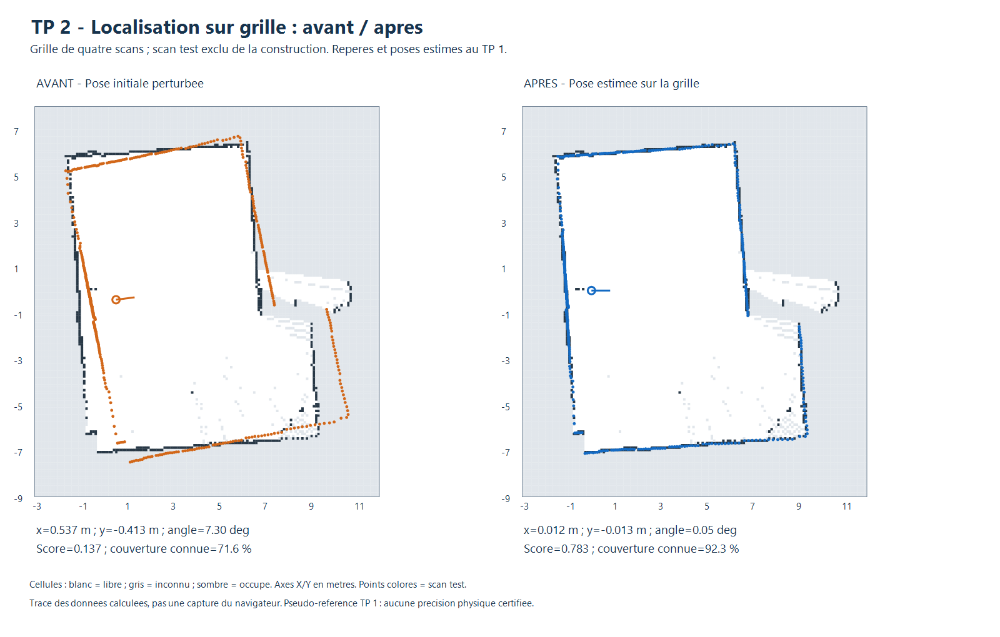

# TP 2 - Localisation sur grid map

**Ajouts :** [descente de gradient, pyramide multi-résolution et recuit simulé](OPTIMISATIONS.md)
sont désormais disponibles dans le même sélecteur, avec évaluations, traces et
comparaison des succès et échecs. Le recuit est la méthode stochastique choisie
parmi les pistes probabilistes du document fourni.

**Méthode supplémentaire :** la [recherche exhaustive (brute force)](BRUTE_FORCE.md)
teste toutes les poses d'un domaine discret avec tous les points acceptés.
Elle est sélectionnée par défaut dans l'outil. Le présent document décrit la
première méthode à trois niveaux, qui reste disponible dans le sélecteur.

Une méthode fonctionnelle est implémentée : **recherche corrélative locale à
trois niveaux de finesse**. Elle estime `(x, y, theta)` d'un scan dans une carte
d'occupation fixe, sans modifier la carte et sans intégrer le scan test.
Les autres références du TP 2 ne sont pas traitées dans cette étape.

## Utiliser l'outil

Ouvrir `visualisation/index.html`, puis le panneau **TP 2 · Localisation sur grille**.

1. Cliquer sur **Exemple : carte de 4 scans + 1 test**. Cela remplace la grille
   courante par une grille construite avec quatre scans du groupe 1. Le cinquième
   est affiché avec une pose volontairement perturbée ; les autres scans chargés
   sont conservés et masqués.
2. Cliquer sur **Estimer la pose** : le scan ne bouge pas pendant la recherche.
3. Lire le score, la couverture et les avertissements. Cliquer sur **Appliquer
   la pose proposée** pour déplacer le scan dans la vue **Grille + points**.
4. Exporter le résultat en JSON. La grille de référence conserve ses cellules
   et son historique ; la localisation n'ajoute pas le scan à la carte.

Pour ses propres données : charger une grille JSON du TP 1 et un scan indépendant
couvrant une zone de cette grille. Choisir une pose initiale approximative dans
la grille, puis régler les fenêtres de recherche. Le bouton **Copier la pose du
scan** reprend la pose courante comme initialisation. Un scan déjà présent dans
l'historique de la carte est refusé par empreinte de points, même renommé.
Pour une carte externe sans historique complet, cette protection ne suffit pas :
il faut vérifier la séparation des données manuellement.

## Méthode et score

Pour chaque pose candidate, appliquer la transformation rigide du TP 1 aux points
locaux. On recherche les impacts qui correspondent aux obstacles de la grille.

1. Construire un champ de distance aux cellules occupées : deux parcours avec
   voisinage à huit directions, coûts `resolution` et `sqrt(2)*resolution`.
   C'est une distance de chanfrein approximative, pas une distance euclidienne exacte.
2. Transformer cette distance en champ de correspondance :
   `L = exp(-d² / (2 sigma²))`.
3. Échantillonner le champ par interpolation bilinéaire aux impacts transformés.
   Les cellules inconnues ou extérieures contribuent zéro. Si la cellule contenant
   l'impact est inconnue, cet impact contribue également zéro.
4. Calculer `score = somme(L) / nombre total de points acceptés`, y compris ceux
   qui ne correspondent pas. Sortir les points de la carte ne réduit donc pas
   artificiellement le dénominateur.
5. Retenir les meilleures poses puis affiner la recherche autour de plusieurs
   candidats spatialement ou angulairement distincts.

Le score se situe entre 0 et 1, mais **ce n'est pas une probabilité**. Une cellule
libre proche d'un obstacle peut contribuer positivement via le champ de distance.
Les rayons libres ne sont pas évalués : ce modèle compare les impacts à la carte.
La couverture rapportée est la fraction d'impacts dans des cellules connues,
pas une preuve que toute la scène est correctement expliquée.

| Niveau | Pas XY | Pas angulaire | Sigma | Zone explorée |
|---|---:|---:|---:|---|
| 1 | 0,20 m | 3° | 0,30 m | Fenêtre initiale, par défaut ±1 m et ±15° |
| 2 | 0,05 m | 0,75° | 0,15 m | ±0,20 m et ±3° autour des candidats retenus |
| 3 | 0,025 m | 0,25° | 0,10 m | ±0,05 m et ±0,75° autour des candidats retenus |

Six candidats distincts au maximum sont conservés entre les niveaux. La grille
reste à sa résolution native : la multi-échelle porte sur le pas des poses et
le lissage du champ ; il ne s'agit pas d'une pyramide de cartes ni d'un algorithme
branch-and-bound. La première recherche est exhaustive sur ses candidats discrets ;
l'élagage ultérieur est heuristique et ne garantit pas l'optimum global.

Au plus 240 points régulièrement répartis servent à la recherche. Une liste finale
des 60 meilleurs candidats échantillonnés, complétée de candidats distincts,
est réévaluée avec tous les points acceptés. La portée maximale est de 12 m ;
le seuil d'intensité nul désactive ce filtre. Ni `scan.pose` ni une pose de
référence d'évaluation ne sont lus pour déterminer la solution : seule la pose
initiale explicitement fournie définit la fenêtre.

Une égalité de score est départagée par proximité à l'initialisation, sans
ajouter de terme de pose au score de correspondance. Les angles sont normalisés
dans `[-180°, 180°[` et les candidats restent dans la fenêtre initiale.

## Indicateurs et garde-fous

- Score final inférieur à 0,30 : avertissement.
- Moins de 60 % des impacts dans des cellules connues : avertissement.
- Solution au bord de la fenêtre : avertissement ; élargir ou corriger l'initialisation.
- Concurrent testé à au moins 25 cm ou 4°, avec écart de score inférieur à 0,015 : avertissement d'ambiguïté.

L'absence de concurrent dans la liste limitée ne démontre pas l'unicité. Les
seuils sont heuristiques et ne sont pas calibrés comme des probabilités.
Le champ `quality` distingue `criteres_satisfaits` de `a_verifier`, sans certifier
une pose. L'application reste une action explicite de l'utilisateur.
Une carte ou pose de scan modifiée rend le résultat inapplicable. La recherche
asynchrone cède régulièrement la main au navigateur et peut être annulée.

## Évaluation chiffrée

Les résultats détaillés sont dans [evaluation.json](resultats/evaluation.json)
et [evaluation.csv](resultats/evaluation.csv). La fenêtre et les seuils sont
identiques pour tous les essais. Les trois perturbations initiales sont
`(+0,537 m ; -0,413 m ; +7,3°)`, `(-0,467 m ; +0,559 m ; -8,2°)` et
`(+0,263 m ; +0,371 m ; +5,4°)`. Elles ne sont pas toutes alignées sur les pas
de recherche. Le critère de réussite fixé est une erreur ≤20 cm et ≤2°.

| Série | Essais | Erreur XY initiale moyenne | Erreur XY finale moyenne | Erreur angulaire finale moyenne | Réussites |
|---|---:|---:|---:|---:|---:|
| Simulation avec pose connue | 9 | 62,0 cm | 8,1 cm | 0,19° | 9/9 |
| Scans réels, pseudo-référence TP 1 | 15 | 62,0 cm | 1,5 cm | 0,18° | 15/15 |

**Simulation :** salle en L et obstacle rectangulaire, grille analytique à 10 cm,
trois poses connues, scans de 360 rayons avec bruit déterministe de ±4 mm.
La géométrie est ray-tracée séparément de la grille : les points test ne sont pas
insérés dans la carte. L'erreur maximale mesurée est de 8,8 cm. La cellule
représente une surface avec une étendue de 10 cm ; le centrage et la discrétisation
des parois contribuent à un biais, visible ici. La simulation ne mesure pas la
précision physique du LD06 dans la salle.

**Données réelles :** les cinq scans du groupe 1 sont testés successivement.
Pour chaque scan, reconstruire une grille avec seulement les quatre autres et
répéter les trois perturbations. La couverture finale moyenne est de **94,5 %**
et le score moyen de **0,629**. L'erreur maximale par rapport aux poses du TP 1
est de **1,9 cm**. Les grilles sans chaque scan sont fournies pour audit.

**Limite essentielle :** les poses de construction et les poses de comparaison
proviennent du recalage TP 1 qui utilisait le groupe complet, dont le scan test.
Le scan est exclu de l'insertion dans la grille, mais les poses ne constituent
pas une référence indépendante. Les 1,5 cm mesurent une cohérence avec ces poses,
pas une précision absolue. Les essais répétés d'un même scan sont corrélés.

Sur le PC de calcul (Intel Core i5-6300U, Node.js 24.22.1), les moyennes observées
sont **238 ms en simulation** et **214 ms sur les scans réels**. Ces temps incluent
le champ de distance et varient avec la machine, sa charge et l'échauffement JIT.
Le temps de l'interface inclut aussi ses pauses ; il n'est pas directement comparable.



Figure : le même scan test est affiché avant et après, sur une carte construite
sans ses impacts. Cette image est un tracé des résultats calculés, pas une capture
du navigateur et pas une comparaison à une position physique mesurée.

## Validation et reproduction

Depuis la racine du dépôt, sans dépendance npm :

```powershell
node localisation/grid/test.cjs
node localisation/grid/test_ui.cjs
node localisation/grid/evaluer.cjs
.\localisation\grid\tracer.ps1
```

Les **12 contrôles du moteur** vérifient le champ de distance, les données invalides,
l'inconnu, les doublons, une pose connue, le franchissement de ±180°, les fenêtres,
les faibles couvertures, l'annulation, l'équivalence synchrone/asynchrone et
l'absence de modification des données. Le contrôle d'interface exerce les vrais
gestionnaires dans un DOM minimal : exemple, recherche, application explicite,
annulation, résultat périmé, doublons et régression des commandes du TP 1.
Il ne remplace pas une validation visuelle complète du navigateur.

`evaluer.cjs` régénère les bilans, les cinq cartes d'évaluation et l'exemple embarqué
`visualisation/grid-localisation-example.js`. Les acquisitions sources du TP 1
ne sont jamais modifiées. `scene.cjs` fournit la scène synthétique de contrôle.

## Choix techniques, limites et suites

La recherche locale est adaptée à une pose approximative disponible et évite
une exploration globale très coûteuse. Elle peut échouer si la pose vraie sort
de la fenêtre ou si le premier niveau élimine la bonne solution. Les couloirs,
symétries, obstacles mobiles, zones inconnues et erreurs de carte restent difficiles.
La grille catégorielle peut effacer des impacts à chaque nouveau scan ; le score
doit donc tolérer un écart spatial. Une partie des cellules inconnues peut aussi
réduire le score d'un scan pourtant pertinent.

Pour valider une précision physique, acquérir des positions mesurées et des scans
indépendants, construire la carte sans utiliser leurs poses dans son estimation,
et tester aussi des initialisations plus éloignées et des zones peu couvertes.
Une pyramide de grilles, une recherche globale, une distance euclidienne exacte
ou la prise en compte des espaces libres seraient des approfondissements.

## Référence de méthode

L'idée d'évaluer des poses candidates sur une grille s'inscrit dans le scan matching
corrélatif décrit dans la [documentation Cartographer](https://google-cartographer.github.io/cartographer/mapping/internal/2d/scan_matching/real_time_correlative_scan_matcher_2d.html).
Notre implémentation pédagogique utilise son propre score par distance et sa propre
recherche à trois niveaux ; elle ne reprend pas le moteur de Cartographer.
La page pédagogique EIGSI liée dans l'énoncé n'était pas accessible depuis l'outil
de consultation ; aucune instruction supplémentaire de cette page n'est supposée.
