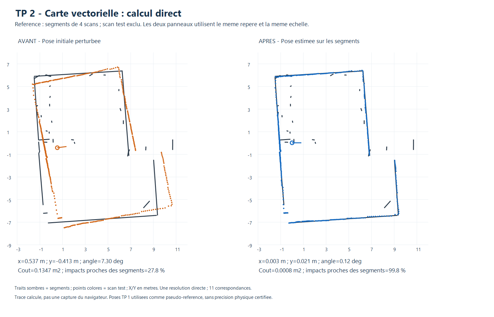

# TP 2 - Calcul direct de pose sur une carte vectorielle

Oui, un calcul direct est possible **une fois les correspondances géométriques
établies**. Cette version associe les segments du scan à ceux de la carte depuis
la pose initiale, estime l'orientation par une formule fermée, puis résout la
translation par un système linéaire 2×2. Les correspondances ne sont pas mises
à jour après ce calcul : ce n'est ni une recherche exhaustive ni une boucle ICP.

L'approche s'inscrit dans les pistes géométriques des sections 5, 7 et 8.5 du
document « Scan matching.md », Jonathan Quillès, 2026, fourni pour le TP.
L'implémentation précise choisie ici utilise les orientations de segments et
des contraintes de normales, plutôt qu'un appariement des barycentres de tous
les points bruts.

## Utilisation dans l'outil

1. Charger **Exemple vectoriel : 4 scans + 1 test**, ou une carte et un scan
   indépendant couvrant la même zone.
2. Choisir **Calcul direct sur segments** dans le panneau de localisation vectorielle.
3. Donner une pose initiale approximative. Les fenêtres XY et angulaire servent
   à sélectionner les correspondances et à vérifier l'estimation finale.
4. Cliquer sur **Estimer la pose**, contrôler le nombre de correspondances et
   le résultat, puis **Appliquer la pose proposée**.
5. Exporter le JSON pour conserver les associations et le système résolu.

Les pas de l'exhaustif, le budget du gradient et les réglages de recuit sont
grisés. La carte reste inchangée. Les doublons, l'annulation et les résultats
périmés sont contrôlés comme dans les méthodes précédentes.

## 1. Extraire et associer les segments

Les retours sont filtrés avec la même portée de 12 m et le même seuil d'intensité
nul par défaut. Les fonctions du TP 1 extraient ensuite les segments locaux :
rupture 30 cm, résidu maximal 5 cm, au moins cinq points. La longueur minimale
est ici de **50 cm**, afin de privilégier les structures linéaires stables.

Chaque segment du scan est projeté dans la carte avec la pose initiale. Une
correspondance est choisie en combinant :

- la distance entre son milieu et le segment **fini** de référence ;
- l'écart entre les orientations non dirigées des deux segments.

La distance admissible vaut `sqrt(2)*fenetreXY + 0,10 m`. L'écart angulaire
admissible est `min(50°, fenetreAngle + 5°)`. Ces marges sont des heuristiques,
pas une garantie de correspondance physique. Le score d'association est la somme
des carrés des deux écarts normalisés par leurs seuils.

Une correspondance reçoit le poids `min(longueur_scan, longueur_carte)²`, pour
favoriser les longues structures tout en limitant l'influence d'une association
à un petit fragment. Plusieurs fragments du scan peuvent partager une référence.

Un consensus déterministe retient le groupe de corrections angulaires situé à
±3° autour d'une correction candidate et de poids total maximal. Ce filtrage
privilégie une rotation commune ; il ne prouve pas que les objets associés sont
les mêmes. Il n'y a pas de réassociation après estimation de la pose.

## 2. Calculer directement l'orientation

Les segments sont non orientés : inverser leurs extrémités ne doit pas changer
la solution. Pour chaque correspondance, calculer la correction delta_j entre
la direction du segment local, orientée selon l'initialisation, et celle de la carte.
La correction est ramenée dans `[-90°,90°[`.

```text
C = somme w_j cos(2 delta_j)
S = somme w_j sin(2 delta_j)
delta = 0,5 atan2(S, C)
theta = theta_initial + delta
```

Le doublement des angles gère l'ambiguïté de 180° des segments non dirigés.
L'initialisation choisit la branche locale : les orientations seules ne résolvent
pas une ambiguïté globale de 180°. Une concentration angulaire trop faible
(`sqrt(C²+S²)/somme(w) < 0,5`) entraîne un refus.

## 3. Résoudre directement la translation

Noter m_j le milieu du segment local, a_j une extrémité du segment de référence
et n_j sa normale unitaire. Une fois theta calculé, chaque correspondance impose :

```text
n_j^T t = n_j^T (a_j - R(theta)*m_j) = b_j
```

La translation t minimise la somme pondérée des résidus au carré de ces
contraintes. Avec les poids normalisés, former puis résoudre :

```text
A = somme w_j n_j n_j^T
u = somme w_j n_j b_j
A t = u
```

A est une matrice symétrique 2×2 ; sa solution est calculée directement par
son déterminant. Cette étape utilise les supports des segments associés comme
contraintes de normale. La sélection initiale et le contrôle final utilisent
bien les segments finis ; on ne prétend pas minimiser ici le coût tronqué
point-vers-segment de tous les points.

### Observabilité et refus

Deux familles de directions différentes sont nécessaires. Des segments parallèles
ne contraignent pas le déplacement le long de leur direction. Le rapport entre
la plus petite et la plus grande valeur propre de A mesure ce conditionnement.

- Rapport inférieur à **0,001** : calcul refusé.
- Rapport inférieur à **0,02** : avertissement de sensibilité au bruit.
- Moins de deux correspondances utilisables : calcul refusé.
- Estimation hors de la fenêtre initiale : calcul refusé, sans projection artificielle.

Il n'y a pas de pose inventée ou de repli caché vers une autre méthode lorsque
le système n'est pas exploitable.

## 4. Contrôler la pose obtenue

Le coût tronqué point-vers-segment commun est évalué seulement **avant et après**
pour comparer le résultat aux méthodes précédentes, avec tous les points acceptés.
Ces deux diagnostics ne constituent pas une recherche sur deux poses candidates.
Une augmentation du coût ou moins de 50 % d'impacts à 20 cm des segments produit
un avertissement. Un bon conditionnement ne garantit pas une bonne association.

La résolution de pose est fermée, mais la procédure complète comporte de
l'extraction et des comparaisons de segments. « Direct » ne signifie donc pas
un coût constant ni l'absence de prétraitement.

## 5. Évaluation sur les mêmes données

Le protocole reprend les neuf configurations simulées et quinze configurations
réelles précédentes, avec un écart initial moyen de 62 cm. La carte réelle de
chaque test est reconstruite avec les quatre autres scans, en excluant ses impacts.
Le critère de réussite reste **20 cm et 2°**.

| Évaluation | Cas | Solutions retournées | Réussites | Erreur XY moyenne | Erreur angulaire moyenne |
|---|---:|---:|---:|---:|---:|
| Simulation, pose connue | 9 | 9 | 9/9 | 0,92 cm | 0,011° |
| Réel, pseudo-référence TP 1 | 15 | 15 | 15/15 | 3,4 cm | 0,29° |

L'erreur XY maximale est de **4,6 cm en simulation** et de **8,5 cm par rapport
aux poses estimées du TP 1**. Le calcul retient en moyenne environ **12 correspondances**
par essai réel. Le temps moyen observé est de **3,6 ms** sur les données réelles
(Node.js 24.22.1, Intel Core i5-6300U), hors pauses d'interface.

Les bilans prévoient aussi les refus : ceux-ci comptent comme des échecs et
restent enregistrés avec leur motif. Les moyennes finales sont calculées sur
les solutions retournées, avec leur effectif indiqué. Aucun refus n'a eu lieu
dans le lot présent ; les cas de parallélisme sont testés séparément.

**Limite physique :** les poses de construction et de comparaison viennent du
recalage TP 1 sur le groupe complet. L'exclusion du scan de la construction
vectorielle ne rend pas ces poses indépendantes. Les erreurs réelles mesurent
une cohérence avec ces estimations, pas une précision expérimentale absolue.
Les trois perturbations d'une acquisition sont corrélées.

Les petites erreurs simulées concernent une carte analytique idéale. Deux
configurations présentent des erreurs de plusieurs centimètres liées aux
associations : même avec une géométrie connue, le calcul direct dépend de leur
qualité. Ces résultats ne constituent pas une calibration du LD06 réel.



Dans cet exemple, l'écart passe de **67,7 cm / 7,3°** à **2,1 cm / 0,12°**
par rapport à la pseudo-référence. L'image représente les données calculées,
pas une capture du navigateur. La carte sombre reste fixe ; seuls les points
du scan passent de leur pose initiale orange à leur pose estimée bleue.

## 6. Fichiers, reproduction et tests

- Moteur : `visualisation/vector-direct.js`.
- [Bilans JSON avec associations et système linéaire](resultats/evaluation_direct.json).
- [Tableau CSV, solutions et refus](resultats/evaluation_direct.csv).

```powershell
node localisation/vectorielle/test_direct.cjs
node localisation/grid/test_ui.cjs
node localisation/vectorielle/evaluer_direct.cjs
.\localisation\vectorielle\tracer.ps1 -EvaluationFile evaluation_direct.json -OutputFile avant_apres_direct.png
```

Les **9 contrôles dédiés** vérifient une solution exacte à partir de correspondances
connues, l'inversion des extrémités, le parallélisme et quasi-parallélisme,
les poids invalides, les segments dégénérés et ±180°. Ils couvrent aussi la
procédure complète, les doublons, les scans sans segments, la conservation de
la carte, l'absence de lecture de `scan.pose`, l'annulation et l'équivalence
synchrone/asynchrone.

Le test d'interface commun exerce le nouveau sélecteur, la résolution et la
conservation de la référence dans un DOM minimal. Il ne remplace pas une
validation graphique complète du navigateur. Le rendu calculé est inspecté
séparément. Si les cartes d'évaluation sont absentes, lancer d'abord
`node localisation/vectorielle/evaluer.cjs`.
