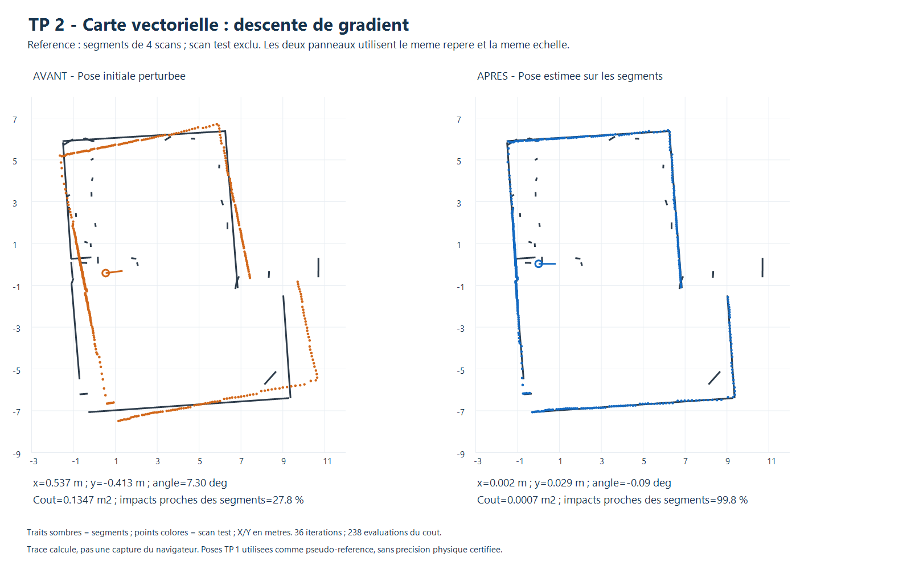
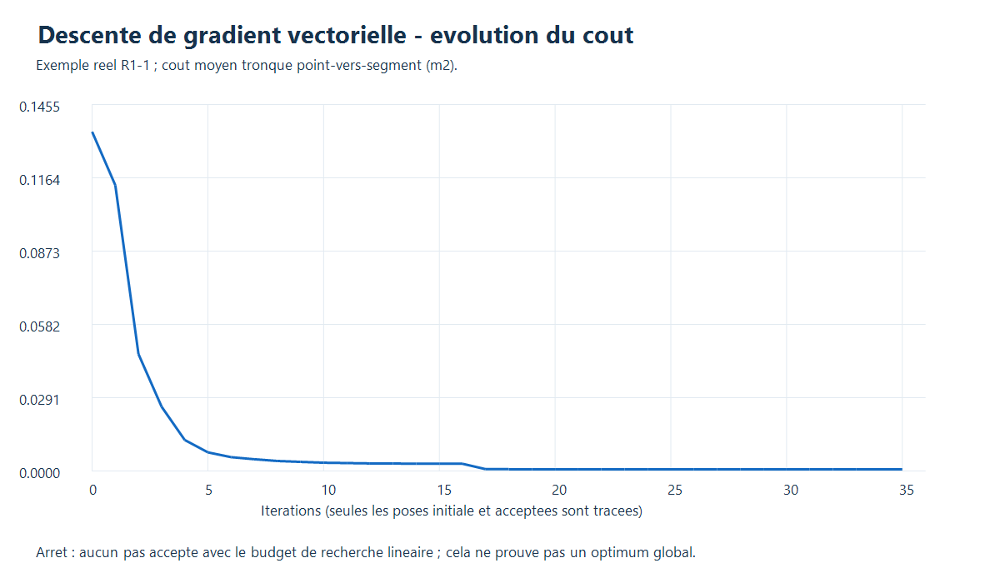

# TP 2 - Descente de gradient sur carte vectorielle

La méthode est disponible dans le panneau **TP 2 · Localisation sur carte vectorielle**,
sélecteur **Descente de gradient**. Elle complète la [recherche exhaustive](README.md)
en réutilisant exactement le même coût point-vers-segment fini, tronqué à 0,50 m
par défaut. Elle suit les sections 5 et 8.3 de « Scan matching.md », Jonathan
Quillès, 2026, fourni pour le TP.

## Utilisation

1. Charger **Exemple vectoriel : 4 scans + 1 test**, ou une carte et un scan
   indépendant couvrant cette zone.
2. Choisir **Descente de gradient** et saisir ou copier la pose initiale.
3. Régler la fenêtre et le budget maximal, initialement **100 itérations**.
   Les pas de la recherche exhaustive sont grisés : ils ne servent pas au gradient.
4. **Estimer la pose**, contrôler le coût, les impacts proches et le motif d'arrêt,
   puis **Appliquer la pose proposée**.
5. Exporter le JSON pour conserver la trace des itérations et la carte utilisée.

La carte de référence reste fixe et le scan n'est pas réintégré pendant le calcul.
L'annulation, les contrôles de doublon et de résultat périmé sont conservés.

## 1. Coût et correspondances

Pour chaque point local p, calculer `P = R(theta)*p + translation`, puis chercher
le point Q le plus proche sur l'ensemble des **segments finis** de la carte.
La projection est limitée aux extrémités, comme pour la recherche exhaustive.
Les correspondances sont recalculées à chaque évaluation de pose.

```text
E(pose) = (1/N) somme min(||P-Q||^2, D^2)
D = 0,50 m par defaut
```

Tous les points acceptés restent dans le dénominateur N, y compris ceux dont
le coût est saturé. Les filtres sont identiques : portée 12 m et intensité
minimale nulle par défaut. Le scan n'est pas sous-échantillonné.

## 2. Calculer le gradient analytique

Pour une correspondance active, de distance strictement inférieure à D, noter
`r = P-Q` et `u = R(theta)*p`. Sa contribution aux dérivées est :

```text
dE/dx         += 2*r_x/N
dE/dy         += 2*r_y/N
dE/dtheta_rad += 2*(-r_x*u_y + r_y*u_x)/N
```

Les contributions des points au-delà de D sont nulles. Cette dérivation utilise
la projection la plus proche ; elle reste valable sur une extrémité de segment
hors d'un changement de correspondance. Aux égalités entre plusieurs segments
ou au seuil de troncature, le coût peut ne pas être différentiable. Le calcul
utilise alors la branche sélectionnée, sans prétendre à une régularité globale.

Pour comparer les translations et la rotation numériquement, les variables
internes sont `q = (dx, dy, 2*dtheta_rad)` : le facteur de 2 m est un bras de
levier de mise à l'échelle, pas une dimension physique mesurée.

## 3. Mettre à jour la pose

- Partir uniquement de la pose initiale fournie, sans recherche exhaustive cachée.
- Suivre l'opposé du gradient normalisé dans les coordonnées q.
- Essayer une longueur de pas de 0,25, puis la diviser par deux jusqu'à accepter
  une décroissance d'Armijo, avec au plus 14 essais de recherche linéaire.
- Projeter les propositions dans la fenêtre initiale, par défaut ±1 m et ±15°.
- Conserver uniquement les poses acceptées, dont le coût ne peut pas augmenter.

Les angles sont normalisés dans `[-180°, 180°[`. Le calcul s'arrête sur petit
gradient, petite mise à jour, absence de pas accepté, plateau de troncature ou
budget d'itérations atteint. La trace JSON contient les poses, coûts et nombres
de points actifs. Les autres cartes de l'outil et les fichiers d'acquisition
restent inchangés.

**Dans le lot évalué, l'arrêt est l'absence de pas accepté avec ce budget de
recherche linéaire.** Ce motif est affiché comme un avertissement. Il décrit
l'arrêt numérique, pas une preuve d'optimum global ou d'exactitude physique.
Un scan trop éloigné des segments peut avoir un gradient nul à cause de la
troncature : ce plateau est signalé explicitement comme un cas à corriger.

## 4. Résultats sur le même protocole

Les scans, cartes sans le scan test, fenêtres, filtres et trois perturbations
initiales sont identiques à ceux du [bilan exhaustif](README.md). Aucun essai
n'est remplacé après observation de son résultat. Le critère de réussite reste
une erreur de pose ≤20 cm et ≤2°, par rapport à la référence indiquée.

| Évaluation | Essais | Réussites | Erreur XY moyenne | Erreur angulaire moyenne |
|---|---:|---:|---:|---:|
| Simulation idéale, pose connue | 9 | 9/9 | 0,15 mm | 0,0031° |
| Scans réels, pseudo-référence TP 1 | 15 | 15/15 | 4,2 cm | 0,21° |

L'erreur XY maximale réelle est de **11,9 cm**. Les cinq acquisitions sont chacune
testées avec trois perturbations : ces répétitions ne sont pas quinze acquisitions
indépendantes. La proportion moyenne d'impacts à 20 cm des segments est de **84,0 %**.
Le moteur utilise en moyenne **24 itérations** et **183 évaluations de coût**
par essai réel, contre 13 671 poses pour l'exhaustif aux pas de 10 cm et 1°.

La très petite erreur simulée provient d'une carte analytique exacte, d'une
transformation continue et de l'ajustement collectif de 360 rayons avec un bruit
déterministe de ±4 mm. Elle ne modélise pas les biais du capteur, les erreurs de
carte et de calibration ou les obstacles mobiles : **ce n'est pas la précision
physique du LD06**.

Les cartes réelles sont construites avec quatre scans, en excluant les impacts
du cinquième. Cependant, leurs poses et la pose de comparaison viennent du recalage
TP 1 sur le groupe complet. Les 4,2 cm mesurent donc une cohérence avec ces poses,
pas une précision absolue validée par des mesures sur place.

### Exemple avant/après



Le même scan commence à **67,7 cm et 7,3°** de la pseudo-référence ; après calcul,
il est à **2,9 cm et 0,09°**. Les segments sombres sont ceux de la carte fixe,
les points sont orange avant correction et bleus après. Le fond blanc n'indique
pas un espace libre. L'image est un tracé des résultats, pas une capture du navigateur.



Seules les poses initiale et acceptées sont tracées. Les propositions refusées
par la recherche linéaire restent comptées dans les évaluations du coût.

### Comparaison à la recherche exhaustive

| Méthode vectorielle | Réussites réelles | Erreur XY moyenne | Temps moyen observé |
|---|---:|---:|---:|
| Exhaustive, pas 10 cm et 1° | 15/15 | 7,1 cm | 1,86 s |
| Gradient, pose continue | 15/15 | 4,2 cm | 41 ms |

Temps relevés sous Node.js 24.22.1 sur Intel Core i5-6300U, hors pauses de
l'interface. Les lots ont été exécutés à des moments différents et les temps
varient avec la charge. Le gradient n'a pas les mêmes garanties que l'exhaustif :
il ne visite pas toutes les poses, tandis que l'exhaustif reste limité à ses pas
discrets. Ces résultats ne prouvent pas que le gradient sera meilleur dans
d'autres scènes, avec des symétries ou une initialisation plus éloignée.

## 5. Vérifications et reproduction

Le moteur est `visualisation/vector-gradient.js`. Les bilans conservent tous les
essais, leurs références, traces et motifs d'arrêt :

- [Évaluation détaillée JSON](resultats/evaluation_gradient.json).
- [Tableau CSV](resultats/evaluation_gradient.csv).

```powershell
node localisation/vectorielle/test_gradient.cjs
node localisation/grid/test_ui.cjs
node localisation/vectorielle/evaluer_gradient.cjs
.\localisation\vectorielle\tracer.ps1 -EvaluationFile evaluation_gradient.json -OutputFile avant_apres_gradient.png
.\localisation\vectorielle\tracer_convergence.ps1
```

Les **10 contrôles dédiés** vérifient le gradient analytique par différences
finies loin des ruptures, la dérivée à une extrémité, l'égalité du coût avec
l'exhaustif, la décroissance des poses acceptées, la récupération depuis une bonne
initialisation et la conservation des données. Ils contrôlent aussi les paramètres,
doublons, plateaux, bornes, ±180°, annulation et équivalence synchrone/asynchrone.

Le test d'interface commun exerce le sélecteur gradient vectoriel, la recherche,
l'application et les contrôles de péremption sans modifier la référence. Il utilise
un DOM minimal et ne remplace pas une validation graphique complète du navigateur.
Les deux figures calculées ont été inspectées séparément.

Si les cartes d'évaluation ne sont pas présentes, lancer d'abord
`node localisation/vectorielle/evaluer.cjs`. Les fichiers bruts restent intacts.
