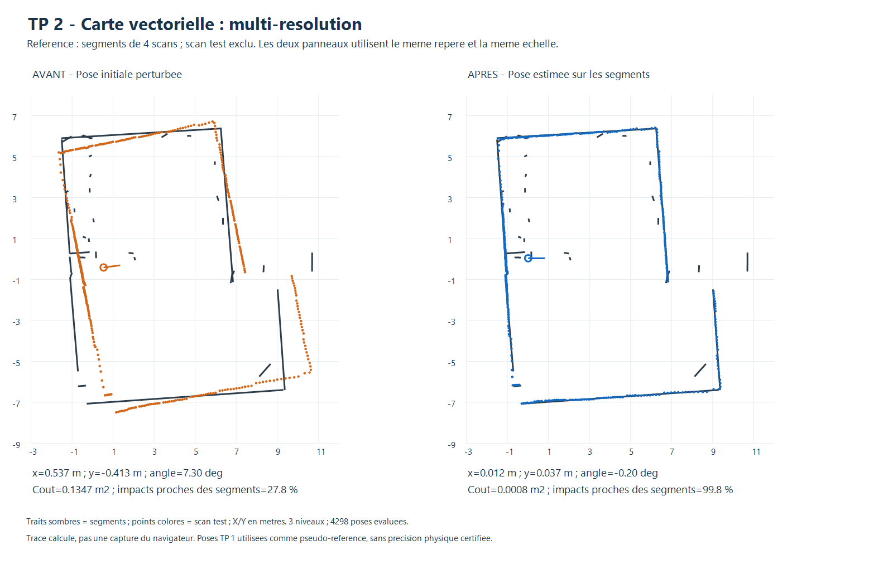
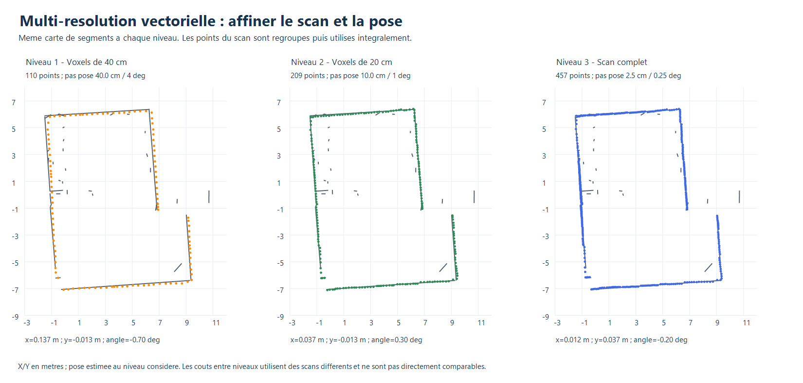

# TP 2 - Localisation vectorielle multi-résolution

Cette méthode complète la recherche exhaustive et la descente de gradient dans
le panneau **TP 2 · Localisation sur carte vectorielle**, option
**Multi-résolution (scan et pose)**. Elle suit la section 8.2 de « Scan matching.md »,
Jonathan Quillès, 2026 : sous-échantillonnage des scans ou cartes, recherche
grossière puis raffinement progressif.

Le choix retenu est de réduire progressivement le **scan**, tout en conservant
la carte de segments finis du TP 1. Les distances sont calculées directement aux
segments avec le même coût quadratique tronqué que dans les deux méthodes précédentes.

## Utilisation

1. Charger **Exemple vectoriel : 4 scans + 1 test**, ou une carte et un scan
   indépendant couvrant cette zone.
2. Choisir **Multi-résolution (scan et pose)** et régler la pose initiale ainsi
   que la fenêtre, par défaut ±1 m en X/Y et ±15°.
3. Cliquer sur **Estimer la pose**. Les trois résolutions sont prédéfinies ; les
   pas de l'exhaustif et le budget du gradient sont grisés.
4. Lire le coût final, les nombres de points par niveau et les avertissements,
   puis **Appliquer la pose proposée**.
5. Exporter le JSON pour conserver les poses et comptes rendus de chaque niveau.

Le calcul laisse la carte et la pose affichée inchangées jusqu'à l'application.
Les contrôles de doublon, d'annulation et de résultat périmé restent actifs.

## 1. Préparer le scan à plusieurs résolutions

Après filtrage des distances et intensités, regrouper les points locaux dans des
carrés de **40 cm**, puis de **20 cm**. Chaque carré non vide est remplacé par
le centroïde de ses points. Les indices sont calculés par plancher, y compris
pour les coordonnées négatives. Les centroïdes sont déterministes et les points
originaux restent intacts.

Le dernier niveau utilise **tous les points acceptés**, sans regroupement.
Les filtres par défaut sont une portée de 12 m et un seuil d'intensité nul.
Les cellules du regroupement servent seulement à sous-échantillonner les points :
la référence reste une liste de segments avec ses extrémités métriques.

Au niveau grossier, les centroïdes ont le même poids entre eux, quelle que soit
la quantité de mesures regroupées. Cela modifie la pondération spatiale et peut
déplacer les points près des coins. Au dernier niveau, chaque mesure acceptée
retrouve son poids initial.

## 2. Rechercher puis affiner la pose

| Niveau | Scan utilisé | Pas XY | Pas angulaire | Zone de recherche |
|---|---|---:|---:|---|
| 1 - grossier | Centroïdes, carrés de 40 cm | 40 cm | 4° | Fenêtre initiale |
| 2 - intermédiaire | Centroïdes, carrés de 20 cm | 10 cm | 1° | ±40 cm et ±4° autour des candidats retenus |
| 3 - fin | Tous les points acceptés | 2,5 cm | 0,25° | ±10 cm et ±1° autour des candidats retenus |

Chaque pose candidate transforme le scan et calcule :

```text
E(pose) = (1/N_niveau) somme min(distance(point transforme, segments finis)^2, D^2)
D = 0,50 m par defaut
```

Les projections sont limitées aux extrémités des segments. Le coût est tronqué
pour limiter l'influence des points sans surface correspondante. Il ne représente
pas une probabilité de pose. La proportion d'impacts proches reste un indicateur
de correspondance, pas une occupation de cellules libres/inconnues.

À chaque niveau, les poses sont classées par coût croissant, puis au plus
**quatre hypothèses distinctes** sont conservées. Une nouvelle hypothèse doit
être distante des autres d'au moins 20 cm ou 3°. Les égalités de coût sont
départagées par proximité à l'initialisation.

Tous les candidats restent dans la fenêtre initiale et les angles sont normalisés
dans `[-180°,180°[`. Les doublons de pose d'un même niveau sont évités. La pose
initiale est également évaluée sur le scan complet au dernier niveau : le résultat
final ne peut donc pas avoir un coût supérieur à cette initialisation.

**L'élagage reste heuristique.** Une bonne solution éliminée au premier niveau
peut être perdue, et des détails fins peuvent disparaître dans les centroïdes.
Les étapes fines ne visitent pas toutes les poses de toute la fenêtre. Cette
méthode ne garantit donc pas le minimum global de la pose continue ou du domaine
fin complet. Aucun raffinement caché par gradient n'est ajouté.

## 3. Résultats sur le protocole commun

Les neuf configurations simulées et quinze configurations réelles sont les
mêmes que pour les méthodes précédentes. Le déplacement initial moyen est de
62,0 cm. Le seuil de réussite reste **20 cm et 2°**.

| Évaluation | Essais | Réussites | Erreur XY moyenne | Erreur angulaire moyenne | Erreur XY maximale |
|---|---:|---:|---:|---:|---:|
| Simulation, pose connue | 9 | 9/9 | 1,4 cm | 0,13° | 1,8 cm |
| Réel, pseudo-référence TP 1 | 15 | 15/15 | 4,6 cm | 0,23° | 12,7 cm |

Le dernier niveau retrouve la totalité du scan, soit 360 points en simulation
et 456 ou 457 points pour les acquisitions réelles. La proportion finale moyenne
d'impacts à 20 cm des segments est de **84,1 %** sur le jeu réel.

Les cartes réelles sont reconstruites avec quatre scans, en excluant les impacts
du cinquième. Leurs poses et la pose attendue proviennent néanmoins du recalage
TP 1 effectué sur le groupe complet. **Les 4,6 cm évaluent une cohérence avec ces
poses estimées, pas une précision physique mesurée dans la salle.** Les trois
perturbations d'un scan sont corrélées et ne sont pas de nouvelles acquisitions.

### Exemple avant/après



L'exemple commence à **67,7 cm / 7,3°** de la pseudo-référence et termine à
**3,9 cm / 0,20°**. Le coût sur le scan complet passe de **0,1347 à 0,0008 m²**.
La carte de référence n'est pas modifiée. Les traits sombres sont ses segments ;
les points orange puis bleus sont ceux du scan avant et après correction.

### Détail des trois niveaux de l'exemple



| Niveau | Points | Poses évaluées | Pose obtenue : x, y, angle |
|---|---:|---:|---|
| 40 cm | 110 | 175 | 0,137 m ; -0,013 m ; -0,70° |
| 20 cm | 209 | 1 377 | 0,037 m ; -0,013 m ; 0,30° |
| Scan complet | 457 | 2 746 | 0,012 m ; 0,037 m ; -0,20° |

Au total, **4 298 poses** sont évaluées pour cet exemple. Les coûts intermédiaires
reposent sur des scans de pondérations différentes : ils ne constituent pas une
unique courbe de convergence comparable d'un niveau à l'autre. Le bilan avant/
après est, lui, toujours recalculé sur tous les points acceptés.
Les figures sont des tracés des données, pas des captures du navigateur.

## 4. Comparaison avec les méthodes précédentes

| Méthode vectorielle | Réussites réelles | Erreur XY moyenne | Temps moyen observé |
|---|---:|---:|---:|
| Exhaustive, pas 10 cm / 1° | 15/15 | 7,1 cm | 1,86 s |
| Gradient, pose continue | 15/15 | 4,2 cm | 41 ms |
| Multi-résolution, dernier pas 2,5 cm / 0,25° | 15/15 | 4,6 cm | 473 ms |

La multi-résolution évalue en moyenne **4 341 poses** par essai réel, contre
13 671 pour l'exhaustif précédent. Les deux premiers niveaux utilisent en plus
des scans plus petits. Le coût de calcul est proportionnel au nombre de poses,
de points du niveau et de segments de la référence.

Temps relevés sous Node.js 24.22.1 sur Intel Core i5-6300U, hors pauses de
l'interface. Les lots ont été exécutés séparément ; la charge et l'échauffement
du moteur JavaScript affectent les temps. Les pas et garanties ne sont pas
identiques : ce tableau illustre un compromis, pas un classement universel.

Un budget conservateur de 400 millions de comparaisons point-segment théoriques
est contrôlé avant la recherche. Il inclut les trois niveaux, les quatre
hypothèses et l'évaluation finale de l'initialisation. Si ce budget est dépassé,
le calcul est refusé sans réduire silencieusement les données.

## 5. Fichiers et contrôles

- Moteur : `visualisation/vector-multiresolution.js`.
- [Bilans JSON](resultats/evaluation_multiresolution.json) : tous les essais, références et niveaux.
- [Tableau CSV](resultats/evaluation_multiresolution.csv).
- [Données des trois niveaux de l'exemple](resultats/niveaux_multiresolution.json).

```powershell
node localisation/vectorielle/test_multiresolution.cjs
node localisation/grid/test_ui.cjs
node localisation/vectorielle/evaluer_multiresolution.cjs
.\localisation\vectorielle\tracer.ps1 -EvaluationFile evaluation_multiresolution.json -OutputFile avant_apres_multiresolution.png
.\localisation\vectorielle\tracer_niveaux.ps1
```

Si les cartes d'évaluation ne sont pas disponibles, lancer d'abord
`node localisation/vectorielle/evaluer.cjs`. Les captures brutes restent intactes.

Les **8 contrôles dédiés** vérifient les centroïdes, les coordonnées négatives,
les résolutions, les pas, les compteurs et l'utilisation de tous les points au
dernier niveau. Ils contrôlent aussi la récupération de pose, le coût final,
l'absence de modification des données, les doublons, les budgets, la fenêtre,
±180°, l'annulation et l'équivalence synchrone/asynchrone.
Les commandes du sélecteur et de recherche sont exercées dans un DOM minimal,
en complément des régressions des méthodes précédentes. Ce contrôle ne remplace
pas une validation graphique complète du navigateur ; les figures sont inspectées
séparément.
