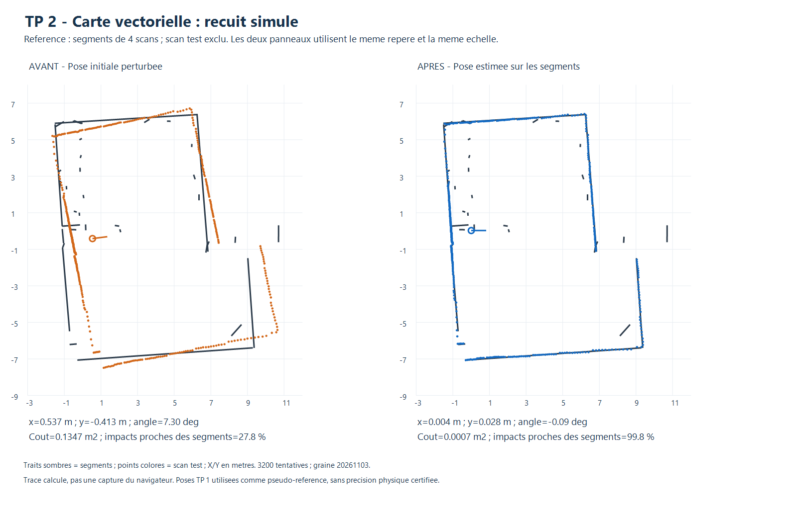
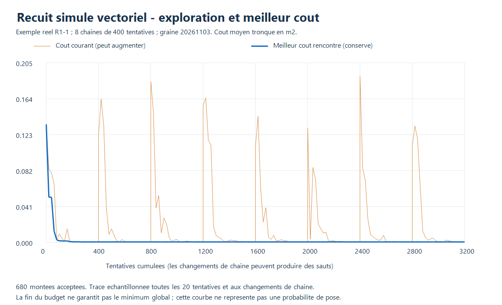

# TP 2 - Localisation vectorielle probabiliste : recuit simulé

La méthode est disponible dans le panneau **TP 2 · Localisation sur carte vectorielle**,
option **Probabiliste : recuit simulé**. Elle correspond à l'une des pistes de la
section **8.4 de « Scan matching.md »**, Jonathan Quillès, 2026, fourni pour le TP.

Il s'agit d'une **optimisation stochastique de la pose**, qui accepte parfois
une dégradation temporaire pour quitter certains minima locaux. Elle ne calcule
pas une distribution bayésienne complète ou une probabilité de position calibrée.
Le score d'alignement affiché ne doit pas être interprété comme une confiance
physique. Ce choix est un recuit, pas un filtre de particules Monte Carlo.

## Utilisation

1. Charger **Exemple vectoriel : 4 scans + 1 test**, ou une carte et un scan
   indépendant représentant une zone couverte par ses segments.
2. Choisir **Probabiliste : recuit simulé**.
3. Régler la pose initiale et la fenêtre (±1 m et ±15° par défaut).
4. Régler le nombre de chaînes (**8**), les tentatives par chaîne (**400**) et
   la graine (**20261103** par défaut).
5. **Estimer la pose**, examiner le résultat, puis **Appliquer** pour déplacer
   le scan sur la carte. Le JSON conserve les traces, compteurs et référence utilisée.

Une même graine et les mêmes données donnent le même résultat. Changer la
graine explore une autre suite de propositions. Le calcul peut être annulé.
Il ne modifie ni la carte ni les acquisitions ; un scan déjà intégré est refusé
par son empreinte. Une carte ou pose modifiée invalide le résultat.

## 1. Fonction de coût commune

Le recuit réutilise les distances exactes aux segments finis et le coût des
méthodes vectorielles précédentes :

```text
E(pose) = (1/N) somme min(distance(point transforme, segments)^2, D^2)
D = 0,50 m par defaut
```

Chaque proposition utilise tous les points acceptés, sans sous-échantillonnage.
Le filtre de portée est fixé à 12 m par défaut et le seuil d'intensité nul
désactive ce filtre. La pose contenue dans le scan n'est pas utilisée par le
moteur pour guider l'optimisation ; seule l'initialisation explicite définit
la fenêtre.

La troncature limite l'influence des surfaces absentes de la carte, mais crée
des plateaux. Une pose présentant un faible coût peut encore être incorrecte
dans un environnement symétrique ou une carte incomplète.

## 2. Générer et accepter des propositions

La première chaîne démarre à la pose initiale ; les suivantes démarrent à des
poses tirées uniformément dans la fenêtre. Chaque tentative ajoute un déplacement
gaussien à X, Y et à l'angle. Une proposition hors fenêtre est rejetée avant
évaluation, plutôt que déplacée artificiellement sur une frontière.

- Si le nouveau coût est plus faible ou égal, accepter la proposition.
- Sinon, l'accepter avec `P = exp(-(E_nouveau - E_actuel) / T)`.
- Conserver séparément la meilleure pose rencontrée dans l'ensemble des chaînes.

La température T décroît géométriquement de **0,04 à 0,00002** par chaîne,
dans l'échelle numérique du coût en m². Les écarts-types des déplacements
passent de **25 cm à 4 mm** et de **4° à 0,08°**. Ces réglages sont heuristiques,
choisis pour le coût tronqué et les fenêtres du TP ; ils ne calibrent pas les
incertitudes du lidar.

Avec les paramètres par défaut, **8 × 400 = 3 200 tentatives** sont réalisées.
Le nombre d'évaluations est différent : les propositions extérieures ne sont
pas évaluées, et les poses initiales des chaînes le sont. Les compteurs vérifient :

```text
tentatives = mouvements acceptes + rejets hors fenetre + rejets Metropolis
```

Les montées acceptées sont comptées séparément. La meilleure pose reste conservée
même si le coût courant remonte. Aucun raffinement par gradient ou recherche
exhaustive n'est ajouté à la fin. L'arrêt correspond au budget fixé, sans preuve
de convergence vers l'optimum global.

## 3. Évaluation avec plusieurs graines

Les 24 configurations précédentes (9 simulées, 15 réelles) sont reprises avec
**trois graines : 20261103, 20261104 et 20261105**. Elles donnent 72 essais
calculatoires, et non 72 nouvelles acquisitions. Le seuil de réussite reste
**20 cm et 2°** ; l'écart initial moyen est de 62,0 cm.

| Série | Essais avec les trois graines | Réussites | Erreur XY moyenne | Erreur angulaire moyenne |
|---|---:|---:|---:|---:|
| Simulation idéale, pose connue | 27 | 27/27 | 1,06 mm | 0,017° |
| Réel, pseudo-référence TP 1 | 45 | 45/45 | 4,2 cm | 0,22° |

Les erreurs XY maximales observées sont de **1,71 mm en simulation** et
**12,0 cm par rapport aux poses TP 1**. La proportion moyenne d'impacts à
20 cm des segments est de **84,0 %** sur le jeu réel.

| Graine | Réussites réelles | Erreur XY moyenne réelle |
|---|---:|---:|
| 20261103 | 15/15 | 4,23 cm |
| 20261104 | 15/15 | 4,19 cm |
| 20261105 | 15/15 | 4,24 cm |

Ces trois graines documentent une variabilité sur ce jeu limité ; elles ne
prouvent pas une robustesse universelle et ne donnent pas des observations
physiques indépendantes. Le résultat n'est pas sélectionné a posteriori parmi
les seules graines favorables : tous les essais sont conservés.

**Limite de la référence réelle :** les cartes contiennent les segments de
quatre scans et excluent les impacts du scan test. Leurs poses et la pose de
comparaison viennent toutefois du recalage TP 1 sur le groupe complet. Les
4,2 cm sont une cohérence avec ces estimations, sans mesure physique indépendante.
Une précision absolue demanderait des poses relevées sur place et une carte
construite indépendamment des scans test.

La simulation utilise dix segments analytiques exacts et 360 rayons avec un
bruit déterministe de ±4 mm. Sa petite erreur n'est pas la précision réelle du
LD06 : les biais, la calibration, les objets mobiles et les erreurs de carte
n'y sont pas reproduits.

## 4. Résultats illustrés



Dans l'exemple R1-1 avec la graine par défaut, l'écart passe de **67,7 cm et 7,3°**
à **2,9 cm et 0,09°**. Le coût diminue de **0,1347 à 0,0007 m²** et les impacts
proches passent de **27,8 % à 99,8 %**. La carte sombre est inchangée ; les points
sont orange avant correction et bleus après.



La courbe orange représente le coût courant, qui peut remonter. Les changements
de chaîne peuvent également produire des sauts. La courbe bleue représente le
meilleur coût conservé ; elle ne peut pas augmenter. Pour cet exemple, **680 montées**
ont été acceptées et **3 135 coûts** évalués sur 3 200 tentatives.
Les traces sont enregistrées toutes les 20 tentatives et aux changements de
chaîne. Ces figures sont des tracés de données, pas des captures du navigateur.

## 5. Comparaison et limites

| Méthode vectorielle | Réussites réelles | Erreur XY moyenne | Temps moyen observé |
|---|---:|---:|---:|
| Exhaustive, pas 10 cm / 1° | 15/15 | 7,1 cm | 1,86 s |
| Gradient continu | 15/15 | 4,2 cm | 41 ms |
| Multi-résolution | 15/15 | 4,6 cm | 473 ms |
| Recuit, trois graines | 45/45 | 4,2 cm | 434 ms |

Temps sous Node.js 24.22.1, Intel Core i5-6300U, hors pauses de l'interface.
Les lots ont été exécutés séparément et les garanties et budgets diffèrent :
ce tableau ne constitue pas un classement à précision ou coût identiques.
En simulation, le temps moyen observé du recuit est de 128 ms.

Les limites importantes restent la fenêtre initiale, les symétries, les segments
manquants, les plateaux de coût et le budget de propositions. Un budget fini peut
manquer une bonne solution, même avec plusieurs chaînes. La fin du recuit n'est
pas une garantie d'optimum ; le score n'est pas une probabilité physique.

## 6. Fichiers et validation

- Moteur : `visualisation/vector-annealing.js`.
- [Bilans JSON complets et synthèses par graine](resultats/evaluation_probabiliste.json).
- [Tableau CSV](resultats/evaluation_probabiliste.csv).
- [Journal des essais](resultats/journal_probabiliste.txt).

```powershell
node localisation/vectorielle/test_probabiliste.cjs
node localisation/grid/test_ui.cjs
node localisation/vectorielle/evaluer_probabiliste.cjs
.\localisation\vectorielle\tracer.ps1 -EvaluationFile evaluation_probabiliste.json -OutputFile avant_apres_probabiliste.png
.\localisation\vectorielle\tracer_probabiliste.ps1
```

Les **9 contrôles dédiés** vérifient la reproductibilité, les compteurs, l'acceptation
effective de montées, la conservation du meilleur coût et des données, l'utilisation
de tous les points et l'absence de lecture de `scan.pose`. Ils couvrent aussi les
paramètres, budgets, doublons, correspondances faibles, bornes, ±180°, annulation
et équivalence synchrone/asynchrone. Une autre graine est vérifiée pour produire
une trajectoire différente.

Le coût de calcul est plafonné avant la recherche à 400 millions de comparaisons
point-segment théoriques ; dépasser le budget exige de réduire chaînes ou
tentatives, sans sous-échantillonnage silencieux.
Le test commun d'interface exerce le sélecteur, les paramètres, le calcul et la
conservation de la carte dans un DOM minimal. Il ne remplace pas une validation
graphique complète du navigateur. Les figures ont été inspectées séparément.

Si les cartes d'évaluation sont absentes, lancer d'abord
`node localisation/vectorielle/evaluer.cjs`. Les acquisitions sources restent intactes.
