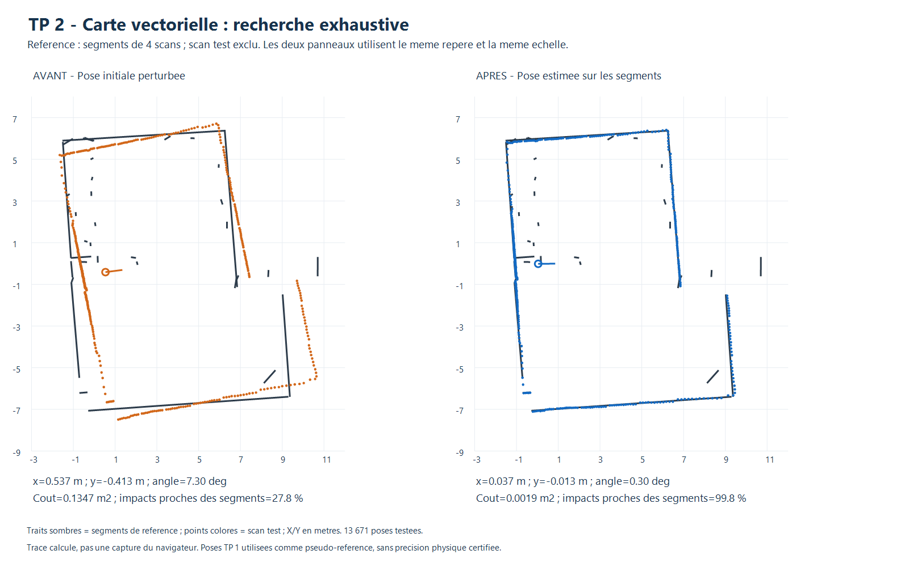

# TP 2 - Localisation sur carte vectorielle par recherche exhaustive

La [descente de gradient vectorielle](GRADIENT.md) est également disponible dans
le même panneau. Elle minimise le même coût tronqué avec un gradient analytique,
une recherche de pas et une évaluation sur les mêmes 24 configurations.

Cette étape estime la pose `(x, y, theta)` d'un scan en le comparant à une
**carte de segments**, construite sans insérer ce scan. Elle suit les sections
**5 et 8.1 du document « Scan matching.md »**, Jonathan Quillès, 2026, fourni dans
l'archive `Localisation-20261103 (1).zip` : correspondances aux primitives,
évaluation géométrique de chaque transformation et recherche brute dans une fenêtre.

La carte du TP 1 et ses formats JSON sont réutilisés. La référence n'est pas
convertie en grille ; les distances sont calculées directement aux segments finis.
La localisation sur un nuage de points, troisième référence du TP 2, reste une
étape distincte.

## Utilisation

Ouvrir `visualisation/index.html`, panneau **TP 2 · Localisation sur carte vectorielle**.

1. Cliquer sur **Exemple vectoriel : 4 scans + 1 test**. La carte vectorielle
   précédente est remplacée ; les autres scans restent chargés et sont masqués.
2. Conserver ou régler la pose initiale, la fenêtre, les pas et les filtres.
3. Cliquer sur **Estimer la pose**. Le calcul ne déplace pas le scan.
4. Examiner le coût, la proportion d'impacts proches et les avertissements,
   puis cliquer sur **Appliquer la pose proposée**.
5. **Exporter le résultat JSON** conserve la pose, les paramètres et une copie
   de la carte de référence utilisée lors du calcul.

Pour une autre scène, utiliser **Ouvrir une carte** du panneau de construction
vectorielle et charger un CSV indépendant. La carte et le scan doivent couvrir
la même zone. Régler l'initialisation dans le repère de cette carte.

Un scan retrouvé par son empreinte dans l'historique de la carte est refusé,
même s'il est renommé. Une carte importée sans historique complet exige de
vérifier manuellement cette indépendance. Si la carte ou la pose du scan change
pendant ou après la recherche, le résultat devient inapplicable et doit être
recalculé. Le calcul peut être annulé.

## 1. Préparer les mesures

Les points locaux sont exprimés en mètres. Les distances non positives, au-delà
de la portée maximale de **12 m**, ou d'intensité insuffisante sont exclues.
Le seuil d'intensité par défaut est zéro, ce qui désactive ce filtre.
Tous les points acceptés participent ensuite à chaque comparaison : il n'y a
pas de sous-échantillonnage du scan.

La pose candidate transforme chaque point par la même rotation et translation
que dans le TP 1. La pose enregistrée dans `scan.pose` n'est pas utilisée par
le moteur pour retrouver la solution ; la fenêtre dépend seulement de
l'initialisation passée explicitement au calcul.

## 2. Calculer la distance aux segments finis

Pour un point P et un segment d'extrémités A et B, projeter P sur son support :

```text
t = clamp(dot(P-A, B-A) / dot(B-A, B-A), 0, 1)
Q = A + t (B-A)
d(P, segment) = norme(P-Q)
```

La restriction de t à `[0,1]` est essentielle : au-delà d'une extrémité, on
mesure la distance à cette extrémité, et non à une droite infinie. Pour chaque
point transformé, on retient le segment de distance minimale dans toute la carte.
Les segments dégénérés ou non finis sont refusés.

Un test de boîte englobante peut éviter une projection dont la distance minimale
possible est déjà supérieure à la meilleure distance trouvée. Cette accélération
est exacte ; elle n'élimine aucune pose candidate et ne change pas le plus proche
segment.

## 3. Évaluer une pose

Nous utilisons une version robuste du coût quadratique du cours :

```text
E(pose) = (1/N) somme_i min(d(point_i transforme, carte)^2, D^2)
D = 0,50 m par defaut
```

La troncature limite l'influence d'objets mobiles, de mesures isolées ou de
surfaces absentes de la carte simplifiée. Tous les points gardent le même poids
avant troncature et restent dans le dénominateur N. Les distances au-delà de D
ont le même coût maximal ; elles ne fournissent donc plus de préférence entre
poses. Ce choix peut aussi créer des plateaux ou des ambiguïtés.

Le résultat conserve le coût E en m², le score normalisé `1 - E/D²`, le RMSE
non tronqué et la proportion d'impacts à moins de **20 cm** d'un segment.
Le score normalisé n'est pas une probabilité et le RMSE point-carte n'est pas
une erreur de pose. Une carte vectorielle ne possède pas d'états libre/inconnu :
on ne reprend pas la notion de couverture en cellules de la grid map.

## 4. Énumérer toutes les poses

La recherche teste tous les triplets de la forme :

```text
x = x0 + k*pasXY ; y = y0 + l*pasXY ; theta = theta0 + m*pasAngle
```

Les entiers k, l et m restent dans les fenêtres choisies. Avec **±1 m** par axe,
**±15°**, un pas de **10 cm** et un pas angulaire de **1°**, on teste
**21 × 21 × 31 = 13 671 poses**. Si une fenêtre n'est pas divisible par le pas,
le dernier candidat est le multiple entier intérieur à la fenêtre. Le centre
est inclus et les angles sont normalisés dans `[-180°, 180°[`.

La pose de coût minimal est retenue. Les égalités exactes sont départagées par
la proximité à l'initialisation, sans ajouter de terme au coût. Le moteur ne
fait ni raffinement caché, ni optimisation par gradient, ni arrêt anticipé.
Il fournit le minimum du **coût tronqué sur le domaine discret**, pas le minimum
sur toutes les poses continues ou sur toute la salle.

Le coût de calcul théorique est proportionnel à `poses × points × segments`.
L'outil refuse plus de **500 000 poses** ou **400 millions de comparaisons
théoriques**. Il demande alors de réduire la fenêtre ou d'augmenter les pas,
sans simplifier silencieusement les données. Ces limites s'appliquent avant
les gains éventuels des boîtes englobantes.

Un avertissement est produit si moins de 50 % des impacts sont à 20 cm d'un
segment, si la solution se trouve au bord du domaine, ou si un concurrent distant
d'au moins 25 cm ou 4° possède un écart de score inférieur à 0,015.
Ces seuils sont heuristiques ; ils ne certifient pas une localisation.

## 5. Évaluation et résultats

Le protocole reprend les configurations de la localisation sur grille : trois
poses simulées et cinq acquisitions réelles, chacune avec trois perturbations
initiales. La translation initiale moyenne est de **62,0 cm**. Le seuil de
réussite est une erreur de pose **≤20 cm et ≤2°**.

| Jeu | Essais | Réussites | Erreur XY moyenne | Erreur angulaire moyenne | Erreur XY maximale |
|---|---:|---:|---:|---:|---:|
| Simulation, pose connue | 9 | 9/9 | 4,6 cm | 0,41° | 5,3 cm |
| Réel, pseudo-référence TP 1 | 15 | 15/15 | 7,1 cm | 0,39° | 16,2 cm |

**Simulation :** les dix segments analytiques d'une salle en L et d'un obstacle
rectangulaire forment la référence. Le scan est produit séparément par lancer
de 360 rayons, avec un bruit déterministe de ±4 mm. Il n'y a pas de discrétisation
des murs en cellules ; la précision reste limitée par les pas des poses.

**Réel :** pour chacun des cinq scans du groupe principal, construire une nouvelle
carte avec les quatre autres, en utilisant les fonctions d'extraction, fusion et
nettoyage du TP 1. Les cinq cartes contiennent respectivement **36, 32, 25, 35 et
38 segments**. Le scan exclu n'est jamais réintégré pendant sa localisation.

À la pose de pseudo-référence, entre **57,5 % et 99,8 %** des impacts sont à
20 cm des segments selon le scan : la zone est partiellement représentée, avec
des recouvrements différents. Après localisation, cette proportion vaut
**83,9 % en moyenne**. La carte ne représente pas tous les petits obstacles.

Les poses de construction et de comparaison proviennent cependant du recalage
TP 1 réalisé sur le groupe complet. L'exclusion des impacts du scan test ne rend
donc pas ces poses indépendantes. **Les 7,1 cm mesurent une cohérence avec les
estimations du TP 1, pas une précision physique certifiée.** Les trois perturbations
d'une acquisition sont corrélées ; il ne s'agit pas de quinze captures distinctes.

Sur le PC de calcul (Node.js 24.22.1, Intel Core i5-6300U), les temps moyens
observés sont de **0,48 s en simulation** et **1,86 s sur les scans réels**.
Ils varient avec la charge et la taille de la carte. Les temps de l'interface
incluent en plus ses pauses pour permettre l'annulation.



Dans cet exemple, le coût passe de **0,1347 à 0,0019 m²** et la proportion
d'impacts proches de **27,8 % à 99,8 %**. L'erreur par rapport à la pseudo-référence
passe de **67,7 cm / 7,3°** à **3,9 cm / 0,3°**. L'image est un tracé des
données calculées, pas une capture du navigateur. Le fond blanc ne signifie
pas « espace libre » ; seules les primitives sombres constituent la carte.

Les [bilans JSON](resultats/evaluation.json), le [tableau CSV](resultats/evaluation.csv)
et les cinq cartes sans chaque scan sont conservés dans `resultats/`.
L'[exemple rechargeable](resultats/exemple.json) conserve carte, scan et pose initiale.

## 6. Validation et reproduction

```powershell
node localisation/vectorielle/test.cjs
node localisation/grid/test_ui.cjs
node localisation/vectorielle/evaluer.cjs
.\localisation\vectorielle\tracer.ps1
```

Les **12 contrôles dédiés** vérifient les projections sur segments finis et leurs
extrémités, les données invalides, la troncature, l'historique des scans, le
nombre de poses, l'utilisation de tous les points, les bornes angulaires et la
conservation de la carte. Une énumération indépendante sur un petit domaine
vérifie le minimum. Les budgets, faibles correspondances, annulations et
l'équivalence synchrone/asynchrone sont aussi contrôlés.

Le test d'interface commun exerce le chargement d'exemple vectoriel, la recherche,
l'application explicite, la conservation de la carte, l'annulation, les résultats
périmés et les doublons. Il utilise un DOM minimal et ne remplace pas une
vérification graphique complète du navigateur. Les PNG calculés ont été inspectés.

Le moteur est dans `visualisation/vector-localisation.js`, les commandes dans
`vector-localisation-ui.js`. L'évaluation régénère les cartes de référence, bilans
et `vector-localisation-example.js`. Si le protocole initial n'est pas disponible,
lancer d'abord `node localisation/grid/evaluer.cjs`. Les acquisitions restent intactes.

## Limites et pistes

Une carte fragmentée ou mal positionnée peut déplacer la solution optimale.
Le coût tronqué protège contre certains points sans correspondance, mais peut
privilégier une correspondance partielle. Les longues parois répétées et les
symétries créent des solutions concurrentes. Le détail géométrique des segments
n'annule pas les erreurs d'extraction, de fusion ou de pose du TP 1.

Une évaluation absolue demanderait des poses physiques relevées et une carte
construite indépendamment des scans test. Une recherche multi-résolution, un index
spatial exact ou une descente de gradient point-vers-segment sont des extensions
possibles ; seule la recherche exhaustive vectorielle est implémentée dans cette étape.
