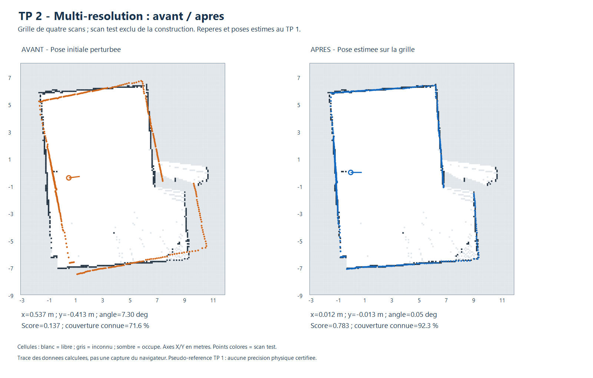
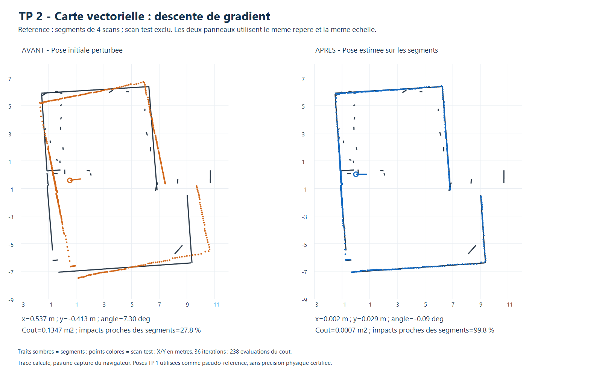
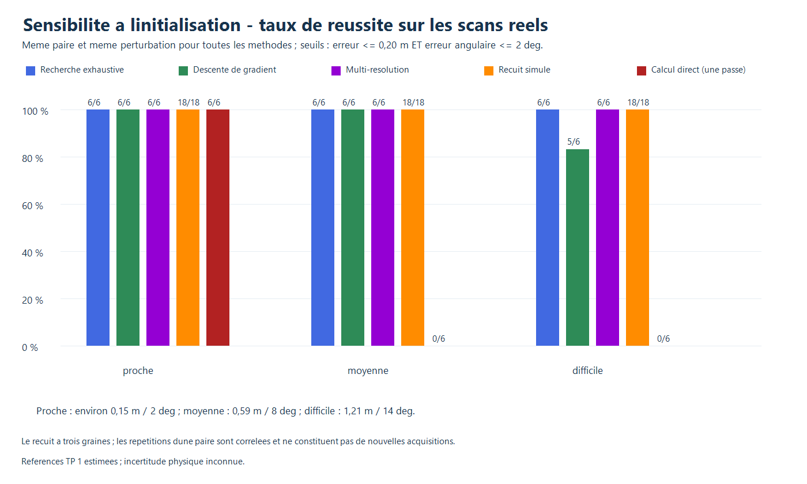
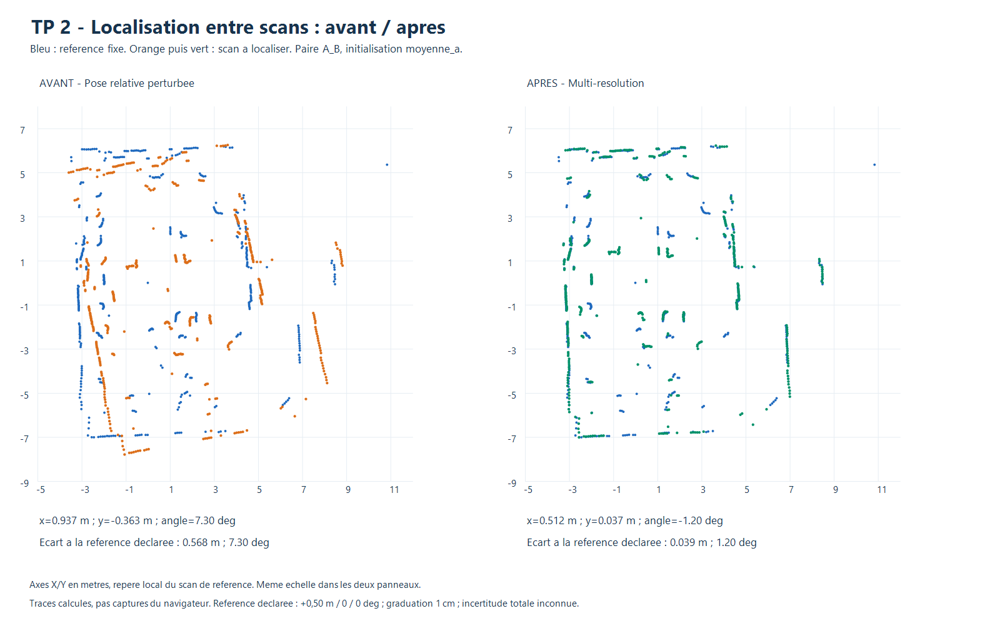
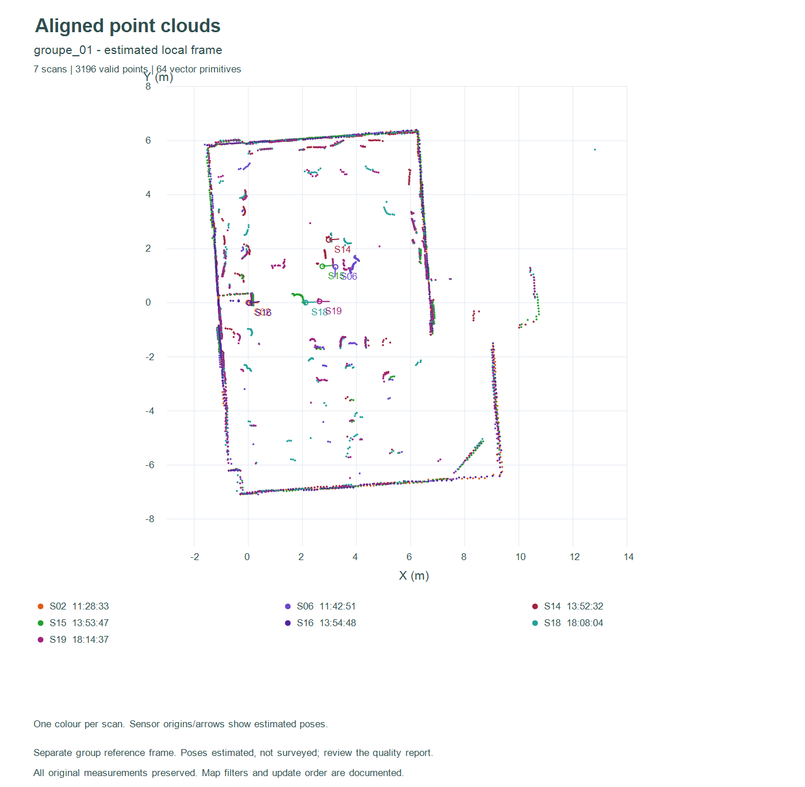

# TP 2 - Localisation 2D par scan matching

## Rapport de réalisation et d'évaluation

**Projet TP-Lidar - LD06 et ESP32**

**Rapport : 4 novembre 2026 - acquisitions : 3 novembre 2026**

### Objectif

Estimer la pose plane d'un scan lidar par rapport à trois types de référence : une grille d'occupation, une carte vectorielle et un autre scan. Le minimum attendu est une méthode fonctionnelle par référence, accompagnée d'une évaluation chiffrée. Plusieurs méthodes ont été réalisées pour étudier les compromis entre coût, précision et sensibilité à l'initialisation.

### Réalisations

| Référence | Méthodes réalisées |
|---|---|
| Grid map | Exhaustive, gradient, pyramide multi-résolution, recuit simulé ; variante corrélative à trois niveaux |
| Carte vectorielle | Exhaustive, gradient, multi-résolution, recuit simulé, calcul direct sur segments |
| Scan de référence | Exhaustive, gradient, multi-résolution, recuit simulé, calcul rigide direct en une passe |

Les moteurs sont intégrés au visualiseur du TP1. Chaque estimation est contrôlable et exportable ; elle n'est appliquée au scan qu'après une action explicite. Les références restent fixes pendant la localisation.

### Trois niveaux de référence expérimentale

**Simulation :** poses connues exactement dans le simulateur, avec mesures synthétiques bruitées. Les erreurs de pose y sont interprétables par rapport à la vérité simulée.

**Anciennes acquisitions réelles :** poses estimées au TP1, utilisées comme pseudo-références. Les écarts mesurent une cohérence entre traitements ; ils ne prouvent pas une précision physique absolue.

**Nouvelle paire A/B :** déplacement déclaré de 50 cm vers 0°, sans rotation. Le mètre est gradué à 1 cm ; les incertitudes de centrage, de placement latéral et d'orientation sont inconnues. Les écarts restent nominaux.

Les résultats présentés proviennent des bilans JSON enregistrés. Aucun échec n'est remplacé par une autre méthode. Les figures sont des tracés des données calculées.


<!-- page -->

## 1. Données et protocole commun

### Transformation et unités

Les mesures sont exprimées en mètres ; les angles affichés sont en degrés. Les coordonnées du LD06 corrigent le sens horaire par y = -r sin(alpha), avec x = r cos(alpha). Une pose transforme les points locaux dans le repère de la référence :

```text
X = x + cos(theta) * px - sin(theta) * py
Y = y + sin(theta) * px + cos(theta) * py
```

Entre scans, la transformation estimée va du scan courant vers le scan de référence. Une pose globale affichée se compose avec cette transformation relative ; elle ne s'additionne pas composante par composante.

### Critères chiffrés

```text
e_position = sqrt((x_estime-x_ref)^2 + (y_estime-y_ref)^2)
e_angle = abs(angle_normalise(theta_estime-theta_ref))
succes = (e_position <= 0,20 m) ET (e_angle <= 2 degres)
```

Le temps est mesuré en millisecondes dans les évaluateurs Node.js. Les bilans ont été produits avec Node.js 24.22.1 sur Intel Core i5-6300U. Les temps dépendent de la charge du PC, du JIT, du nombre de points et de la taille de la référence. L'interface ajoute des pauses pour permettre l'annulation : ses temps ne sont pas directement comparables.

### Comparabilité des essais

Pour la grille et la carte vectorielle, trois poses simulées et cinq scans réels sont testés avec trois mêmes perturbations : (+0,537 ; -0,413 ; +7,3°), (-0,467 ; +0,559 ; -8,2°), (+0,263 ; +0,371 ; +5,4°). Cela donne 9 essais simulés et 15 réels par méthode déterministe. Le recuit est répété sur trois graines : 27 et 45 essais.

Pour les scans réels de ces deux références, une carte est reconstruite avec quatre scans et le cinquième est exclu de l'insertion. Toutefois, les poses du TP1 ont été obtenues avec le groupe complet : cette dépendance empêche de présenter le protocole comme une validation physique indépendante.

Entre scans, le protocole renforcé utilise trois paires simulées, trois paires réelles et six initialisations identiques pour toutes les méthodes. Les résultats de cette campagne et de la paire A/B sont séparés.

Les comparaisons portent sur les mêmes données au sein de chaque famille de référence. Les fonctions de coût et les campagnes diffèrent entre familles : un classement global de leurs précisions ou de leurs temps serait injustifié.


<!-- page -->

## 2. Localisation sur grille d'occupation

### Score et algorithmes

La carte comporte des cellules occupées, libres et inconnues. Un champ de distance de chanfrein à huit voisins approxime la distance aux cellules occupées. Le score corrélatif utilise exp(-d²/(2 sigma²)), interpolé bilinéairement aux impacts transformés. Les impacts inconnus ou hors carte valent zéro et restent au dénominateur. Ce score n'est pas une probabilité.

**Exhaustive :** toutes les 13 671 poses de la fenêtre ±1 m par axe et ±15°, aux pas de 0,10 m et 1°, sont évaluées. La garantie porte seulement sur ce domaine discret.

**Gradient :** minimisation d'un champ min(d, 1 m)², pénalité de 1 m² pour l'inconnu et l'extérieur ; dérivées par différences centrales et recherche de pas d'Armijo, jusqu'à 100 itérations. Les variables sont (dx, dy, 2 dtheta_rad).

**Multi-résolution :** pyramide de cartes de 40, 20 et 10 cm, avec pas de poses 40 cm/4°, 10 cm/1°, puis 2,5 cm/0,25° ; quatre hypothèses au plus passent au niveau suivant. La variante corrélative initiale affine les poses sur une même grille, sans pyramide ; elle est indiquée séparément.

**Recuit :** exploration stochastique bornée avec graines reproductibles ; le meilleur candidat est conservé. Il ne produit pas de distribution de pose calibrée. Les méthodes ajoutées utilisent tous les points acceptés ; la variante corrélative initiale sous-échantillonne sa recherche puis réévalue ses finalistes.

### Simulation - poses connues

| Méthode | Succès / essais | XY moyen (m) | Angle moyen (°) | Temps (ms) |
|---|---:|---:|---:|---:|
| Exhaustive | 9/9 | 0,086 | 0,37 | 241,6 |
| Gradient | 5/9 | 0,168 | 0,03 | 12,8 |
| Multi-résolution | 9/9 | 0,079 | 0,17 | 132,3 |
| Recuit (3 graines) | 27/27 | 0,071 | 0,03 | 64,0 |
| Corrélative 3 niveaux | 9/9 | 0,081 | 0,19 | 238,0 |

### Données réelles - pseudo-références du TP1

| Méthode | Succès / essais | XY moyen (m) | Angle moyen (°) | Temps (ms) |
|---|---:|---:|---:|---:|
| Exhaustive | 15/15 | 0,049 | 0,42 | 344,3 |
| Gradient | 13/15 | 0,046 | 0,26 | 23,3 |
| Multi-résolution | 15/15 | 0,015 | 0,18 | 167,8 |
| Recuit (3 graines) | 45/45 | 0,015 | 0,23 | 91,3 |
| Corrélative 3 niveaux | 15/15 | 0,015 | 0,18 | 213,7 |

Le gradient échoue sur 4/9 essais simulés et 2/15 réels. Les cellules inconnues et les minima locaux limitent sa convergence. Les autres méthodes satisfont les seuils sur ce jeu ; cela ne garantit pas leur réussite dans une autre salle ou hors fenêtre.


<!-- page -->

## 3. Localisation sur carte vectorielle

### Distance aux primitives et coût robuste

La référence reste une liste de segments finis. Pour chaque impact transformé, projeter sur chaque segment, borner le paramètre de projection dans [0,1], puis retenir la distance minimale. Les boîtes englobantes accélèrent les comparaisons sans modifier cette distance.

```text
t = clamp(dot(P-A, B-A) / dot(B-A, B-A), 0, 1)
Q = A + t*(B-A)
E(pose) = moyenne(min(distance(P, carte)^2, 0,50^2))
```

Tous les points acceptés restent au dénominateur. Le gradient analytique ignore les contributions saturées et utilise Armijo. La multi-résolution regroupe le scan à 40 puis 20 cm avant de reprendre tous ses points ; la carte ne devient pas une grille. L'exhaustif teste le domaine discret commun. Le recuit utilise huit chaînes de 400 propositions, sur trois graines, avec une température décroissante de 0,04 à 0,00002.

Le **calcul direct** associe les segments depuis l'initialisation, estime la rotation par moyenne pondérée des angles doublés, puis résout un système de normales 2×2 pour la translation. Il utilise un objectif géométrique différent du coût point-segment. Des directions parallèles rendent la translation inobservable : rapport de valeurs propres inférieur à 0,001, correspondances insuffisantes ou solution hors fenêtre entraînent un refus.

### Simulation - poses connues

| Méthode | Succès / essais | XY moyen (m) | Angle moyen (°) | Temps (ms) |
|---|---:|---:|---:|---:|
| Exhaustive | 9/9 | 0,046 | 0,41 | 478,1 |
| Gradient | 9/9 | 0,00015 | 0,003 | 11,0 |
| Multi-résolution | 9/9 | 0,014 | 0,13 | 134,6 |
| Recuit (3 graines) | 27/27 | 0,001 | 0,02 | 128,3 |
| Direct sur segments | 9/9 | 0,009 | 0,01 | 4,0 |

### Données réelles - pseudo-références du TP1

| Méthode | Succès / essais | XY moyen (m) | Angle moyen (°) | Temps (ms) |
|---|---:|---:|---:|---:|
| Exhaustive | 15/15 | 0,071 | 0,39 | 1864,4 |
| Gradient | 15/15 | 0,042 | 0,21 | 41,2 |
| Multi-résolution | 15/15 | 0,046 | 0,23 | 472,8 |
| Recuit (3 graines) | 45/45 | 0,042 | 0,22 | 434,3 |
| Direct sur segments | 15/15 | 0,034 | 0,29 | 3,6 |

Toutes les méthodes satisfont les seuils sur ces configurations locales. Le direct est très rapide ici, grâce à des associations et directions exploitables ; ce résultat ne s'étend pas aux cas dégénérés. Les petits écarts simulés restent liés à la géométrie et au bruit synthétiques.


<!-- page -->

## 4. Exemples visuels sur les deux cartes

### Grille - recherche par pyramide multi-résolution



Le scan test est comparé à une grille construite sans ses impacts. Les zones grises restent inconnues. La superposition après optimisation illustre la cohérence avec cette carte ; elle n'établit pas une vérité terrain indépendante.

### Carte vectorielle - descente de gradient



Les primitives constituent seules la référence. Le fond blanc ne signifie pas espace libre. La carte simplifiée peut omettre de petits objets ; la troncature limite leur influence sans les expliquer. Ces figures présentent un exemple par méthode, tandis que les tableaux précédents agrègent tous les essais enregistrés.


<!-- page -->

## 5. Localisation entre scans : construction

### Référence et filtrage communs

Le scan courant et la référence proviennent de captures différentes. Les distances positives jusqu'à 12 m sont conservées ; le filtre d'intensité est désactivé par défaut. Les deux nuages sont regroupés en centroïdes de carrés de 10 cm, identiquement pour toutes les méthodes du benchmark. Les sources brutes restent intactes.

Un arbre k-d 2D recherche exactement le plus proche voisin de chaque impact transformé. Le coût est la moyenne de min(distance², 0,50²), orientée du scan courant vers la référence. Tous les points traités restent au dénominateur. Des fractions de voisins à moins de 20 cm sont aussi calculées dans les deux sens pour diagnostiquer le recouvrement.

### Cinq méthodes sur les mêmes entrées

**Exhaustive :** fenêtre ±1 m par axe et ±15°, pas 10 cm et 1°, soit 13 671 candidats. Le meilleur coût discret est retenu, sans raffinement caché.

**Gradient :** dérivées analytiques point-à-point à voisins courants fixés, contributions saturées nulles ; pas normalisé initial 0,25, recherche d'Armijo avec au plus 14 réductions, budget de 100 itérations. La fenêtre est conservée par projection.

**Multi-résolution :** deux nuages regroupés à 40 puis 20 cm avant le niveau commun de 10 cm. Les pas de pose sont 40 cm/4°, 10 cm/1°, 2,5 cm/0,25°. Quatre hypothèses distinctes au plus sont conservées. Cet élagage est heuristique.

**Recuit simulé :** huit chaînes de 400 propositions ; la première commence à l'initialisation, les autres à des poses aléatoires dans la fenêtre. Les dégradations peuvent être acceptées avec exp(-deltaE/T). La température diminue de 0,04 à 0,00002. Trois graines sont évaluées : 20261103, 20261104, 20261105.

**Calcul direct en une passe :** une seule association au plus proche voisin depuis la pose initiale, avec distance inférieure à 50 cm ; centrage des couples puis rotation par atan2(somme_cross, somme_dot), et translation entre barycentres. La correction est composée avec la pose initiale. Il n'y a ni réassociation ni boucle ICP : une mauvaise association initiale peut produire une mauvaise pose.

### Sécurité et interprétation

Le même scan en référence et en requête est refusé, y compris par empreinte. Le budget limite les évaluations à 12 millions de points et l'exhaustif à 500 000 poses. Les recherches sont annulables. Un score de correspondance ou un faible résidu ne constitue ni une incertitude de pose, ni une probabilité physique de succès.


<!-- page -->

## 6. Comparaison entre scans : résultats communs

### Constitution des paires

Les trois paires simulées sont acquises par lancers de rayons séparés, avec bruit de portée indépendant déterministe de ±4 mm ; ce ne sont pas des copies rigidement transformées d'un même nuage. Les espacements entre poses sont environ 0,18, 0,36 et 0,29 m.

Les trois paires réelles R1, R2 et R3 proviennent respectivement des groupes 1, 2 et 4 du TP1. Leurs distances estimées sont environ 0,04, 0,06 et 0,73 m. R3 ne présente qu'environ 48 % de recouvrement selon le diagnostic historique : cette paire difficile est conservée.

Chaque paire est testée avec six perturbations. Les quatre méthodes déterministes sont lancées une fois et le recuit trois fois : **252 exécutions**, réparties également entre simulation et réel. Un échauffement fixe est exclu du temps ; l'ordre des méthodes est alterné. Les initialisations sont identiques entre méthodes pour une même configuration.

### Simulation - poses connues

| Méthode | Succès / essais | XY moyen (m) | Angle moyen (°) | Temps (ms) |
|---|---:|---:|---:|---:|
| Exhaustive | 18/18 | 0,038 | 0,47 | 1149,5 |
| Gradient | 18/18 | 0,009 | 0,29 | 10,1 |
| Multi-résolution | 18/18 | 0,015 | 0,35 | 296,8 |
| Recuit (3 graines) | 54/54 | 0,008 | 0,35 | 214,6 |
| Direct, une passe | 6/18 | 0,566 | 7,61 | 1,6 |

### Données réelles - pseudo-références du TP1

| Méthode | Succès / essais | XY moyen (m) | Angle moyen (°) | Temps (ms) |
|---|---:|---:|---:|---:|
| Exhaustive | 18/18 | 0,053 | 0,55 | 1217,5 |
| Gradient | 17/18 | 0,095 | 0,42 | 25,6 |
| Multi-résolution | 18/18 | 0,039 | 0,36 | 379,5 |
| Recuit (3 graines) | 54/54 | 0,038 | 0,40 | 298,5 |
| Direct, une passe | 6/18 | 0,586 | 7,81 | 1,6 |

Le direct ne réussit que les initialisations proches. Le gradient échoue sur R3 avec l'initialisation difficile_a : l'écart de position atteint environ 1,13 m malgré un écart angulaire inférieur à 2°. Les méthodes exhaustive, multi-résolution et recuit satisfont les seuils de ce jeu.

Les moyennes incluent les solutions incorrectes. Aucune exécution de cette campagne n'a été rejetée. Les répétitions d'une paire restent corrélées : ces taux décrivent les essais exécutés et non une probabilité de réussite dans toute scène.


<!-- page -->

## 7. Sensibilité à l'initialisation

Les six perturbations sont ajoutées aux poses de référence ou de pseudo-référence, puis transmises identiquement aux cinq méthodes. La pose attendue reste dans la fenêtre ±1 m sur chaque axe ; la norme de translation peut néanmoins dépasser 1 m.

| Initialisation | dx (m) | dy (m) | dtheta (°) |
|---|---:|---:|---:|
| proche_a | +0,113 | -0,087 | +2,3 |
| proche_b | -0,127 | +0,093 | -2,2 |
| moyenne_a | +0,437 | -0,363 | +7,3 |
| moyenne_b | -0,417 | +0,453 | -8,2 |
| difficile_a | +0,913 | -0,787 | +14,3 |
| difficile_b | -0,863 | +0,847 | -14,2 |



Chaque niveau regroupe six essais déterministes sur les trois paires, ou dix-huit pour le recuit. Le direct atteint 6/6 sur les poses proches, puis 0/6 aux niveaux moyen et difficile. Le gradient atteint 6/6, 6/6 puis 5/6. Les trois autres méthodes satisfont les seuils à chaque niveau dans cette campagne.

La recherche exhaustive est limitée par son pas discret et son temps. Le gradient est rapide mais local. Le direct est encore plus rapide, à condition que les correspondances initiales soient déjà pertinentes. La multi-résolution et le recuit élargissent l'exploration avec un budget réduit, sans garantie d'optimum global.

Ces résultats justifient de contrôler la sensibilité avant de choisir une méthode pour le robot, plutôt que de sélectionner seulement le meilleur exemple visuel.


<!-- page -->

## 8. Nouvelle mesure réelle A/B

### Acquisition et référence opérateur

Deux tours contrôlés ont été sauvegardés le 3 novembre 2026, via COM3 à 115200 bauds : A à 18:08:04, B à 18:14:37, heure de Paris. Chaque scan contient 456 distances positives ; les amplitudes angulaires contrôlées sont respectivement 359,17° et 359,45°. Le contrôle des indices et angles ne prouve pas l'immobilité du capteur.

L'opérateur déclare **50 cm vers le triangle 0° du LD06, sans rotation**, soit (+0,50 m ; 0 m ; 0°) dans le repère de A. La graduation du mètre est de 1 cm. Les marges totales de centrage et de placement ainsi que l'erreur angulaire sont inconnues ; les champs correspondants restent à null, jamais à zéro. La graduation seule ne justifie pas une borne totale de ±0,5 cm.

### Comparaison nominale - six initialisations, 42 exécutions

| Méthode | Succès / essais | XY moyen (m) | Angle moyen (°) | Temps (ms) |
|---|---:|---:|---:|---:|
| Exhaustive | 6/6 | 0,039 | 1,28 | 2196,0 |
| Gradient | 4/6 | 0,367 | 4,60 | 42,3 |
| Multi-résolution | 6/6 | 0,040 | 1,08 | 696,5 |
| Recuit (3 graines) | 18/18 | 0,037 | 1,05 | 517,1 |
| Direct, une passe | 2/6 | 0,594 | 7,65 | 5,3 |



Dans cet exemple, la multi-résolution estime (0,512 m ; 0,037 m ; -1,20°), soit un écart nominal de 0,039 m et 1,20°. Le seuil de succès reste 0,20 m et 2°. Sur les initialisations difficiles de cette paire, le gradient échoue deux fois ; le direct ne réussit que les deux poses proches.

Une seule paire physique est disponible : les six initialisations ne sont pas six déplacements mesurés. L'incertitude inconnue empêche de certifier les taux physiques et d'attribuer les écarts uniquement à l'algorithme. Un guidage de translation, un centrage borné et un contrôle angulaire indépendant sont nécessaires pour renforcer cette validation.


<!-- page -->

## 9. Intégration aux anciens scans et contexte réel

### Cartes recalculées avec 19 captures

Les 17 acquisitions contrôlées précédentes et A/B totalisent **8 657 points valides**. Les 171 paires ont été évaluées : 136 comparaisons historiques vérifiées sont réutilisées, et 35 nouvelles sont calculées. Le recalage robuste et le contrôle d'ambiguïté retiennent 22 liens, dont cinq nouveaux, sans rejet supplémentaire de boucle.

Le groupe principal passe de cinq à sept scans et de 2 284 à 3 196 points. Nuages, grille à 10 cm, segments et carte vectorielle ont été recalculés. Les autres groupes restent séparés : **sept composantes** subsistent. La fusion globale de 19 scans contient des liens faibles et reste exploratoire.



Le graphe estime A→B à (0,5053 m ; 0,0158 m ; -1,2258°), soit un écart nominal de 0,0167 m et 1,23°. La mesure de 50 cm n'a pas été imposée comme contrainte. Ce résultat diffère du recalage isolé A/B car le graphe utilise plusieurs relations et d'autres filtres. Il ne remplace pas le benchmark de localisation et ne certifie pas une amélioration de la précision absolue.

### Interprétation des photographies

Les deux photographies fournies montrent un îlot central, des tables et chaises, une armoire haute, des murs, stores et personnes. Elles aident à comprendre les occlusions et les retours variables. Le LD06 ne mesure qu'une coupe horizontale à sa hauteur : les éléments hors de ce plan ne contraignent pas la carte 2D.

Aucune dimension n'est déduite du mobilier ou des dalles de plafond. La pose et la calibration de la caméra ainsi que les correspondances photo/lidar sont inconnues. Aucun mur n'est ajouté pour faire ressembler la carte aux photos. Les originaux figurent dans traitement_complet/contexte_salle avec leurs limites d'interprétation.


<!-- page -->

## 10. Utilisation, validation et conclusion

### Rejouer et examiner les résultats

Ouvrir visualisation/index.html dans un navigateur. Les trois panneaux TP2 permettent de choisir une référence, une méthode, une pose initiale et une fenêtre, puis d'estimer, examiner et appliquer explicitement le résultat. Un changement de référence ou de pose invalide un résultat antérieur. Les références ne sont pas modifiées par la localisation.

Pour A/B, choisir l'exemple des captures mesurées dans le panneau entre scans. Pour la cartographie enrichie, charger « 19 scans avec A/B », puis « 19 acquisitions · groupe 1 · 7 scans ». Toute modification de poses demande de reconstruire les cartes déjà intégrées.

### Reproduction depuis la racine du dépôt

```text
node localisation/grid/evaluer.cjs
node localisation/grid/evaluer_exhaustif.cjs
node localisation/grid/evaluer_optimisations.cjs
node localisation/vectorielle/evaluer.cjs
node localisation/entre_scans/evaluer.cjs
node localisation/entre_scans/evaluer_mesures.cjs
python traitement_complet/integrer_ab.py
node traitement_complet/recalculer.cjs resultats_19_scans
```

Les évaluateurs spécifiques vectoriels et leurs paramètres sont indiqués dans les README de chaque méthode. Les scripts de tracé PowerShell reproduisent les figures à partir des JSON enregistrés. Node.js n'utilise pas de dépendance npm pour ces calculs ; le recalage du graphe utilise NumPy. Le présent PDF peut être régénéré avec rapport/generer_TP2.py (ReportLab et pypdf).

### Contrôles et limites

Les tests couvrent transformations de repères, distance aux références, gradient, correspondances rigides, données invalides, doublons, bornes, annulation, résultats périmés et préservation des références. Le contrôle d'interface exécute les gestionnaires dans un DOM minimal ; il ne constitue pas un test visuel complet du navigateur. Les exports des huit jeux de cartes à 19 scans ont été rechargés et contrôlés ; les résultats historiques restent conservés.

Les références connues en simulation permettent de quantifier les erreurs sur ce modèle. Les anciens scans permettent une comparaison interne, et la paire A/B fournit une première confrontation physique nominale. Le minimum algorithmique des trois types de référence est couvert ; la précision réelle reste à valider avec des mesures indépendantes mieux bornées et davantage de paires.

### Sources et traçabilité

Référence pédagogique : « Scan matching.md », Jonathan Quillès, 2026, fourni dans Localisation-20261103 (1).zip ; consignes TP Jour 2 fournies par l'étudiant. Les choix numériques propres à cette réalisation sont détaillés dans les README de localisation/grid, localisation/vectorielle et localisation/entre_scans.

Les tableaux sont extraits des bilans evaluation*.json ; les chemins et SHA-256 exacts figurent dans sources_rapport.json, livré avec le rapport. Les photos sont un contexte qualitatif fourni par l'utilisateur. Les résultats ne sont pas remplacés par des valeurs attendues.
