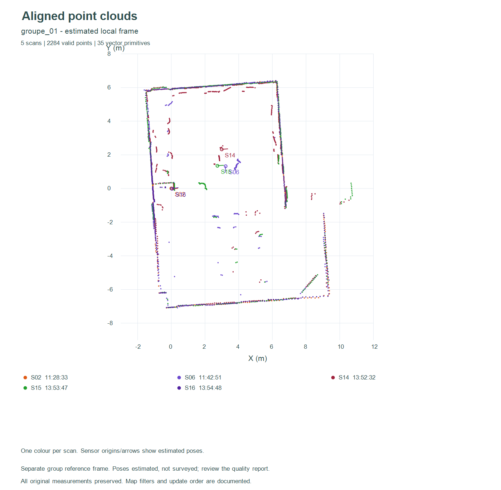
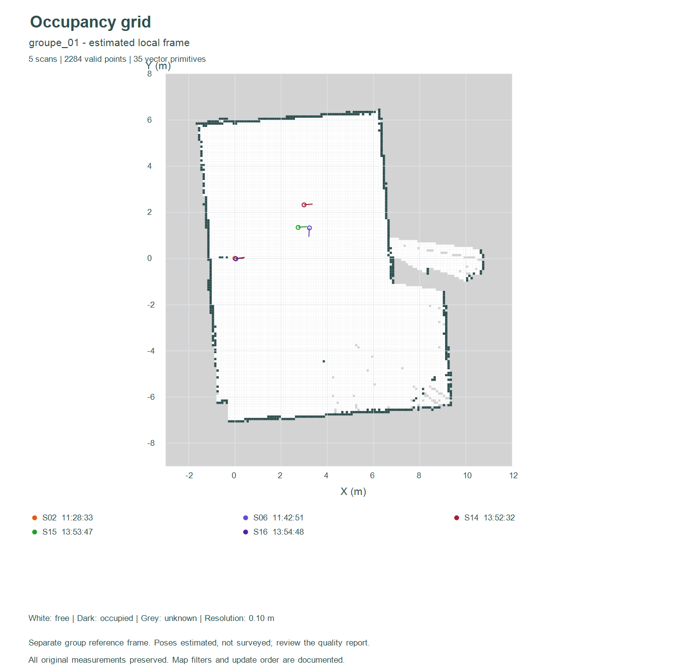
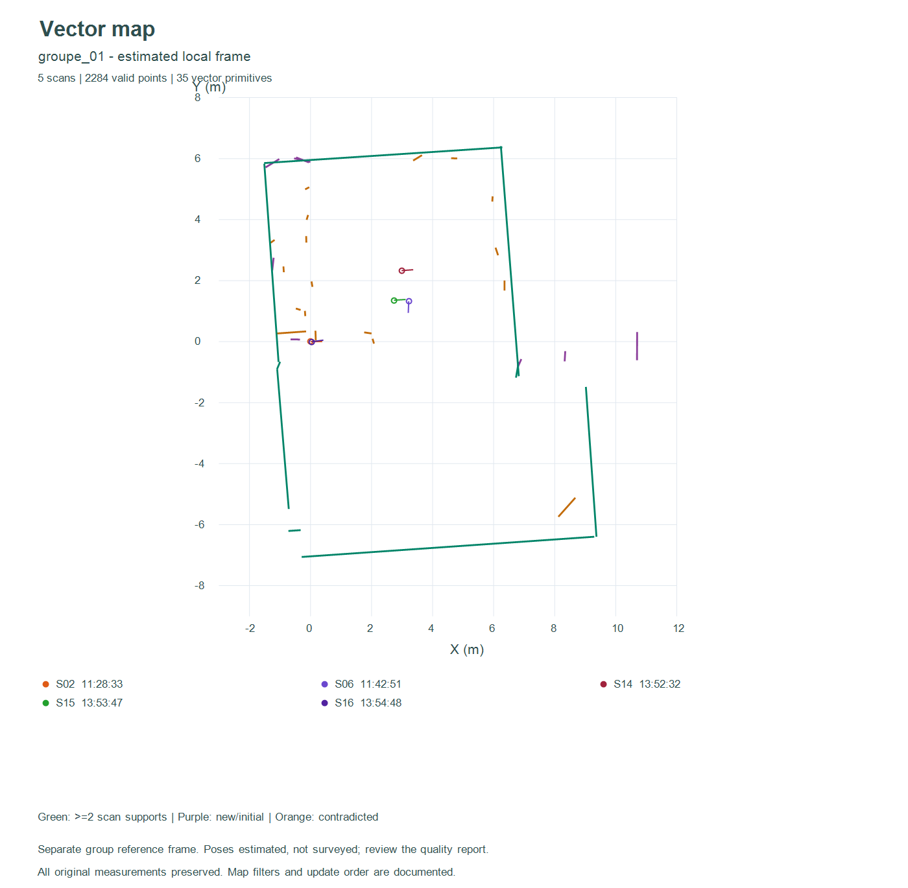

# TP 1 - Extraction, visualisation et cartographie 2D

**Lidar LD06 / ESP32 - Compte rendu du Jour 1**  
Acquisitions du 3 novembre 2026 | Projet TP-Lidar

## Objectif et bilan

Ce travail consiste à acquérir des scans réels de la salle, à les afficher dans
un repère cartésien, puis à construire deux représentations de l'environnement :
une grille d'occupation et une carte vectorielle. Un atelier géométrique fournit
les opérations sur les segments nécessaires à la seconde représentation.

Les cinq étapes sont réunies dans un outil local en HTML et JavaScript. Les scans
et leurs poses sont communs aux différents affichages ; la grille, l'atelier de
segments et la carte vectorielle conservent chacun leurs propres données.

| Étape | Réalisation |
|---|---|
| 1. Extraction | Acquisitions série, sauvegarde CSV et contrôle des tours |
| 2. Visualisation | Nuages cartésiens, couleurs distinctes, poses indépendantes |
| 3. Grid map | Création, mise à jour et sauvegarde d'une carte à trois états |
| 4. Segments | Extraction, angle, proximité, fusion, intersection et découpage |
| 5. Carte vectorielle | Intégration successive, fusion, confirmations et nettoyage |

## Résultats à retenir

Le jeu actif contient **17 scans contrôlés et 7 745 points valides** : six
captures initiales et onze nouvelles acquisitions. Les fichiers bruts restent
conservés ; les blocs comportant plusieurs séquences sont remplacés dans les
calculs par une séquence contrôlée.

Le recalage fournit **sept groupes dans des repères locaux indépendants**.
Le groupe le plus fourni réunit cinq scans : ses 116 segments extraits conduisent
à 35 primitives vectorielles finales. Une fusion exploratoire de tous les scans
est disponible, mais ses liaisons entre groupes ne sont pas validées.

**Portée du résultat :** l'outil et les traitements sont réalisés. La précision
absolue de la carte de salle n'est pas établie, faute de poses physiques et de
dimensions de référence relevées pendant les acquisitions.

<!-- page -->

## 1. Acquisition et contrôle des données

### Matériel et communication

Le lidar LD06 est relié à un ESP32, connecté au PC Windows en USB sur COM3.
Le programme fourni, `ESP32_LD06_Test.ino`, utilise la bibliothèque LD06 du cours.

| Liaison | Configuration prévue par le programme |
|---|---|
| TX du LD06 vers l'ESP32 | GPIO33, réception Serial2 |
| Commande moteur du LD06 | GPIO32 |
| Masse | Commune au lidar et à l'ESP32 |
| Alimentation LD06 | 5 V selon les ressources ; source réelle à préciser |
| LD06 vers ESP32 | 230400 bauds, 8N1 |
| ESP32 vers PC | 115200 bauds, 8N1 |

Le câblage physique n'a pas été inspecté directement. Le modèle exact de carte
et les versions de la bibliothèque et du cœur ESP32 restent à documenter.

### Procédure

- Libérer le port série et attendre le signal « prêt » de l'opérateur.
- Demander l'immobilité du lidar pendant la capture, sans prétendre l'avoir mesurée.
- Enregistrer un bloc CSV horodaté, puis vérifier les colonnes et les indices.
- Contrôler la progression angulaire ; sauvegarder les bruts, le contrôle et le tracé.

Les colonnes sont `point_index`, `angle_deg`, `dist_mm`, `intensity`, `x_lib_mm`
et `y_lib_mm`. Les données polaires nécessaires au TP sont donc conservées,
même lorsque les traitements utilisent les coordonnées cartésiennes fournies.

### Constitution du jeu actif

| Série | Scans | Mesures retenues | Points valides | Retours nuls |
|---|---:|---:|---:|---:|
| Initiale | 6 | 2 741 | 2 737 | 4 |
| Nouvelle | 11 | 5 019 | 5 008 | 11 |
| Total actif | 17 | 7 760 | 7 745 | 15 |

Les anciens blocs de 1 061 et 956 mesures ont été contrôlés et leurs séquences
« tour2 » de 456 et 457 points retenues. Trois nouveaux blocs longs de 1 063,
1 026 et 987 mesures donnent chacun une séquence contrôlée de 457 points.
Le contrôle de la nouvelle série exige des indices continus, des angles
décroissants, un départ au-delà de 357°, une fin sous 3°, une amplitude d'au
moins 357° et des pas d'au plus 3°. Ce contrôle numérique n'est pas une mesure
indépendante de la rotation physique. Les captures archivées du 2 novembre ne
font pas partie des 17 scans actifs.

<!-- page -->

## 2. Visualisation cartésienne et poses

Les distances sont converties des millimètres vers les mètres. Si les coordonnées
cartésiennes figurent dans le CSV, elles sont utilisées directement après conversion.
Pour un CSV polaire seul, la convention horaire par défaut utilise :

```text
x_local = r cos(alpha) ; y_local = -r sin(alpha)
X = x_pose + cos(theta) x_local - sin(theta) y_local
Y = y_pose + sin(theta) x_local + cos(theta) y_local
```

Le sens angulaire est réglable. Chaque scan possède une couleur distincte,
une visibilité et une pose indépendante `(x, y, theta)`. L'utilisateur peut
ainsi déplacer manuellement chaque nuage sans modifier les acquisitions sources.
Les poses sont sauvegardables en JSON et les points transformés exportables.

### Estimation complémentaire des poses

Les positions physiques n'ont pas été relevées. Un traitement séparé compare
les 136 paires possibles : recherche de rotations, translations par corrélation,
puis raffinement ICP. Pour ce recalage seulement, un filtre retient les distances
de 0,20 à 12 m et les intensités d'au moins 100, avec sous-échantillonnage à 8 cm
et contrôle des voisins. Ces filtres ne suppriment pas les points des bruts.

Un lien exige notamment 45 % de recouvrement dans chaque direction, une erreur
RMSE d'au plus 12 cm et un écart suffisant avec une solution concurrente.
Les 17 liens retenus forment sept groupes. Des ajustements de poses et contrôles
de boucle complètent cette sélection ; ils ne certifient pas les poses.



**Figure 1.** Superposition du groupe de cinq scans avec les poses estimées.
Les groupes différents ne partagent pas un repère global validé. Le constructeur
de carte utilise les poses fournies ; il ne réalise pas à lui seul un SLAM.

<!-- page -->

## 3. Construction et mise à jour de la grid map

La méthode suit le document du cours : définir la grille, transformer les points,
libérer les cellules traversées et marquer les impacts. Trois états catégoriels
sont utilisés : **libre = 0, inconnu = 127, occupé = 255**. Une cellule non
observée reste inconnue ; ces valeurs ne sont pas des probabilités.

La résolution est de **0,10 m**. Pour un point global `(X, Y)`, les indices sont
obtenus par plancher : `i = floor((X - origine_X) / resolution)`, et de même pour
`j`. Cette convention traite aussi les coordonnées négatives.

### Intégration d'un scan et de sa pose

- Filtrer les distances invalides et les retours dépassant la portée retenue.
- Transformer les points et utiliser la pose comme origine des rayons.
- Parcourir les cellules avec Bresenham : avant l'impact, les marquer libres.
- Marquer la cellule d'impact occupée, avec priorité sur les traversées du même scan.

Un impact hors carte ne crée pas d'obstacle au bord : seul le parcours intérieur
est libre. Une origine hors carte est refusée. Une mesure rejetée ne libère rien.
Lors d'un nouveau scan, la dernière observation remplace l'état des cellules
observées ; les autres restent inchangées. La carte peut être sauvegardée,
rechargée puis complétée en JSON ; le CSV exporte la grille.



**Figure 2.** Grille du groupe 1 : 150 × 170 cellules, soit 15 × 17 m ;
11 410 cellules libres, 515 occupées et 13 575 inconnues, pour un total de 25 500.

Un exemple distinct à deux scans vérifie la reprise d'une grille : 390 cellules
changent d'état. Le modèle reste sensible au bruit et à l'ordre d'intégration.
Il n'intègre ni vieillissement temporel ni accumulation probabiliste.

<!-- page -->

## 4. Extraction et manipulation des segments

Les points successifs sont séparés lorsque leur écart dépasse **0,30 m**.
Chaque groupe est ajusté par PCA orthogonale, puis subdivisé si son résidu dépasse
**0,05 m**. Un segment doit contenir au moins **5 points** et mesurer **0,15 m**.
Ce choix fournit une représentation simple des parois ; les courbes sont
approximées par plusieurs segments.

### Opérations géométriques réalisées

| Opération | Méthode et comportement |
|---|---|
| Angle | Comparaison des directions ; angle entre supports de 0 à 90° |
| Proximité | Angle au plus 8° et distance entre segments finis au plus 0,12 m |
| Fusion | Ajustement sur quatre extrémités puis conservation des projections extrêmes |
| Intersection | Calcul du croisement et vérification de son appartenance aux deux segments finis |
| Découpage | Coupe du segment A traversé par B ; conservation du côté le plus long |

La fusion pondère également les extrémités, sans régression sur tous les points
d'origine. La proximité est un critère géométrique : deux segments proches ne
représentent pas nécessairement le même objet physique.

### Tolérances et cas limites du découpage

La tolérance métrique est **EPS = 1e-9 m**. Le parallélisme est testé sur le
sinus entre directions normalisées avec une tolérance sans unité de **1e-12**.
Une coupe exige une intersection sur les deux segments et strictement à
l'intérieur de A, à plus d'EPS de ses deux extrémités.

| Cas testé | Résultat attendu |
|---|---|
| Intersection intérieure aux deux segments | Garder le côté le plus long de A |
| Croisement des droites, hors d'un segment | A inchangé |
| Intersection à une extrémité de A | A inchangé |
| Extrémité de B touchant l'intérieur de A | Coupe possible |
| Segments colinéaires, même superposés | A inchangé |
| Côtés égaux à EPS près | Garder le côté contenant le premier point de A |
| Segment dégénéré de longueur nulle | Pas de coupe |

L'atelier permet d'exécuter ces opérations, d'annuler des modifications et
d'exporter les segments. Les **38 contrôles dédiés** couvrent notamment les
intersections finies, les extrémités, la colinéarité et les égalités de longueur.
Conserver uniquement le plus long côté peut supprimer une portion réelle de mur :
c'est le comportement demandé, sans garantie de préservation de la topologie.

<!-- page -->

## 5. Construction de la carte vectorielle

La méthode reprend les six étapes du document du cours. La carte est une liste
de segments : identifiant, deux extrémités métriques, scans confirmants et compteur
de contradictions. Elle démarre vide ou depuis une géométrie de l'atelier.

- **Préparer :** filtrer les retours et appliquer la pose de chaque scan.
- **Extraire :** réutiliser la segmentation et la PCA de l'étape 4.
- **Comparer :** chercher les primitives proches en angle et en position.
- **Intégrer :** ajouter une primitive nouvelle ou fusionner les correspondances.
- **Contrôler les absences :** tester les anciens segments non soutenus par le scan.
- **Maintenir :** enregistrer l'historique, sauvegarder et intégrer les scans suivants.

Pour le nettoyage, au moins **trois directions distinctes** doivent traverser
l'intérieur d'un ancien segment à plus de **15 cm avant leur impact**. La
traversée médiane est utilisée pour une seule réduction par primitive et par scan.
Après **trois scans contradictoires depuis la dernière confirmation**, la
primitive est retirée ; un fragment trop court l'est également.

Un scan confirmant remet les contradictions à zéro. Les fragments d'un même
scan ne comptent qu'une fois comme confirmation. Un secteur non observé ne
vieillit pas et n'est pas supprimé. Ces compteurs ne sont pas des probabilités.



**Figure 3.** Carte locale obtenue après cinq scans : **35 primitives**, dont
13 confirmées par plusieurs scans et 18 portant des contradictions. Ces deux
catégories peuvent se recouvrir. Vert : confirmé ; violet : observation unique
ou géométrie initiale ; orange : contradiction enregistrée.

Une contradiction peut résulter du bruit ou d'une erreur de pose. Les cercles,
arcs, portes et polygones fermés ne sont pas reconnus automatiquement. Le JSON
conserve l'historique ; le CSV exporte les quatre coordonnées des extrémités.

<!-- page -->

## 6. Résultats d'ensemble et discussion

Les paramètres des cartes sont communs : résolution de grille 10 cm, portée
maximale 12 m, seuil d'intensité nul, rupture 30 cm, résidu 5 cm, fusion à 8° et
12 cm. Le filtre d'intensité plus strict du recalage ne s'applique pas aux cartes.
Tous les points de distance positive restent dans les exports de points alignés.

| Résultat | Scans | Points valides | Segments extraits | Primitives finales |
|---|---:|---:|---:|---:|
| Groupe 1 | 5 | 2 284 | 116 | 35 |
| Groupe 2 | 3 | 1 368 | 72 | 34 |
| Groupe 3 | 3 | 1 369 | 62 | 37 |
| Groupe 4 | 2 | 907 | 57 | 42 |
| Groupe 5 | 2 | 906 | 38 | 25 |
| Groupe 6 | 1 | 454 | 31 | 31 |
| Groupe 7 | 1 | 457 | 16 | 16 |
| Fusion exploratoire | 17 | 7 745 | 392 | 85 |

La dernière ligne réutilise les mêmes acquisitions : elle ne s'ajoute pas aux
sept groupes. Les primitives ne constituent pas un décompte des murs de la salle.
Le nombre final dépend des poses, des fusions, du nettoyage et de l'ordre des scans.

### Difficultés rencontrées et réponses apportées

- **Blocs longs :** conservation des bruts et sélection de séquences angulaires contrôlées.
- **Repères et unités :** conversion unique en mètres, pose rigide et sens angulaire explicite.
- **Alignements ambigus :** comparaison de plusieurs solutions et maintien de groupes séparés.
- **Effacement excessif :** priorité aux impacts dans une grille et nettoyage vectoriel corroboré.
- **Traçabilité :** paramètres, poses, bilans et données rechargeables conservés avec les images.

### Limites et améliorations

Les déplacements et dimensions de référence n'ont pas été mesurés. L'immobilité
est une hypothèse. Des obstacles mobiles, surfaces réfléchissantes et structures
répétées peuvent perturber les cartes. Les tests logiciels ne mesurent pas une
précision absolue en centimètres.

Pour améliorer la validation, il faudrait relever les positions, orientations
et dimensions de la salle, puis acquérir des scans avec recouvrement maîtrisé.
Une accumulation probabiliste, un vieillissement temporel et des modèles de
courbes pourraient ensuite compléter la version simple. Ils ne sont pas
implémentés dans ce rendu.

<!-- page -->

## 7. Validation et reproduction

**92 contrôles JavaScript** : 12 pour la lecture, les couleurs et les poses,
17 pour la grille, 38 pour les segments et 25 pour la carte vectorielle.
Ils sont complétés par **6 tests Python de recalage**.

Les contrôles couvrent notamment les rayons, limites de carte, doublons,
rechargements, transformations connues et cas limites géométriques. Une vérification
supplémentaire examine les huit jeux d'exports : sept groupes et une fusion
exploratoire. Les commandes de l'interface ont été exercées dans un DOM minimal ;
cela ne remplace pas une validation graphique complète du navigateur. Les images
calculées ont été inspectées séparément.

### Utiliser le rendu

- Ouvrir `visualisation/index.html` dans Chrome ou Edge, sans serveur.
- Charger les 17 scans, puis un groupe de poses estimées ou régler les poses manuellement.
- Créer une grille ou une carte vectorielle et intégrer les scans visibles.
- Sauvegarder le JSON pour reprendre le travail ; exporter CSV ou PNG pour le présenter.

Après modification des poses, recréer les cartes : déplacer les nuages à l'écran
ne déplace pas les cellules ou primitives déjà enregistrées.

### Rejouer les contrôles depuis la racine du dépôt

```text
node visualisation/test_core.cjs
node visualisation/test_grid.cjs
node visualisation/test_segments.cjs
node visualisation/test_vector.cjs
python traitement_complet/test_alignement.py
node traitement_complet/verifier.cjs
```

Le recalcul des poses utilise Python et NumPy ; les modules de cartographie sont
les mêmes que dans le navigateur. Les scripts de tracé utilisent PowerShell/.NET.
La procédure complète et les versions sont dans `traitement_complet/README.md`.

## Conclusion

Les cinq étapes du TP sont réalisées dans un outil commun et accompagnées de
données réelles, d'exports et de tests. La grid map décrit l'espace observé ;
la carte vectorielle résume ses structures linéaires. La qualité de leur fusion
reste conditionnée par les poses : les résultats locaux doivent être distingués
de l'assemblage global exploratoire.

## Références et pièces du rendu

- Jonathan Quillès, « Construction d'une grid map 2D à partir d'un scan Lidar », 2026, document fourni pour le TP.
- Jonathan Quillès, « Construction d'une carte vectorielle 2D à partir d'un scan lidar », 2026, document fourni pour le TP.
- Programme et ressources LD06 fournis dans le cadre du cours ; provenance conservée dans le code d'acquisition.
- Dépôt : https://github.com/abdeljalilhannaouipro-cyber/TP-Lidar
- Sources et résultats : `nouvelle_serie/`, `controle_scans/`, `traitement_complet/resultats/` ; guides techniques dans `visualisation/`.
