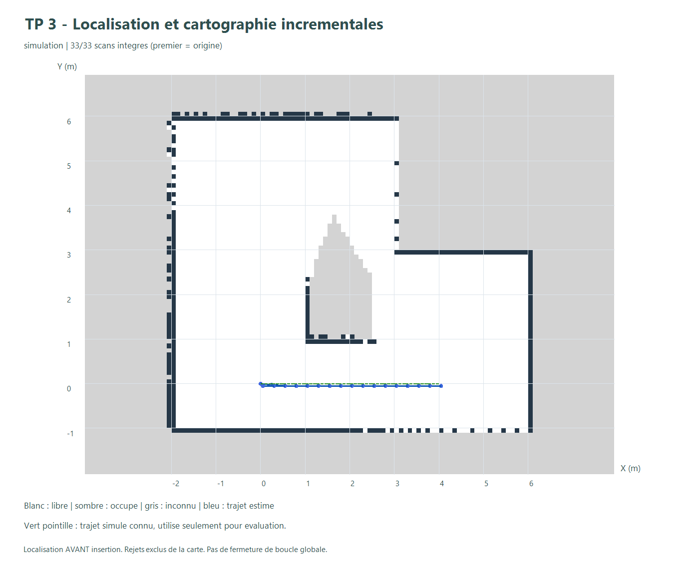
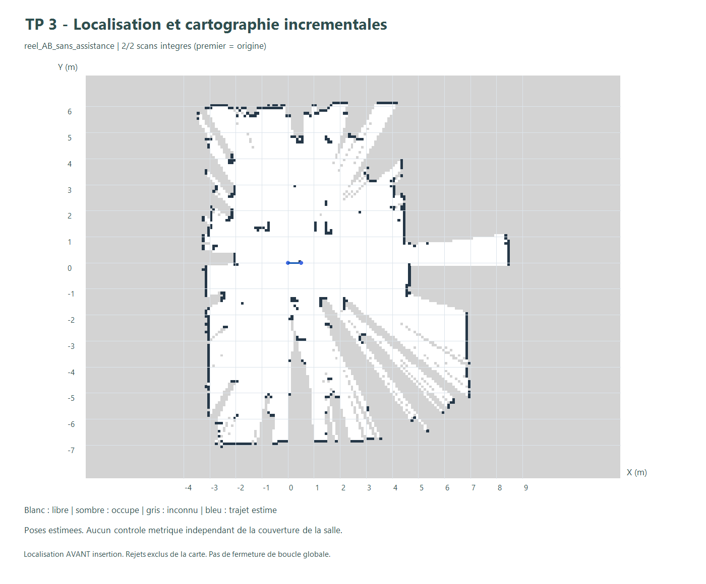

> **Mise à jour après identification du câblage réel :** le robot photographié utilise huit commandes moteur directes. Les anciens programmes moteur I²C cités plus bas sont des versions historiques incompatibles avec ce montage et ne doivent pas être utilisés dessus. Pour poursuivre le TP3, utiliser **TP3_Lidar_USB** et le [parcours guidé](PARCOURS_SALLE.md), sans commande de mouvement. La calibration des quatre roues reste distincte du SLAM.

# TP3 - Intégration incrémentale de la localisation et de la cartographie

Cette étape réunit le scan matching du TP2 et la grid map du TP1. Le moteur
est un **début de SLAM local** : le premier scan fixe un repère, chaque scan
suivant est localisé sur la carte précédente, puis intégré si le contrôle est
satisfait. Les poses et la carte sont estimées successivement dans la même boucle.

Il n'y a pas d'odométrie, de correction globale de dérive ni de fermeture de
boucle. Le retour au point de départ n'est pas une fermeture de boucle optimisée.
Le programme ne garantit ni une exploration autonome, ni la couverture complète
de la salle. Le bonus moteur reste une étape matérielle à valider.

## Utiliser l'outil

Depuis la racine du dépôt :

```powershell
python -m http.server 8766 --bind 127.0.0.1
```

Ouvrir `http://127.0.0.1:8766/slam/` dans un navigateur. La simulation et le
rejeu CSV fonctionnent aussi en ouvrant `slam/index.html` directement.

1. Choisir **Simulation**, **Salle · 7 scans** ou importer des CSV dans l'ordre
   de leur acquisition. L'import est préparé entièrement avant de remplacer le jeu.
2. Créer une session vide si nécessaire. La grille mesure 40 × 40 m à 10 cm ;
   cette taille de stockage n'est pas une mesure de la salle.
3. **Scan suivant** localise, contrôle puis intègre un seul scan. **Rejouer la
   suite** s'arrête au premier refus ; les scans déjà intégrés sont conservés.
4. La simulation utilise uniquement la dernière pose acceptée comme estimation
   initiale. L'exemple de salle utilise explicitement les poses TP1 comme aide :
   ce n'est pas un rejeu autonome des anciennes captures.
5. Exporter la session JSON, la grille et une image. Une session importée est
   reconstruite depuis ses scans et poses pour vérifier la cohérence de la carte.

Le premier scan définit l'origine (0, 0, 0°) sauf pose initiale explicitement
fournie. La pose déjà stockée dans un objet scan est ignorée par le moteur.
Une pose manuelle est une aide d'initialisation, jamais une vérité mesurée.

## Boucle et contrôle de qualité

```text
nouveau scan -> validation -> estimation sur la carte M(k-1)
             -> qualité suffisante ?
                oui : insertion à la pose estimée -> M(k), mémoriser la pose
                non : conserver M(k-1) et la dernière pose acceptée
```

Le moteur réutilise la recherche corrélative à trois niveaux du TP2 : fenêtres
par défaut ±1 m par axe et ±15°, puis raffinement 20 cm/3°, 5 cm/0,75° et
2,5 cm/0,25°. Le champ de distance de chanfrein est approximatif. Une recherche
sous-échantillonnée produit une liste de candidats, puis les finalistes sont
réévalués sur tous les points acceptés. Portée maximale 12 m, filtre d'intensité
désactivé par défaut. Le score n'est pas une probabilité.

Les seuils SLAM sont volontairement conservateurs et fixés avant le rejeu :

| Contrôle avant insertion | Valeur par défaut |
|---|---:|
| Score de correspondance minimal | 0,45 |
| Fraction d'impacts dans une zone connue | au moins 60 % |
| Fraction d'impacts à 20 cm d'un obstacle | au moins 55 % |
| Fraction dans le libre à plus de 30 cm des obstacles | au plus 20 % |
| Écart au concurrent distant testé, s'il existe | au moins 0,015 |
| Impacts hors grille | aucun |
| Solution sur le bord de la fenêtre | refus |

Les absences de concurrent dans une liste limitée ne prouvent pas l'unicité.
Les seuils peuvent refuser une pose correcte en présence de personnes ou de
grands changements. Un refus est un besoin de contrôle, pas la preuve d'un mur
ou d'une mauvaise mesure physique. Les seuils ne sont pas abaissés pour imposer
une fusion de toutes les anciennes captures.

La mise à jour de carte réutilise le modèle simple à trois états du TP1 :
Bresenham pour les cellules libres, impacts occupés prioritaires dans le même
scan, dernières observations entre scans. Il peut effacer des objets auparavant
vus. La grille est préparée séparément avant validation de l'insertion ; une
annulation ou une erreur ne modifie pas la carte existante.

La carte vectorielle des résultats est dérivée des scans acceptés avec le module
du TP1, après le rejeu. Elle ne sert pas à la localisation de cette première
version et n'est pas recalculée à chaque image de l'interface.

## Résultats observés

Les données sources, paramètres, décisions et durées sont dans `resultats`.

| Rejeu | Scans intégrés, origine incluse | Interprétation |
|---|---:|---|
| Simulation continue, aller-retour | 33/33 | Dernière pose seulement comme initialisation |
| Paire réelle A/B | 2/2 | Déplacement déclaré de 50 cm non transmis au moteur |
| 19 anciennes captures, ordre chronologique | 1/19 | 18 refus ; déplacements trop importants ou inconnus |
| Groupe principal, poses TP1 en aide | 2/7 | Rejeu assisté, ne valide pas le parcours réel |
| Autres groupes assistés | 2/3, 1/3, 1/2, 1/2, 1/1, 1/1 | Repères séparés ; singleton = origine sans localisation |

**Simulation :** lancer de rayons indépendant pour chaque pose dans la scène
du TP2, bruit déterministe ±4 mm, déplacement de 25 cm par scan, petite variation
angulaire, 33 positions aller-retour. La vérité ne sert qu'au calcul des erreurs
et au tracé, jamais à l'initialisation ou à la sélection des poses. Erreurs
moyennes observées : **0,0672 m et 0,0724°** ; erreur XY maximale **0,0707 m**.
Les 33 poses satisfont 0,20 m et 2° simultanément, origine incluse. Les nombres
ne caractérisent que cette scène simple, pas les performances dans la classe.



**Réel :** les poses exactes et leur incertitude ne sont pas disponibles. Aucun
taux de précision physique n'est calculé : les champs de métriques sans vérité
restent `null`. La paire A/B est exploitable localement ; elle ne suffit pas à
couvrir toute la pièce. Les scans du matin et de l'après-midi ne forment pas
une vidéo continue du déplacement du robot. Les rejets conservateurs ne doivent
pas être masqués par une fusion forcée ou des poses fournies comme si elles
avaient été retrouvées automatiquement.



La reconstruction de 19 scans du TP1 reste disponible séparément dans
`traitement_complet/resultats_19_scans` : sept groupes, dont un de sept scans,
et une fusion globale exploratoire. Elle n'est pas renommée résultat SLAM.

## Acquisition en direct : USB ou Wi-Fi

### USB - firmware lidar CSV existant

Dans **Acquisition en direct**, cliquer **Connecter le lidar USB** et choisir
son port. La vitesse est 115200 bauds côté PC. Cette page ne transmet aucun
octet série ; elle lit uniquement les CSV du programme LD06 existant.

La lecture USB utilise Web Serial après un choix de port initié par l'utilisateur.
Il faut un navigateur compatible et un contexte autorisé, typiquement localhost
ou HTTPS ; voir la [documentation Chrome officielle](https://developer.chrome.com/docs/capabilities/serial).
Fermer tout autre moniteur série avant d'ouvrir le port.

### Wi-Fi - programme RobotControl du cours

Le programme fourni dans `Ressources-20261104.zip` est copié sans modification
dans `firmware/ESP32RobotControl`. Voir [la mise en route](MATERIEL.md).

Se connecter au réseau du robot, renseigner son adresse, puis cliquer **Lire les
scans Wi-Fi**. L'outil lit uniquement `/scan`, valide une trame binaire exacte
de 8 + 5N octets et au plus 460 mesures, puis convertit les angles et distances.
Les six premiers octets représentent une pose renseignée par la commande `/pose`
du programme du cours : ce n'est pas une odométrie mesurée. Elle est donc ignorée.

Les deux entrées contrôlent la cohérence d'un seul tour : indices série continus,
angles monotones croissants ou décroissants, pas maximal 5°, amplitude de 350
à 360,5°. Un paquet tronqué, un saut ou plusieurs tours dans un bloc sont refusés.
Une mesure série incomplète en cours à la déconnexion n'est pas intégrée.

Cocher **Localiser et intégrer les scans reçus** seulement quand le lidar est
prêt. Démarrer une carte vide pour une nouvelle acquisition. Un seul calcul est
actif ; les scans reçus pendant le calcul restent dans l'export brut mais ne
sont pas tous intégrés. Leur nombre est affiché. L'outil conserve au plus 300
captures distinctes par page : exporter avant cette limite.

Les doublons exacts sont ignorés par empreinte des points. Ils peuvent être des
relectures du même paquet Wi-Fi ; un scan stationnaire identique ne compte pas
comme une observation indépendante. Après un refus, la cartographie se met en
pause et la lecture peut continuer. Il n'y a aucun rattrapage caché avec une pose
de vérité. Un retour à la dernière pose connue ou une initialisation manuelle
doit être contrôlé avant reprise.

Le navigateur peut demander une autorisation d'accès au réseau local. Une
interdiction, un délai expiré ou une coupure Wi-Fi conserve la carte en mémoire.
L'acquisition série et l'acquisition Wi-Fi n'ont pas été validées ici sur le robot ;
les protocoles et gestionnaires ont été testés sur des données et ports simulés.

## Obtenir une carte complète de la classe

1. Vérifier la lecture d'un scan avec le robot immobile et l'origine du lidar.
2. Valider la commande d'arrêt et le sens des roues avant de rouler.
3. Commencer par un parcours piloté ou un déplacement manuel, lent et continu,
   avec un recouvrement élevé ; s'arrêter régulièrement pour un tour stable.
4. Faire le tour accessible de la salle et de l'îlot, observer les deux côtés
   des obstacles et revenir près du départ. Les zones non vues restent inconnues.
5. Contrôler les doubles contours, les refus, les angles morts et les mesures
   indépendantes disponibles. Un pourcentage de cellules connues dans la grille
   de stockage ne représente pas un pourcentage de couverture de la salle.

Le lidar est une coupe horizontale : il peut manquer les obstacles sous son
plan et ne couvre pas les vides ou escaliers. La dimension du robot, la hauteur
du capteur, la vitesse et l'arrêt réel restent à vérifier. Les photos du TP1
aident à comprendre la scène mais ne fournissent pas de dimensions mesurées.

Une exploration autonome nécessite encore une commande motrice vérifiée, une
empreinte du robot, des distances d'arrêt et une logique d'exploration/évitement.
La page SLAM ne transmet aucun appel moteur. Une [page de commande manuelle](controle.html) distincte permet, après test de `/stop` et armement explicite, des impulsions de 50 à 300 ms. Aucun déplacement autonome matériel n’est revendiqué.

## Vérifier et reproduire

```powershell
node slam/test.cjs
node slam/test_ui.cjs
node slam/evaluer.cjs
./slam/tracer.ps1
```

Les tests couvrent l'ordre localisation/insertion, la pose précédente,
l'absence d'utilisation de `scan.pose`, les doublons renommés, l'intégrité après
refus ou annulation, les appels concurrents, la restauration et les corruptions
de session. Les tests d'acquisition couvrent les trames binaires et série,
l'ordre des angles, les données tronquées et les multi-tours. Les gestionnaires
de la page sont testés dans un DOM minimal : ce n'est pas un essai du matériel
ni un test graphique complet du navigateur.

Références pédagogiques : archives `Cartographie-20261104.zip`,
`Localisation-20261104.zip` et `Ressources-20261104.zip`, Jonathan Quillès, 2026,
documents fournis par l'utilisateur. Les choix de seuils, journaux, exports et
conditions de refus appartiennent à cette réalisation.

## Commande manuelle ajoutée

Ouvrir `controle.html` sur le même serveur. Aucun appel au chargement. Les mouvements restent désactivés jusqu’à un accusé `STOPPED` et à une confirmation explicite de l’utilisateur. STOP utilise un canal indépendant et reste disponible pendant une commande. Les tests utilisent des réponses HTTP simulées (`node slam/test_controle.cjs`), sans action moteur. Le robot a été signalé en mouvement au démarrage puis mis hors tension : garder les roues soulevées pour les premiers essais et vérifier le firmware avant de le remettre au sol.

### Commande au clavier

Dans `controle.html`, après vérification de STOP et armement : flèches haut/bas pour avancer/reculer, gauche/droite pour les translations, Q/E pour les rotations, Espace pour STOP et désarmement. Chaque appui correspond à une impulsion bornée ; relâcher la touche demande un arrêt. Les répétitions système, les touches simultanées, les raccourcis modifiés et la saisie dans les champs ne déclenchent pas de mouvement. La perte de focus demande STOP. Les tests sont réalisés avec des requêtes simulées.
