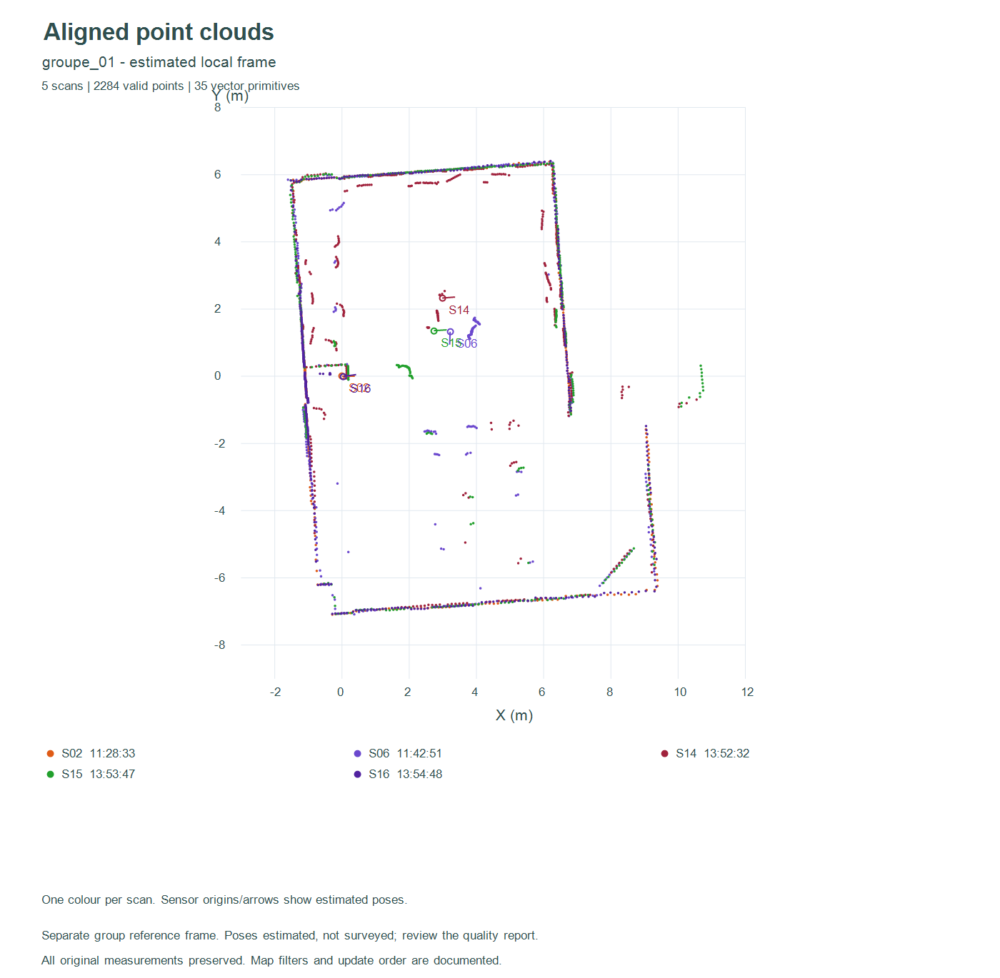
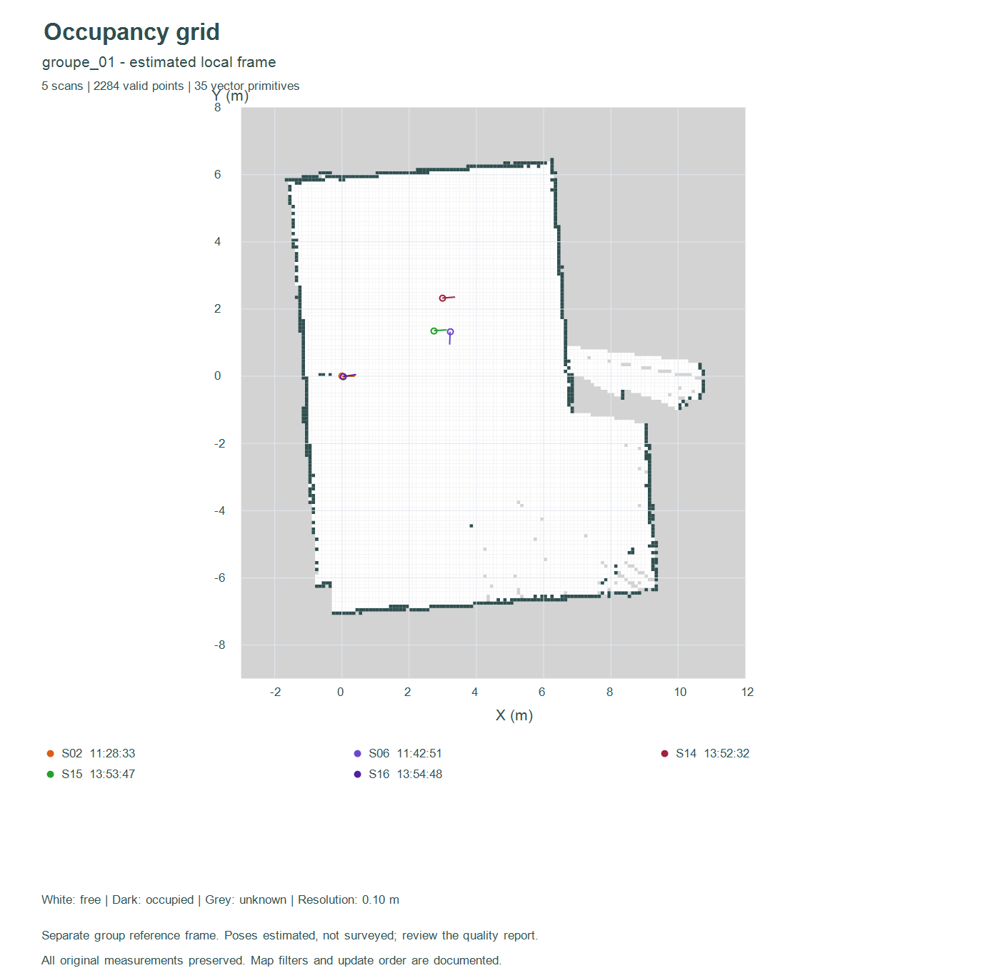
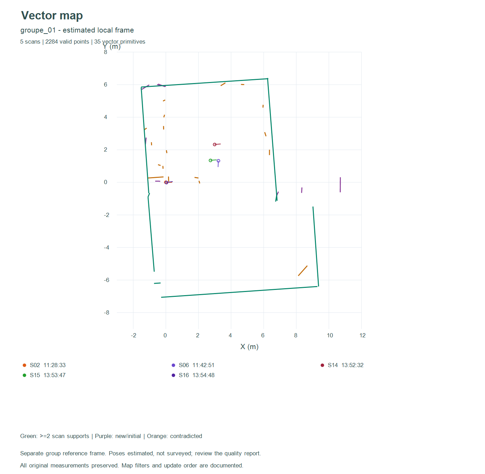
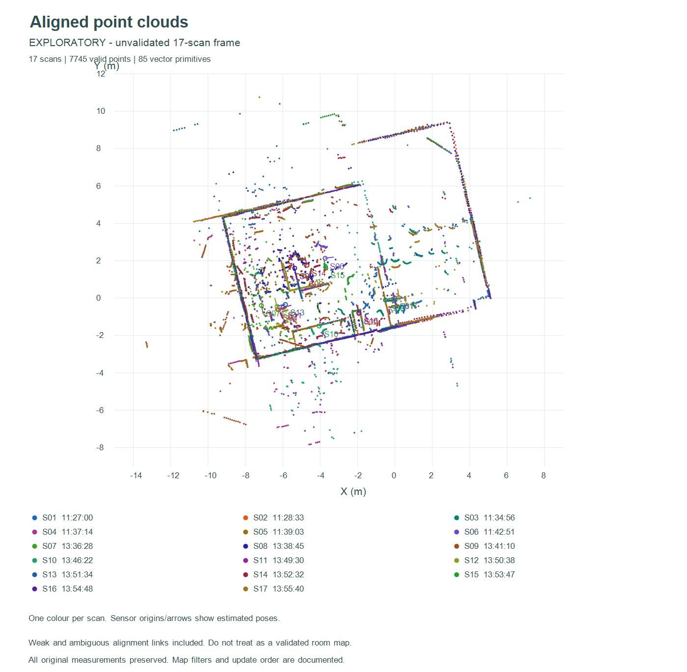

# Recalcul complet avec les 17 scans contrôlés

Ce dossier reprend les traitements des étapes 2 à 5 avec les **6 captures déjà
utilisées dans le visualiseur** et les **11 acquisitions de la nouvelle série**.
Les données du 2 novembre restent archivées dans le dépôt ; elles ne font pas
partie de ce jeu actif de 17 acquisitions.

## Résultat et limite essentielle

Le jeu contient **7760 mesures retenues**, dont **7745 distances positives** et
**15 retours nuls**. Les blocs longs sont remplacés dans les calculs par leurs
séquences contrôlées ; les bruts restent conservés séparément.

Les **136 paires de scans** ont été comparées. Avec les seuils d'ambiguïté et de
cohérence retenus, 17 liens sont acceptés et forment **sept composantes**. Ce
résultat ne signifie pas sept salles : seulement que les relations entre les
groupes ne sont pas suffisamment établies par cet algorithme et ces données.

**Chaque groupe possède son propre repère local. Ils ne doivent pas être
superposés comme s'ils partageaient une pose globale mesurée.** Une fusion
exploratoire de tous les scans est fournie séparément, avec ses liens faibles.
Elle couvre tous les fichiers mais ne constitue pas une carte de salle validée.

| Dossier | Scans | Points valides | Segments extraits | Primitives finales |
|---|---:|---:|---:|---:|
| `groupe_01` | 5 | 2284 | 116 | 35 |
| `groupe_02` | 3 | 1368 | 72 | 34 |
| `groupe_03` | 3 | 1369 | 62 | 37 |
| `groupe_04` | 2 | 907 | 57 | 42 |
| `groupe_05` | 2 | 906 | 38 | 25 |
| `groupe_06` | 1 | 454 | 31 | 31 |
| `groupe_07` | 1 | 457 | 16 | 16 |
| `exploratoire_17_scans` | 17 | 7745 | 392 | 85 |

La dernière ligne réutilise tous les scans ; elle ne s'ajoute pas aux sept
groupes dans les totaux. Les nombres de primitives dépendent des poses et du
nettoyage, et ne sont pas des décomptes de murs physiques.

## Consulter et utiliser les résultats

Ouvrir `visualisation/index.html` dans Chrome ou Edge, sans serveur :

1. **Charger les 17 scans** ajoute le jeu complet ; les deux autres boutons
   permettent de charger seulement les six anciens ou les onze nouveaux.
2. Choisir un groupe dans **Poses estimées des 17 scans**, puis **Charger ce
   groupe**. Les 17 fichiers sont disponibles, mais seuls les membres du groupe
   sont visibles et positionnés dans son repère.
3. Pour calculer dans l'outil, créer une nouvelle grille ou carte vectorielle,
   puis intégrer les scans visibles. Ne pas mélanger les poses de groupes différents.
4. Pour consulter les cartes déjà calculées, utiliser **Ouvrir une grille** ou
   **Ouvrir une carte** et choisir le JSON du groupe voulu dans `resultats`.
5. L'atelier de segments recharge les `segments.json`. Les grilles et cartes
   vectorielles sont indépendantes des copies de segments manipulées manuellement.

Les poses de la fusion exploratoire sont également rechargeables, avec un
avertissement explicite dans le visualiseur. Charger un groupe ne déplace pas
les cellules ou primitives de cartes déjà intégrées : il faut les recréer pour
appliquer les nouvelles poses.

### Exemple du groupe le plus fourni







### Vue exploratoire de toutes les acquisitions



La coïncidence de quelques grands murs ne suffit pas à valider tous les objets
intérieurs. Les doubles contours, les objets mobiles et les zones contradictoires
doivent être contrôlés avant de présenter cette fusion comme une carte finale.

## Contenu de chaque dossier de résultat

- `poses.json` : poses rechargeables dans le visualiseur, visibilité des membres
  du groupe et identité des fichiers. Les autres scans sont masqués.
- `points_alignés.csv` : tous les points de distance positive du groupe, avec
  coordonnées locales et transformées en mètres. Aucun point valide n'est effacé
  de cet export en fonction du filtre de recalage.
- `segments.json` / `.csv` : extraction par scan dans les poses du groupe.
- `grille.json` / `.csv` : carte d'occupation à trois états, résolution 10 cm.
- `carte_vectorielle.json` / `.csv` : carte fusionnée, confirmations et contradictions.
- `alignement.png`, `grille.png`, `vectorielle.png` : tracés métriques inspectés.
- `bilan.json` : compteurs, dimensions et rapports de chaque intégration.
- `donnees_traces.json` : géométrie employée pour reproduire les images.

À la racine des résultats : `alignement.json` contient les poses, les 136 comparaisons,
les solutions alternatives et les erreurs de boucle ; `synthese.json` regroupe
les bilans. Le fichier de checkpoint conserve le cache du recalage, sans changer
les acquisitions sources.

## Méthode et choix techniques

### Contrôle des sources

La liste des anciennes captures est explicite. Les onze nouvelles sont choisies
à partir de leur manifeste et du champ `validated_file`. Les SHA-256 des sources
sont conservés dans le rapport. On évite ainsi les doublons brut/copie contrôlée.
Les coordonnées cartésiennes enregistrées sont utilisées après conversion mm → m.

### Estimation des poses

Pour le recalage seulement, retenir les distances de 0,20 à 12 m et les intensités
≥100, sous-échantillonner à 8 cm puis garder les points ayant au moins trois
voisins, eux-mêmes inclus, dans un rayon de 25 cm. Ce sont des filtres heuristiques,
pas une calibration de la qualité du LD06. Ils réduisent l'influence des points
isolés ; les sources originales et les exports de points restent intacts.

Pour chaque paire, explorer les rotations par pas de 3°, estimer les translations
par corrélation de rasters de 15 cm, puis raffiner plusieurs candidats par ICP
rigide tronqué. Les translations candidates sont limitées à ±14 m par axe.
Le raster couvre 38,4 × 38,4 m, adapté aux distances filtrées de cette scène.
Cette recherche à plusieurs départs ne prouve pas que toutes les solutions
possibles ont été trouvées.

### Sélection des liens et repères séparés

Un lien doit satisfaire tous les critères suivants :

- au moins 45 % de voisins à moins de 20 cm **dans chacune des deux directions** ;
- score symétrique d'au moins 0,45 ;
- RMSE des correspondances retenues ≤12 cm ;
- écart de score d'au moins 0,035 avec une solution distincte concurrente, lorsqu'elle existe.

Les poses de chaque composante sont initialisées par un arbre couvrant de bonne
qualité, puis ajustées par moindres carrés robustes sur les contraintes relatives.
Une pose de référence reste fixe. Les contraintes de rotation sont exprimées
en radians et pondérées avec un bras de levier numérique de 2 m. Les résidus
forts sont atténués par une pondération robuste.

Les liens dont les erreurs après ajustement dépassent 30 cm ou 8° sont rejetés,
puis les composantes sont recalculées. Aucun lien n'a nécessité ce rejet final
dans le résultat fourni. Les seuils sélectionnent des estimations mieux étayées,
**pas des poses certifiées**.

La vue exploratoire utilise un arbre reliant toutes les paires, même faibles,
et reste explicitement distincte des groupes retenus. Elle n'est pas une solution
de remplacement silencieuse aux contrôles de qualité.

### Grilles, segments et cartes vectorielles

Les modules des étapes précédentes sont réutilisés, sans deuxième implémentation :

- grille à 10 cm, Bresenham, cellules inconnues/libres/occupées, impacts prioritaires
  dans chaque scan ; dimensions adaptées aux points et origines avec une marge ;
- segmentation : rupture 30 cm, résidu 5 cm, au moins 5 points et 15 cm de longueur ;
- fusion vectorielle : proximité de 8° et 12 cm ;
- nettoyage : au moins trois directions traversantes, marge de 15 cm avant impact,
  conservation du plus long côté puis retrait après trois observations contradictoires.

Les cartes et l'extraction utilisent une portée maximale de 12 m et aucun seuil
d'intensité supplémentaire. Les points au-delà de la portée restent dans l'export
aligné mais ne libèrent pas de cellules et ne créent pas d'obstacles dans les cartes.
Les intégrations suivent l'ordre chronologique des fichiers dans chaque groupe.

## Limites et travail de validation physique

Les déplacements, rotations et dimensions de la salle n'ont pas été fournis.
L'immobilité et les temps de rotation ne sont pas mesurés. Les poses restent
donc des estimations sans vérité terrain. Des obstacles mobiles, des surfaces
réfléchissantes, des structures répétées et un recouvrement limité peuvent tromper
le recalage. Ajouter des scans ne garantit pas à lui seul une meilleure précision.

Les cartes d'occupation et vectorielles dépendent des poses et de l'ordre des
observations. Une traversée contradictoire peut provenir du bruit ou d'une erreur
de pose, et non d'une disparition réelle d'un obstacle. Les compteurs ne sont pas
des probabilités calibrées. La carte vectorielle ne garantit ni des murs continus,
ni des polygones fermés, ni l'identification de portes.

## Reproduire

Environnement utilisé : Python 3.13.2, NumPy 2.2.5, Node.js 24.22.1 ; les PNG sont
tracés avec PowerShell/.NET sur Windows. Aucun serveur ou paquet npm n'est requis
pour ouvrir le visualiseur. NumPy n'est nécessaire que pour recalculer les poses.

Depuis la racine du dépôt :

```powershell
python -m pip install -r traitement_complet/requirements.txt
python traitement_complet/alignement.py
node traitement_complet/recalculer.cjs
node traitement_complet/construire_presets.cjs
.\traitement_complet\tracer.ps1
```

Les données sources restent inchangées ; seuls les résultats et les poses embarquées
sont régénérés. Le script de tracé s'exécute dans PowerShell sous Windows.

## Contrôles

```powershell
node visualisation/test_core.cjs
node visualisation/test_grid.cjs
node visualisation/test_segments.cjs
node visualisation/test_vector.cjs
python traitement_complet/test_alignement.py
node traitement_complet/verifier.cjs
```

Les **92 contrôles JavaScript**, les **six tests de recalage** et la vérification
des huit jeux d'exports passent. Ils couvrent les nouvelles données, les couleurs,
les transformations connues, la composition des poses, la séparation des groupes,
les formats rechargeables, les effectifs et la présence des images. Les commandes
de l'interface ont été exercées dans un DOM minimal, y compris les 17 scans, les
poses d'un groupe et l'avertissement exploratoire. Cela ne constitue pas une
vérification graphique complète de l'application dans un navigateur.
