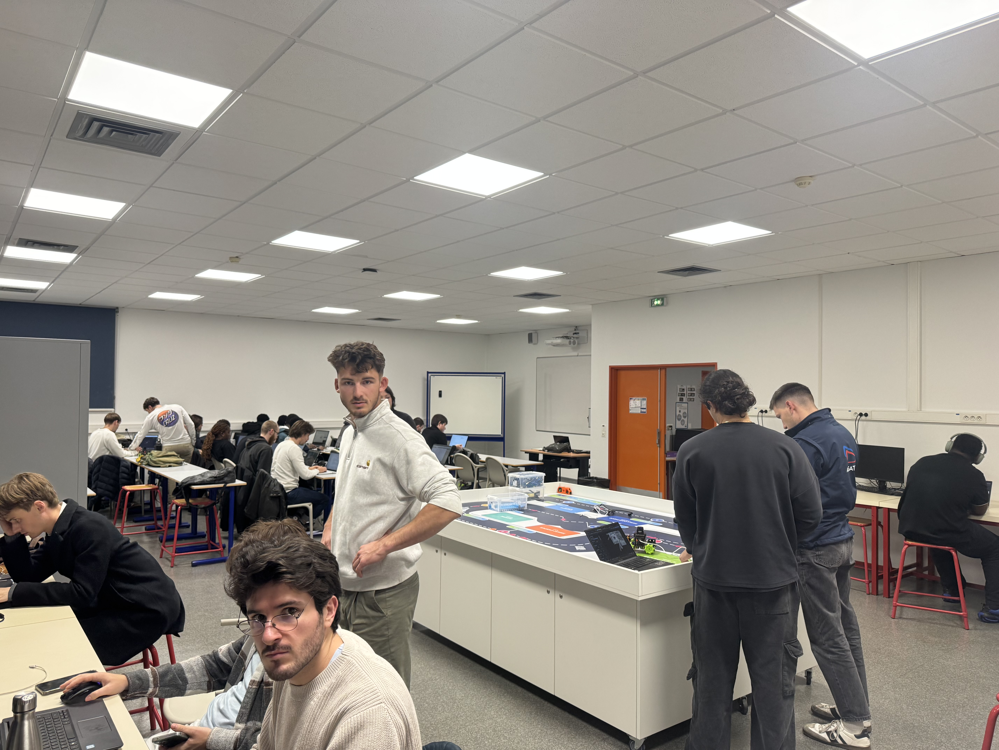
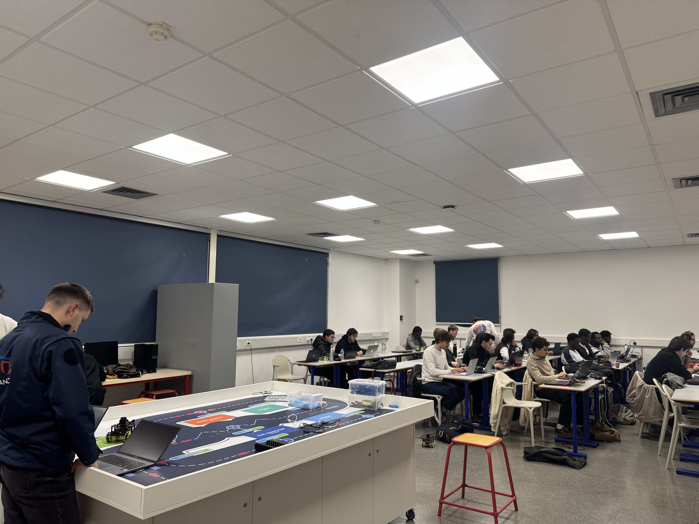

# Contexte photographique de la salle

Deux photographies fournies par l’utilisateur : `IMG_8198 (1).jpeg` et `IMG_8199.jpeg`.
Les copies sont conservées sous `vue_01.jpeg` et `vue_02.jpeg`.

## Observations et interprétation

Les vues montrent un îlot central de robotique, des tables et chaises en périphérie,
une armoire haute, des murs, des stores fermés et une porte. Plusieurs personnes
occupent la salle. Ces observations aident à comprendre les occlusions, les objets
intérieurs et les retours susceptibles de changer entre acquisitions.

Un scan LD06 est une coupe horizontale à la hauteur du capteur : une table n’est
visible que si le faisceau rencontre son plateau ou son piètement. Les plafonds,
luminaires et autres objets hors du plan lidar ne sont pas des contraintes 2D.
Les photos ne prouvent pas que l’aménagement ou les positions des personnes
étaient identiques lors de tous les scans.

## Limites métriques

Ni la pose de la caméra, ni sa calibration, ni des correspondances photo/lidar,
ni les dimensions de la salle ne sont connues. Aucune longueur n’est déduite des
dalles de plafond ou du mobilier. Aucune forme n’est ajoutée aux cartes sur la
seule base de ces photos ; les cartes restent calculées à partir des scans.
Ces photos ne permettent pas de certifier une carte exacte ni de lever seules
les ambiguïtés entre les groupes de scans.

