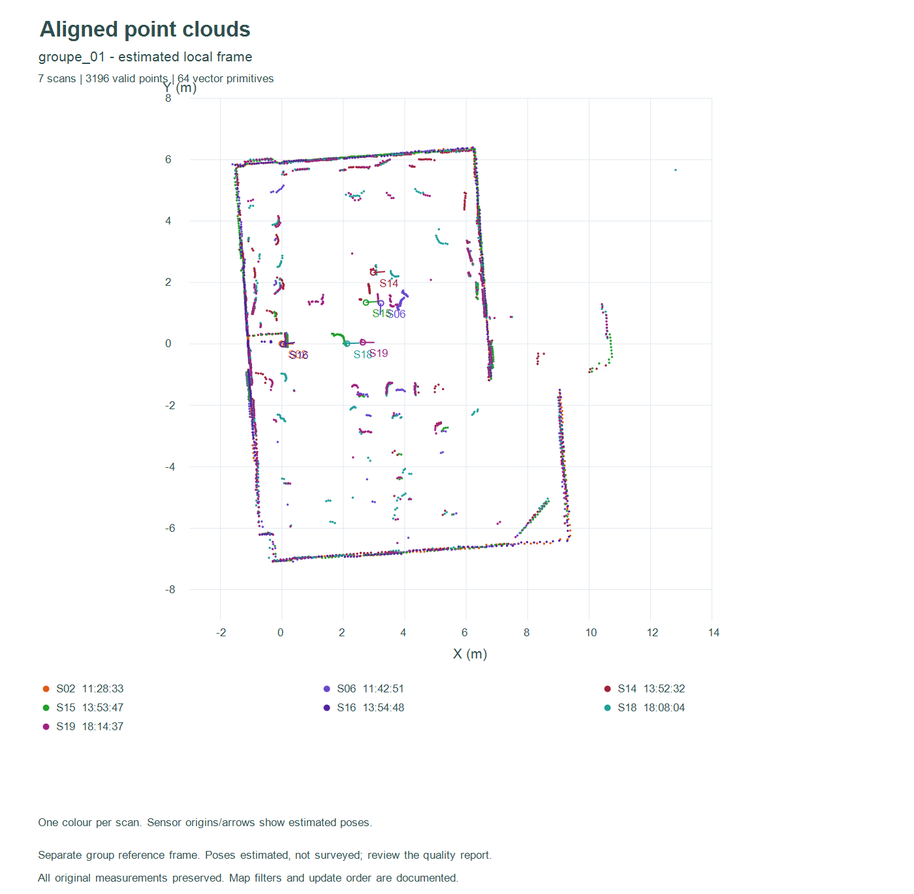
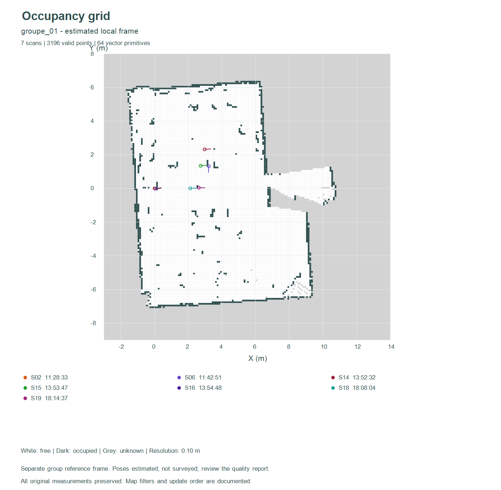
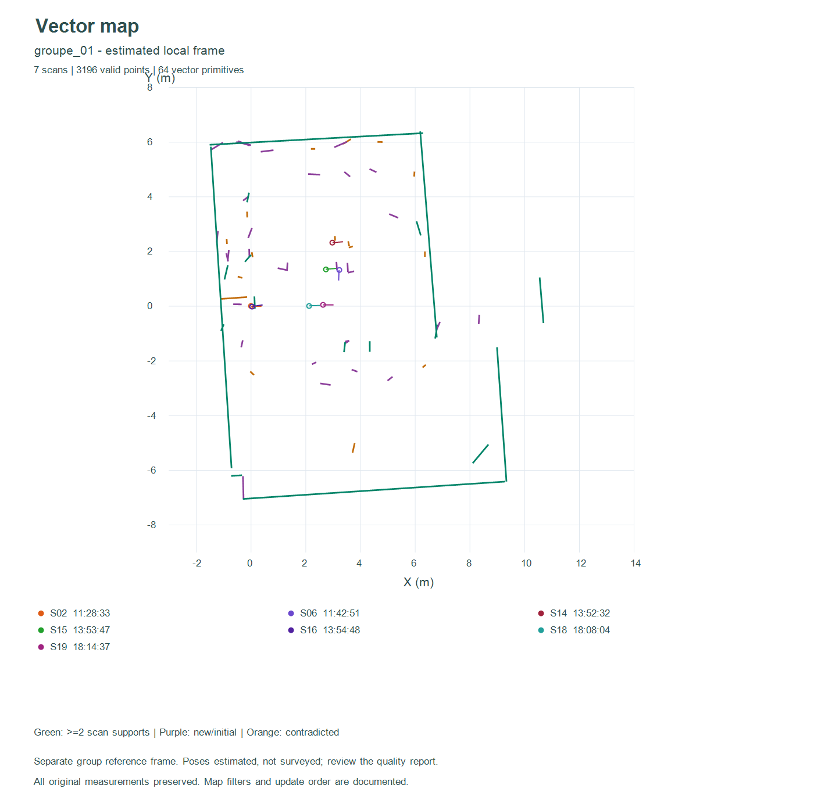

# Intégration de A/B aux anciens scans : 19 acquisitions

Les 17 acquisitions contrôlées précédentes et les deux nouvelles captures A/B
sont réunies : **19 scans, 8 657 points valides**. Les bruts et les résultats
historiques à 17 scans sont conservés. Les scans du 2 novembre restent archivés
et ne font pas partie de ce jeu actif.

## Ce qui a été recalculé

Les 171 paires possibles ont été évaluées : 136 comparaisons historiques sont
réutilisées après contrôle des empreintes, paramètres et algorithme ; 35 nouvelles
comparaisons impliquant A/B sont calculées. Recalage global rotation/translation,
ICP robuste, rejet des solutions ambiguës, optimisation des poses et contrôle
des boucles reprennent les seuils documentés dans le dossier parent.

22 liens sont retenus, dont 5 nouveaux. Ils forment encore **sept composantes**.
A/B rejoignent le groupe 1, qui passe de **5 à 7 scans**, et de **2 284 à 3 196
points valides**. L’ajout apporte des observations supplémentaires, sans prouver
à lui seul une amélioration de la précision absolue. Les autres groupes restent
dans leurs propres repères. Aucun lien faible n’est imposé pour les fusionner.

| Résultat | Avant | Avec A/B |
|---|---:|---:|
| Acquisitions actives | 17 | 19 |
| Points valides | 7 745 | 8 657 |
| Paires évaluées | 136 | 171 |
| Liens retenus | 17 | 22 |
| Groupes indépendants | 7 | 7 |
| Scans du groupe principal | 5 | 7 |

Pour chaque groupe, les nuages cartésiens, poses, segments, grille d’occupation
à 10 cm et carte vectorielle ont été recalculés, exportés et rechargés pour
vérification. Le groupe principal contient 191 segments extraits et 64 primitives
finales, dont 19 soutenues par au moins deux scans et 16 signalées contradictoires.
Ces nombres ne désignent pas des murs physiques. Les mises à jour restent
sensibles à l’ordre d’intégration et au mobilier ou aux personnes mobiles.







## Contrôle indépendant du déplacement A/B

La référence opérateur reste **(+0,50 m, 0 m, 0°)** avec un mètre gradué à 1 cm,
mais une incertitude totale de placement et d’orientation inconnue. Cette valeur
n’est pas forcée dans l’optimisation : elle sert à comparer le résultat.

Le graphe estime **(+0,5053 m, +0,0158 m, −1,2258°)** de A vers B dans le repère
local de A, soit un écart nominal d’environ **0,0167 m et 1,23°**. Il ne s’agit
pas d’une précision physique certifiée. L’incertitude inconnue ne devient pas
nulle, et les résidus d’alignement ne la remplacent pas.

Le résultat du graphe à plusieurs scans est distinct du résultat de la
multi-résolution sur la seule paire A/B : objectifs, filtres et contraintes
sont différents. Le benchmark TP2 déjà réalisé n’est pas remplacé ni réécrit.

## Apport des photos

Les [deux vues de la salle](../contexte_salle/README.md) documentent l’îlot central,
le mobilier, les murs et la présence de personnes. Elles expliquent des
occlusions et des différences possibles entre captures. Elles ne fournissent
ni dimensions mesurées, ni correspondances avec les points lidar. Aucun mur
n’est ajouté ou déplacé dans la carte pour ressembler à une photographie.
Les dimensions et poses relatives des groupes restent à vérifier sur place.

La fusion de tous les scans dans `exploratoire_19_scans` est conservée pour
inspection seulement : elle utilise des liens faibles et ne constitue pas
une carte exacte ou validée de la pièce.

## Ouvrir dans le visualiseur

Ouvrir `visualisation/index.html`, cliquer **19 scans avec A/B**, puis choisir
**19 acquisitions · groupe 1 · 7 scans** dans les poses et **Charger ce groupe**.
Les captures restent réglables indépendamment. Les autres groupes peuvent être
consultés séparément. Après changement de poses, recréer la grille ou la carte
vectorielle avant d’intégrer les scans visibles.

## Reproduire depuis la racine du dépôt

```powershell
python traitement_complet/integrer_ab.py
node traitement_complet/recalculer.cjs resultats_19_scans
node traitement_complet/construire_19.cjs
./traitement_complet/tracer.ps1 -Resultats ./traitement_complet/resultats_19_scans
node traitement_complet/verifier.cjs resultats_19_scans
```

NumPy est nécessaire au recalage ; Node.js aux cartes et aux contrôles. Les
sources ne sont pas modifiées. `qualite_integration.json` résume les compteurs
et le contrôle A/B. Les résultats historiques et le benchmark TP2 restent disponibles.
