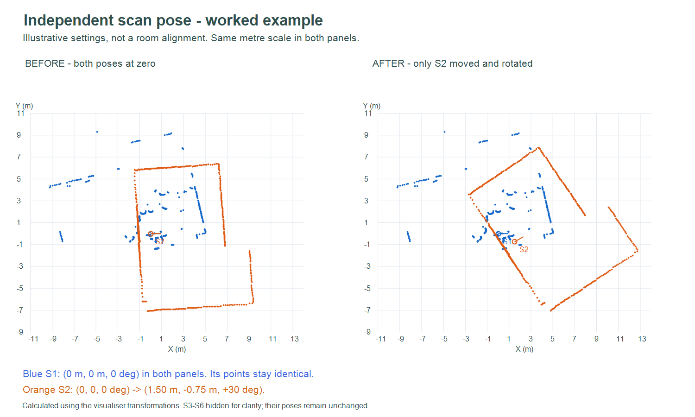

# Étapes 2 à 5 — Visualisation, grille, segments et carte vectorielle

## Ouvrir l'outil

Ouvrir **`index.html` dans Chrome ou Edge** par un double-clic. Aucun serveur,
compte, accès série, installation Python ou connexion Internet n'est nécessaire.
Conserver dans le même dossier `index.html`, `core.js`, `viewer.js`, `grid.js`,
`segments.js`, `segments-ui.js`, `vector-map.js`, `vector-ui.js` et `examples.js`.
Les données restent dans la mémoire du navigateur jusqu'à la fermeture de la page.
Sauvegarder les poses avant de quitter pour ne pas perdre les réglages.

## Utilisation

1. Cliquer sur **Charger mes 6 scans**, ou **Charger des CSV** pour choisir plusieurs
   fichiers réels. Chaque scan possède une couleur et une origine fléchée.
   Les doublons de données sont ignorés.
2. Modifier **X**, **Y** (mètres) et **Angle** (degrés) dans la fiche d'un scan.
   Le nuage est mis à jour immédiatement, indépendamment des autres scans.
   La réglette permet également de tourner le scan. Un angle positif tourne
   dans le sens trigonométrique, autour de l'origine locale du lidar.
3. Pour le déplacement à la souris, sélectionner une fiche puis choisir
   **Glisser pour → déplacer le scan sélectionné**. Glisser sur la carte.
   En mode « déplacer la vue », seule la caméra bouge ; les poses restent intactes.
4. Pour les raccourcis, cliquer sur la carte ou sur le titre d'une fiche : les
   flèches déplacent le scan sélectionné de 10 cm (Maj : 50 cm), Q/E le tournent
   de −1°/+1°. Les raccourcis ne remplacent pas la saisie dans les champs.
5. Cocher/décocher un scan pour l'afficher/masquer. Régler l'opacité pour mieux
   comparer les recouvrements. « Remettre à zéro » concerne uniquement sa pose.
6. **Cadrer les scans** adapte la vue aux scans visibles. La molette et les
   boutons +/− règlent le zoom. La grille indique les distances métriques.
7. **Sauver les poses** produit un JSON. Pour le restaurer, charger d'abord les
   mêmes scans, puis **Ouvrir des poses**. Le nom et une empreinte des points
   servent à vérifier la correspondance ; ce n'est pas une signature de sécurité.
8. **Exporter les points** produit un CSV contenant les coordonnées locales et
   transformées des scans visibles. **Exporter PNG** enregistre la vue actuelle,
   avec légende, origines et grille. Les CSV sources restent inchangés.

## Données et choix techniques

Les six jeux embarqués sont les captures réelles du 3 novembre. Les blocs longs
de 11:37 et 11:42 sont remplacés par les fichiers contrôlés `_tour2` de 456 et
457 points. Le bouton charge donc **2737 points valides** ; quatre retours de
distance nulle sont exclus. Les données originales restent archivées ailleurs
dans le dépôt. Aucun recalage automatique n'est exécuté par cet outil : toutes
les poses initiales valent `(0,0,0°)` et les ajustements sont manuels.

Le lecteur accepte les CSV LD06 `angle_deg,dist_mm`, les noms d'en-tête Arduino
`Angle(°),Distance(mm)` et les distances métriques `distance_m` / `r_m`.
Si `x_lib_mm,y_lib_mm` ou `x(mm),y(mm)` sont présents, leurs valeurs sont utilisées
et converties de mm en m. Les colonnes métriques `x_rel_m,y_rel_m` sont aussi
acceptées. La base utilisée est indiquée dans chaque fiche.

Pour un CSV uniquement polaire, l'outil calcule `x=r cos(α)` et, par défaut,
`y=−r sin(α)`, ce qui reproduit la convention des colonnes cartésiennes des fichiers
fournis. Le sélecteur permet d'utiliser `y=r sin(α)` pour un CSV antihoraire.
Ce réglage s'applique **aux prochains chargements polaires**, pas aux fichiers
déjà chargés ni à ceux disposant de leurs propres coordonnées cartésiennes.
Vérifier le sens avec un obstacle connu avant de mélanger des exports de sources
différentes. La bibliothèque du cours applique déjà ses propres conventions.

Une pose `(tx,ty,θ)` applique, sans modifier les points locaux :

```text
X = tx + cos(θ) x − sin(θ) y
Y = ty + sin(θ) x + cos(θ) y
```

L'angle est converti de degrés en radians pour le calcul. L'écran inverse ensuite
uniquement l'axe vertical ; le repère de carte garde X vers la droite et Y vers
le haut. Une même échelle est utilisée pour les deux axes.

Le rendu utilise Canvas 2D, adapté à quelques milliers de points sans dépendance
externe. Chaque scan possède son propre objet de pose. Les erreurs de lecture
sont signalées ; les valeurs non finies et les CSV fusionnés sont refusés.
Un passage angulaire interne par zéro déclenche un avertissement de contrôle,
sans prétendre prouver à lui seul qu'un scan est invalide.

## Exemple avant/après pour le compte rendu

Le dossier [`exemple_pose`](exemple_pose/README.md) contient deux fichiers de
poses rechargeables et un export des points : seul S2 passe à `(1.50 m, -0.75 m,
30°)`, tandis que S1 reste fixe. Les quatre autres scans sont masqués pour rendre
la comparaison lisible ; leurs poses restent inchangées. Ces valeurs illustrent
la manipulation indépendante et ne sont pas un recalage de la salle.



## Vérification

Avec Node.js installé :

```powershell
node visualisation/test_core.cjs
```

Les contrôles couvrent les unités, la conversion polaire et ses deux sens,
la rotation/translation, l'indépendance des poses, les six vrais scans, les données
invalides, les exports et le rechargement des poses. Les tests ne valident pas
l'exactitude du recalage manuel d'une salle.

Résultat dans l'environnement de développement : **10 contrôles réussis** et
aperçu servi avec une réponse HTTP 200. La vérification graphique automatisée
n'a pas pu être menée à terme ici ; les interactions et le rendu restent à
confirmer dans le navigateur du poste utilisateur.

## Étape 3 — Carte d'occupation

Le panneau **Grille d'occupation** permet de créer une carte inconnue, d'intégrer
un scan et sa pose, puis d'ajouter les scans suivants à la même carte. Les cellules
traversées deviennent libres ; les impacts deviennent occupés. Les vues **Grille**
et **Grille + points** affichent le résultat. La carte est sauvegardable et
rechargeable en JSON, avec un export CSV et PNG.

La procédure, les choix techniques, les hypothèses et les limites suivant le
document du cours sont détaillés dans [`GRID.md`](GRID.md). Cette version
est complétée par le module vectoriel de l'étape 5 décrit ci-dessous.

## Étape 4 — Atelier de segments

L'atelier extrait des segments à partir des scans positionnés. Deux listes
permettent de choisir A et B, puis d'analyser leurs angles, leur proximité et leur
intersection, de fusionner les segments proches, ou de découper A par B en
conservant le plus long côté. Les exemples géométriques intégrés montrent les
cas limites ; les modifications sont annulables et exportables en JSON/CSV.

Le [guide et compte rendu de l'étape 4](SEGMENTS.md) explique la tolérance de
1e-9 m, les règles d'intersection, l'égalité des côtés et les limites de l'extraction.
Les [exemples](exemple_segments/README.md) incluent les images de calcul et les
fichiers rechargeables. Les 38 contrôles supplémentaires se lancent avec
`node visualisation/test_segments.cjs` depuis la racine du dépôt.

## Étape 5 — Carte vectorielle

Le panneau **Carte vectorielle** réutilise l'extraction, la proximité, la fusion,
l'intersection et le découpage pour intégrer successivement les scans positionnés.
Les primitives proches sont fusionnées, les nouveaux segments sont ajoutés et
les anciennes primitives traversées peuvent être réduites ou retirées selon les
critères configurés. Les compteurs de confirmations et contradictions sont conservés.

La carte se sauvegarde et se recharge en JSON, avec export géométrique CSV et
image PNG. Le [guide et compte rendu](VECTORIELLE.md) suit la méthode du cours,
explique les seuils et les limites. L'[exemple sur deux scans réels](exemple_vectorielle/README.md)
contient les cartes avant/après et les fichiers rechargeables. Les 25 tests de
carte se lancent avec `node visualisation/test_vector.cjs` ; total : 90 contrôles.
