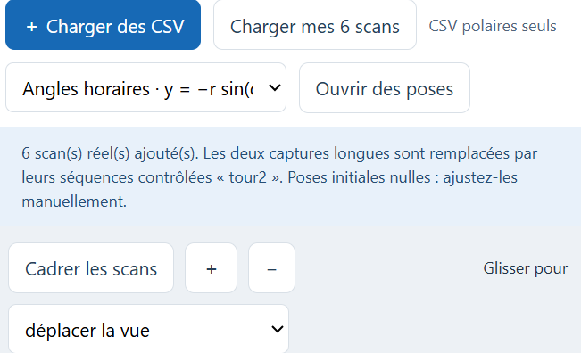
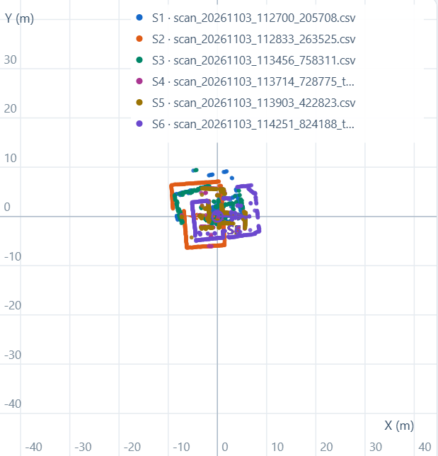
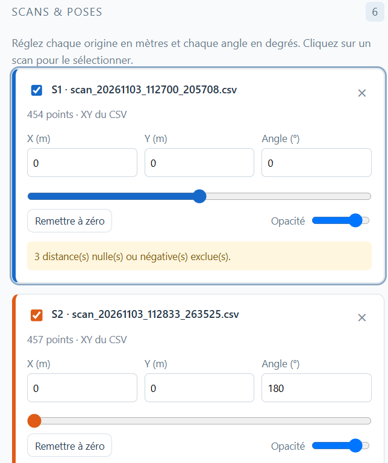
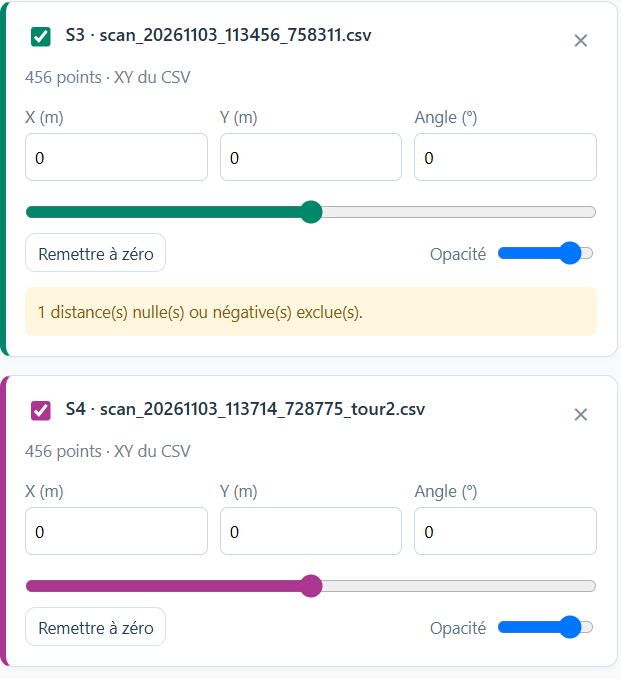
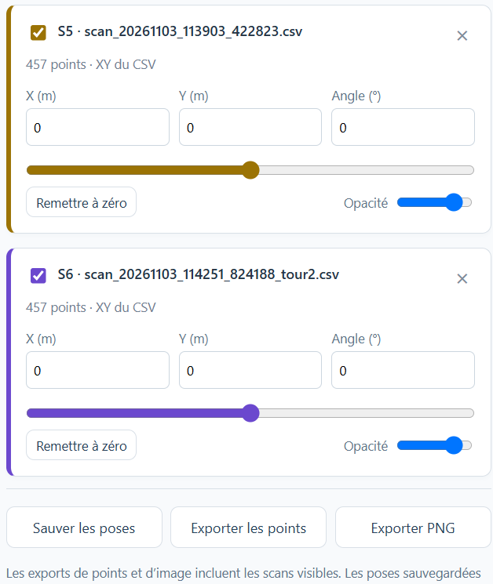

# Captures d'utilisation — Étape 2

Ces cinq images ont été fournies par l'étudiant après utilisation du visualiseur.
Elles montrent l'affichage simultané des six scans, leurs couleurs distinctes
et les commandes permettant de modifier chaque pose indépendamment.

## Chargement des fichiers

Les captures longues sont remplacées par leurs séquences contrôlées `_tour2`.

## Affichage cartésien et couleurs distinctes

Les axes sont exprimés en mètres. Cette vue illustre la superposition des scans,
pas un recalage final validé de la salle.

## Réglage indépendant des poses

Dans cette session, S1 est à `(0,0,0°)` tandis que S2 est à `(0,0,180°)` :
la rotation de S2 n'a pas modifié la pose affichée de S1.

S3 à S6 ont leurs propres champs X, Y et angle, restés à zéro sur ces images.
La capture montre aussi les commandes de sauvegarde des poses et d'export CSV/PNG.
Elle ne prouve pas, à elle seule, une manipulation de translation ni le contenu
des exports. L'exemple reproductible de translation et rotation est présenté
dans [`../exemple_pose/README.md`](../exemple_pose/README.md).
