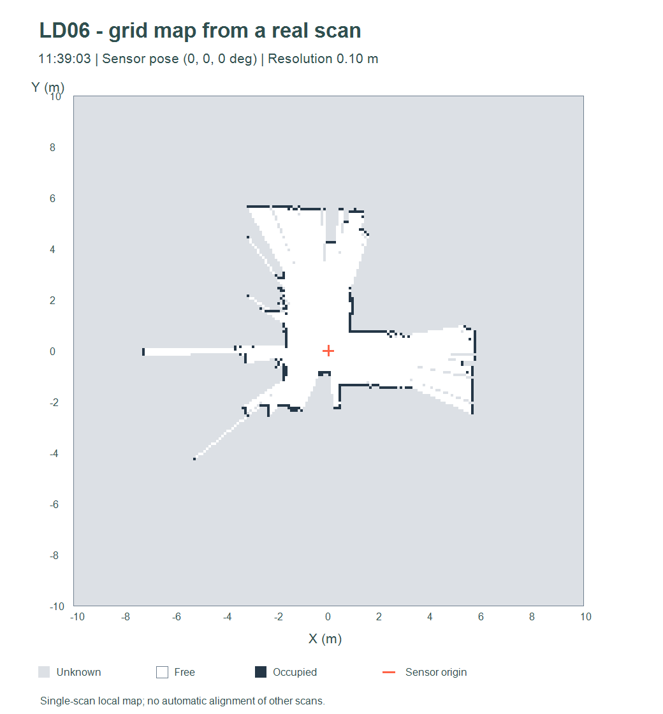

# Exemple réel — grille à partir d'un scan

Cette carte est calculée à partir de `scan_20261103_113903_422823.csv`, avec la
pose locale `(0,0,0°)`. C'est une carte locale d'un seul scan, pas la fusion
recalée des six captures.

- Résolution : **0,10 m**.
- Dimensions : **20 × 20 m**, soit **200 × 200 cellules**.
- Origine inférieure gauche : **(-10,-10) m**.
- Mesures intégrées : **457**, sans filtre d'intensité ; portée maximum 12 m.
- Cellules libres : **3463**.
- Cellules occupées : **267**.
- Cellules inconnues : **36270**.

L'image est un tracé de la matrice produite par les fonctions de l'outil, et non
une capture de l'interface. Le blanc correspond aux cellules traversées, le
bleu sombre aux impacts, le gris aux cellules non observées. La croix indique
le lidar. Le total des trois classes est bien 40000 cellules.

## Recharger et mettre à jour

1. Ouvrir `visualisation/index.html`.
2. Cliquer sur **Ouvrir une grille** et sélectionner `grille_occupation.json`.
3. La carte peut être affichée sans charger les CSV d'origine.
4. Charger un **nouveau** scan, régler sa pose dans le même repère et l'intégrer
   pour mettre à jour cette grille. Le scan de 11:39 est déjà intégré ; le
   réintégrer sans changement est ignoré, le réintégrer avec une nouvelle pose
   demande une reconstruction.

`grille_occupation.csv` est l'export de la matrice lisible indépendamment de
l'application, avec les conventions dans les deux lignes de commentaires.
