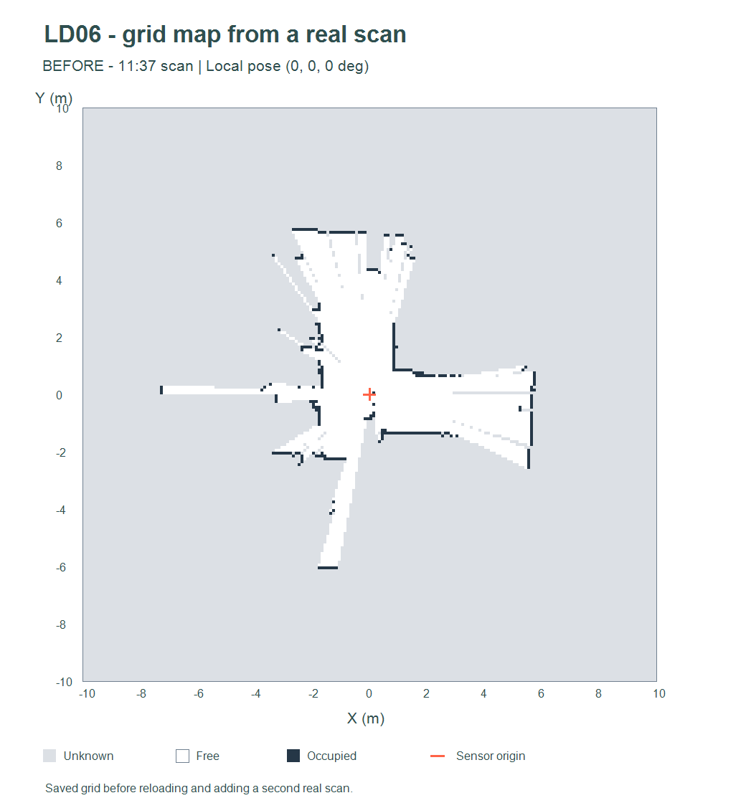
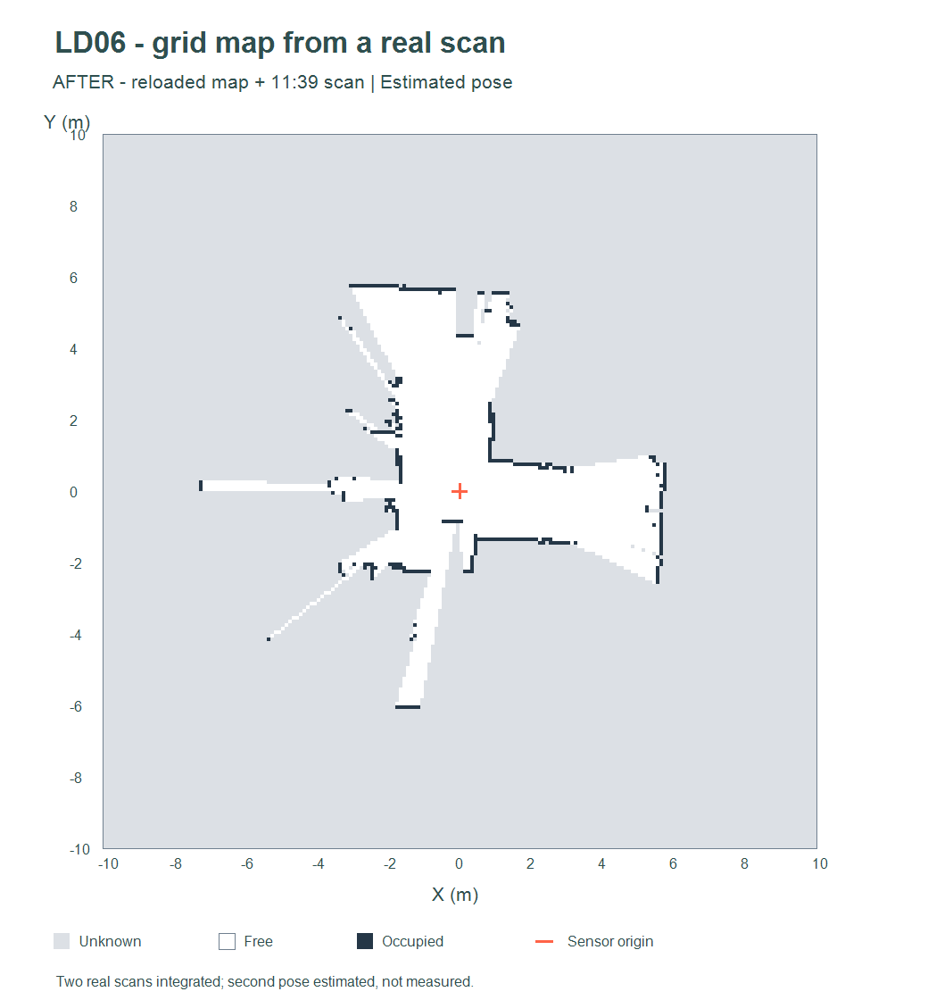

# Exemple réel : mise à jour d'une grille existante

Cet exemple vérifie le cycle demandé à l'étape 3 : **scan + pose → carte**, puis
**carte existante + nouveau scan + pose → carte mise à jour**.

## Données et paramètres

- Premier scan : `scan_20261103_113714_728775_tour2.csv`, **456 points**. La pose
  est `(0,0,0°)` et définit le repère de la carte.
- Nouveau scan : `scan_20261103_113903_422823.csv`, **457 points**.
- Pose du nouveau scan : environ **(-0,0196 m, +0,0592 m, -0,9734°)**.
- Grille de **20 × 20 m**, origine **(-10,-10) m**, résolution **0,10 m** :
  **200 × 200 cellules**.
- Portée maximale 12 m, seuil d'intensité 0 (aucune exclusion par intensité).

La pose du second scan est **estimée par recalage rigide**, pas mesurée. Le
recalage a été refait sur la séquence contrôlée `_tour2`, et non sur le bloc long
brut. Environ 93 %/92 % des points sous-échantillonnés ont un voisin à moins
de 20 cm dans l'autre scan ; l'erreur quadratique moyenne des correspondances
retenues est de 5,2 cm. Ces indicateurs ne constituent pas une mesure de précision
absolue de la salle. Les paramètres sont conservés dans `poses_et_qualite.json`.

## Procédure effectivement exécutée

1. Créer une grille entièrement inconnue.
2. Intégrer le premier scan avec sa pose nulle.
3. Sauvegarder la carte dans `grille_avant.json`.
4. **Recharger ce JSON dans un nouvel objet de grille**.
5. Intégrer le second scan avec sa pose estimée.
6. Sauvegarder `grille_apres.json` et les deux exports CSV.

Le programme vérifie que la sauvegarde/relecture conserve exactement les
cellules, que la première carte reste inchangée, que la seconde mémorise deux
scans et qu'une nouvelle intégration identique du second scan est ignorée.

## Résultats observés

| État | Après le premier scan | Après le second scan |
|---|---:|---:|
| Libre, `0` | 3612 | 3884 |
| Occupé, `255` | 264 | 308 |
| Inconnu, `127` | 36124 | 35808 |
| Total | 40000 | 40000 |

**390 cellules changent d'état** :

- 246 cellules inconnues deviennent libres ;
- 70 cellules inconnues deviennent occupées ;
- 50 cellules occupées deviennent libres parce qu'elles sont traversées ;
- 24 cellules libres deviennent occupées à la suite d'un nouvel impact.

Ces transitions montrent la mise à jour, pas un simple ajout d'impacts. Elles
ne prouvent pas la disparition physique de 50 obstacles : le bruit, les
occlusions, la discrétisation et l'erreur de pose peuvent aussi provoquer ces
changements. C'est une limite du marquage direct retenu pour commencer simplement.

### Carte avant



### Carte après rechargement et intégration du nouveau scan



Ces images sont des rendus des matrices calculées, pas des captures de l'interface.
Blanc : libre ; sombre : occupé ; gris : inconnu ; croix rouge : origine du premier
scan. La petite translation du second lidar n'est pas représentée par une seconde
croix dans ces tracés statiques ; sa pose est enregistrée dans les JSON.

## Reproduire dans le visualiseur

1. Ouvrir une nouvelle session du visualiseur et charger **uniquement les deux
   CSV indiqués ci-dessus** depuis le dépôt (le premier est dans `controle_scans`).
2. Charger `poses_manuelles.json` avec **Ouvrir des poses**. Ce nom désigne le
   format de poses de l'outil ; ici la deuxième pose provient d'une estimation.
3. Avec **Ouvrir une grille**, ouvrir `grille_avant.json`.
4. Sélectionner le scan de 11:39 puis cliquer sur **Intégrer**. Le scan de 11:37
   figure déjà dans l'historique et ne doit pas être ajouté une seconde fois.
5. Contrôler les compteurs ci-dessus, choisir la vue Grille et sauvegarder.

On peut aussi ouvrir directement `grille_apres.json` sans charger les scans pour
consulter le résultat déjà calculé.

## Reproduire les calculs avec Node.js

Depuis la racine du dépôt, sans installer de dépendances :

```powershell
node visualisation/exemple_mise_a_jour/generer.cjs
```

Le script réutilise `core.js` et `grid.js`, ainsi que les CSV du dépôt. Il régénère
les cartes JSON/CSV, les poses et `bilan.json`. Les images statiques sont fournies
séparément ; elles ne sont pas régénérées par cette commande.
