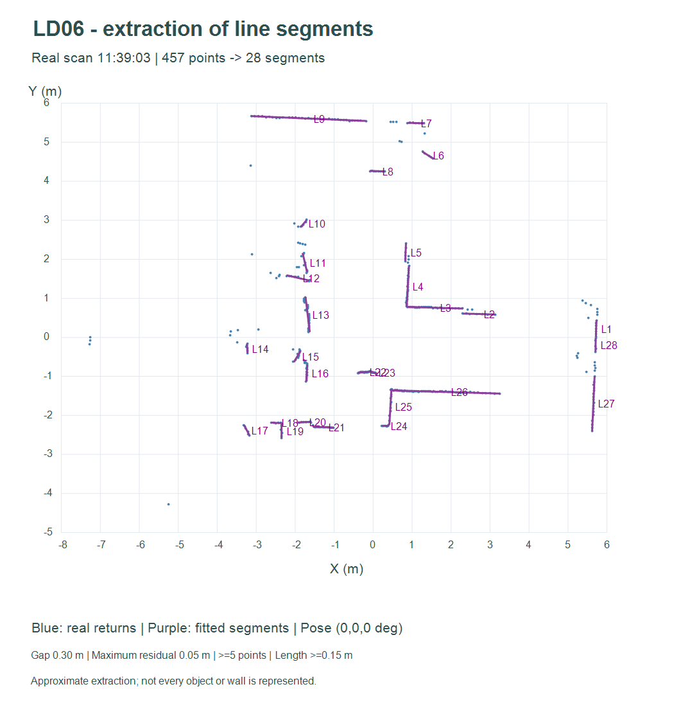
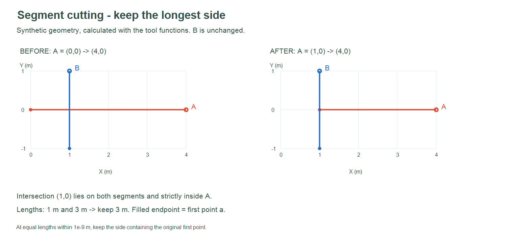

# Exemples — Extraction et manipulation de segments

## Extraction sur les données réelles

`segments_scan_reel.json` et `.csv` contiennent les **28 segments** extraits des
**457 points** du scan réel de 11:39:03, avec pose `(0,0,0°)`, écart de rupture
0,30 m, résidu maximal 0,05 m, minimum 5 points et longueur minimale 0,15 m.



Charger ce scan dans le visualiseur, puis ouvrir le JSON avec **Ouvrir des
segments**. Sélectionner la vue **Points + segments** pour comparer les contours.
Le fichier ne contient pas une carte vectorielle fusionnée de la salle.

## Découpage avant/après

Les fichiers `decoupage_avant.json` et `decoupage_apres.json` sont rechargeables
dans l'atelier. L'exemple est **synthétique** :

- A va de `(0,0)` à `(4,0)` ;
- B va de `(1,-1)` à `(1,1)` ;
- leur intersection `(1,0)` appartient aux deux segments et est intérieure à A ;
- les deux côtés de A mesurent 1 m et 3 m : on conserve `(1,0) → (4,0)` ;
- B reste inchangé.



L'image montre le résultat calculé par les fonctions de l'outil, pas une capture
de son interface. Les points remplis sont les premières extrémités `a`.

## Cas limites et fusion

`cas_limites.json` conserve les entrées et résultats de dix cas : croisement
intérieur, égalité exacte, égalité à la tolérance près, sens inversé de A,
extrémité de A, point très proche de l'extrémité, croisement hors de B ou hors
de A, colinéarité et extrémité de B intérieure à A.

`bilan.json` contient aussi un exemple de proximité et de fusion de deux segments
presque jointifs. Leur angle est nul et leur distance minimale est d'environ
6,4 cm ; ils passent les seuils de 8° et 12 cm. La fusion ajuste un support
commun aux quatre extrémités, puis en conserve les projections extrêmes.

## Reproduire

Depuis la racine du dépôt, avec Node.js :

```powershell
node visualisation/exemple_segments/generer.cjs
node visualisation/test_segments.cjs
```

Le générateur régénère les JSON et CSV à partir du scan du dépôt. Les images
statiques sont fournies séparément et ne sont pas régénérées par cette commande.
