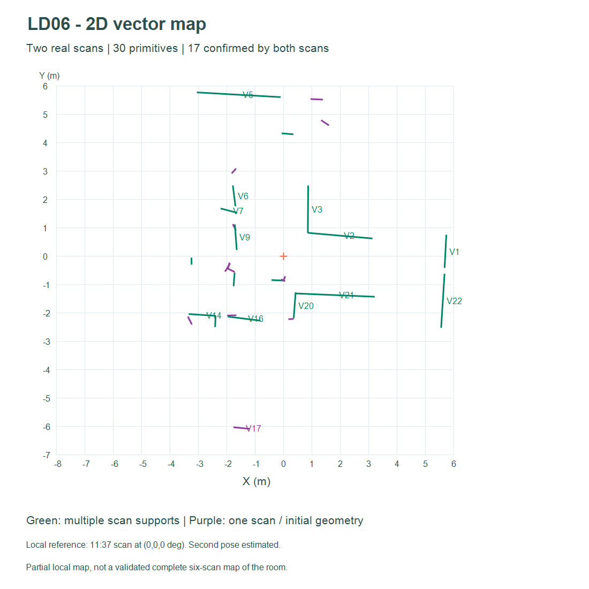
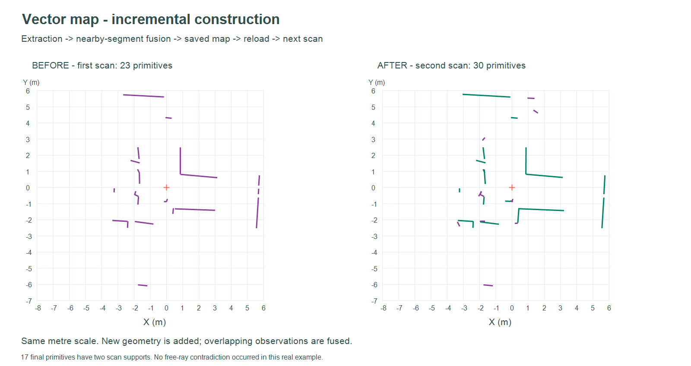

# Exemple — Construction d'une carte vectorielle avec deux scans réels

## Entrées

- Référence : `controle_scans/scan_20261103_113714_728775_tour2.csv`, **456 points**,
  pose locale `(0,0,0°)`.
- Second scan : `scan_20261103_113903_422823.csv`, **457 points**, pose estimée
  d'environ `(-0.01958 m, +0.05924 m, -0.97338°)`.

Cette seconde pose a été estimée séparément sur les séquences contrôlées.
Les métriques et la provenance figurent dans `bilan.json`. Elle n'est pas une
mesure physique de référence. La carte est locale et partielle ; elle ne prétend
pas réunir les six scans ni représenter tous les murs de la salle.

## Résultats





Le premier scan donne 27 segments extraits, consolidés en **23 primitives**.
Après sauvegarde, rechargement puis ajout du second scan, la carte contient
**30 primitives**, dont **17 soutenues par les deux acquisitions**. La seconde
intégration extrait 28 segments et réalise 21 opérations de fusion. Les doubles
confirmations sont comptées par scan, pas par nombre de fragments.

Vert : au moins deux scans ; violet : une seule observation ou élément initial.
Les images sont des tracés des primitives calculées, pas des captures de l'interface.
La croix indique l'origine du premier scan ; le très faible décalage de la
seconde origine n'est pas représenté par une seconde croix sur ces tracés.

## Fichiers rechargeables

- `carte_avant.json` / `.csv` : carte après le premier scan.
- `carte_vectorielle.json` / `.csv` : carte après les deux scans.
- `poses_scans.json` : poses dans le format du visualiseur.
- `bilan.json` : paramètres, poses, rapports des deux intégrations et statistiques.

Dans le visualiseur, utiliser **Ouvrir une carte** dans le panneau **Carte
vectorielle** pour afficher directement l'un des JSON, même sans charger les scans.
Pour reproduire la mise à jour : charger seulement les deux CSV, ouvrir leurs
poses, ouvrir `carte_avant.json`, sélectionner le second scan et l'intégrer.

## Nettoyage : démonstration séparée

Sur cette paire réelle, aucune contradiction ne remplit les critères de nettoyage.
Le fichier `exemple_nettoyage_synthetique.json` contient donc un cas **synthétique**
distinct : un ancien segment vertical de 4 m est traversé par trois directions
de rayons par scan. Il est réduit au plus long côté aux deux premières contradictions,
puis retiré à la troisième. Les paramètres, rayons, rapports et états successifs
sont enregistrés. Ce scénario ne décrit pas une disparition observée dans la salle.

## Reproduire les calculs

Depuis la racine du dépôt, avec Node.js et sans dépendance externe :

```powershell
node visualisation/exemple_vectorielle/generer.cjs
node visualisation/test_vector.cjs
```

Le générateur réutilise `segments.js`, `core.js` et `vector-map.js`. Il régénère les
JSON/CSV et le scénario synthétique à partir des sources du dépôt. Les PNG sont
fournis séparément ; cette commande ne les régénère pas.
